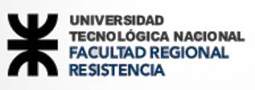

\newpage

{width=45%}

# Datos Descriptivos

| Campo | Detalle |
| :--- | :--- |
| **Institución** | Universidad Tecnológica Nacional – Facultad Regional Resistencia |
| **Carrera** | Ingeniería en Sistemas de Información |
| **Departamento** | Ingeniería en Sistemas de Información |
| **Área / Bloque** | Sistemas de Información / Tecnologías Aplicadas / Integradora |
| **Asignatura** | Administración de Sistemas de Información |
| **Nivel** | 4.º Año |
| **Ciclo Lectivo** | 2026 |
| **Carga Horaria Total** | 192 hs cátedra / 144 hs reloj |
| **Carga Horaria Semanal** | 6 hs cátedra / 4,5 hs reloj |
| **Régimen de Cursado** | Anual |

---

# Estructura de la Cátedra

| Docente | Categoría | Condición | Dedicación | Función Principal |
| :--- | :--- | :--- | :--- | :--- |
| **Claudia Alejandra Soria Ojeda** | Titular | Regular | 1,5 Simple | Según Art. 19.° del Estatuto de la UTN |
| **Rosina Analía Ramírez** | JTP | Regular | 1 Simple | Según Inciso 2, Anexo II, Ord. N.° 1181 UTN |
| **Raúl Alejandro Montiel** | Auxiliar 1.ª | Interino | 1 Simple | Según Inciso 4, Anexo II, Ord. N.° 1181 UTN |

---

# Fundamentación

La asignatura **Administración de Sistemas de Información (ASI)** es la materia del tronco integrador de 4.º nivel del Plan 2023 (Ordenanza N.° 1877 C.S.U.).

De acuerdo con su finalidad curricular, se proponen contenidos y prácticas que formen al estudiante en la comprensión del **enfoque estratégico corporativo** de la administración de recursos de Sistemas de Información y Tecnologías de la Información (**SI/TI**), adquiriendo una **visión holística de la gestión** y aplicando de manera articulada los conocimientos adquiridos en los niveles previos y en las asignaturas horizontales.

---

# Articulación Curricular y Resultados de Aprendizaje

## Asignaturas Previas y Resultados Requeridos

| Asignatura Previa | Resultados de Aprendizaje Requeridos |
| :--- | :--- |
| **Sistemas y Procesos de Negocio** *(1.º Nivel - Integradora)* | Identifica la estructura organizativa del escenario en estudio. Diferencia las planificaciones estratégica, táctica y operativa. Diferencia funciones y procesos de negocio para determinar la matriz de necesidades. Distingue procesos administrativos de procesos operativos. Identifica los tipos de sistemas de información existentes. |
| **Análisis Numérico** *(3.º Nivel)* | Distingue variables y magnitudes, construyendo modelos numéricos y estadísticos básicos para determinar la carga de trabajo y el uso de recursos del sistema. |
| **Análisis de Sistemas** *(2.º Nivel - Integradora)* | Aplica técnicas y metodologías de análisis de requerimientos para especificar la cartera de aplicaciones en una situación en estudio. |
| **Diseño de Sistemas** *(3.º Nivel - Integradora)* | Aplica técnicas y metodologías de diseño de sistemas para definir la carga de trabajo representativa. |
| **Economía** | Clasifica conceptualmente el impacto de las aplicaciones según tipos de beneficios, costos y valor de la inversión. |

## Asignaturas en Desarrollo Simultáneo (4.º Nivel)

| Asignatura Simultánea | Articulación con ASI |
| :--- | :--- |
| **Investigación Operativa** | Aplica técnicas de programación lineal para determinar la carga de trabajo representativa, minimizando costos y corridas según la cartera de aplicaciones. |
| **Ingeniería y Calidad de Software** | Especifica la cartera de aplicaciones y elabora programas de auditoría de software con objetivos y alcances definidos. |
| **Simulación** | Aplica técnicas de modelado de sistemas discretos/continuos para determinar carga futura y cuellos de botella; evalúa rendimiento y monitoreo de sistemas. |
| **Redes de Datos** | Determina la plataforma tecnológica en la ubicación y gestión de SI/TI; aplica parámetros de rendimiento y herramientas de monitoreo de redes. |
| **Legislación** *(1.º Cuatrimestre)* | Aplica legislación laboral vigente para proponer esquemas de provisión y aplicación de recursos humanos en áreas de SI/TI. |
| **Técnicas de Desarrollo Ágil** *(2.º Cuatrimestre)* | Define equipos de trabajo por roles y actividades; establece pautas de trabajo y evaluación de desempeño en proyectos de SI/TI. |

## Aporte a Asignaturas Posteriores

| Asignatura Posterior | Resultados Aportados por ASI |
| :--- | :--- |
| **Proyecto Final / Gestión Gerencial** *(5.º Nivel - Integradora)* | Comprende la gestión tecnológica de recursos alineada a estrategias de SI/TI y de negocio. Propone equipos de trabajo interdisciplinarios y asume compromisos de gestión compartida. |

---

# Programa Analítico (Unidades Temáticas)

## Unidad I: Planificación Estratégica de SI/TI

* **El enfoque de Tavistock**: el sistema sociotécnico y la doble función técnica y social.

* **Los recursos organizacionales**: clasificación y administración estratégica.

* **La racionalidad de las organizaciones**: adecuación de medios a fines.

* **Los sistemas de información en la empresa**: definición formal de Andreu, Ricart y Valor.

* **El SI en el contexto de la cadena de valor**: ubicación en la infraestructura y explotación de vínculos.

* **El rol de las tecnologías de la información**: qué vs. cómo, no neutralidad e idiosincrasia de las TI.

* **Valor de la información e inversión en SI**: costos, niveles de inversión y auditoría (Robson).

* **Beneficios de los SI**: clasificación genérica (eficiencia, efectividad, avance estratégico) y Economía de la Información (Parker y Benson).

* **Planificación de SI/TI a partir de la estrategia del negocio**: análisis de los cuatro entornos (Edwards).

* **Procedimiento general de alineación estratégica**: Fases I a IV de Andreu, Ricart y Valor.

* **Análisis de la cartera de aplicaciones**: matriz de McFarlan (alto potencial, estratégicas, clave para operaciones y apoyo).

* **Estrategias genéricas de gestión de SI/TI**: las seis estrategias de Parsons/Edwards, prioridades y migraciones.

## Unidad II: Administración de Recursos de SI/TI — Subsistema de Provisión

* **La ARH como proceso**: objetivos, políticas y responsabilidad del gerente de SI/TI sobre los recursos humanos.

* **Subsistema de provisión de personas**: mercado de recursos humanos y mercado laboral; reclutamiento (técnicas, métodos, medios) y selección de personal.

* **Subsistema de provisión de software y hardware**:

  * Provisión de software: aspectos críticos, normas, técnicas de selección y evaluación.

  * Provisión de hardware: aspectos críticos, técnicas de selección y dimensionamiento.

  * Tercerización de servicios de SI/TI (*outsourcing*): procesos y aspectos contractuales.

## Unidad III: Administración de Recursos de SI/TI — Subsistema de Aplicación

* **Subsistema de aplicación de personas**:

  * Socialización organizacional y cultura de empresa.

  * Diseño, descripción y análisis de cargos.

  * Equipos formales: concepto, características y conformación.

  * Evaluación del desempeño humano: métodos y modelos de competencias (Martha Alles).

  * Gerenciamiento de recursos de SI/TI: rol, ubicación jerárquica y organización del área de sistemas.

* **Proceso de aplicación de software y hardware**:

  * Evaluación del rendimiento de sistemas informáticos: métricas y evaluación de prestaciones.

  * Planificación de capacidades de SI/TI (Molero): caracterización de la carga de trabajo y técnicas de proyección.

  * Modelo de administración de recursos: políticas, normas y explotación de sistemas.

## Unidad IV: Administración de Recursos de SI/TI — Subsistema de Desarrollo y Mantenimiento de RRHH

* **Subsistema de desarrollo de personas**:

  * Entrenamiento y desarrollo de personal: inventario de necesidades, medios y ciclo de entrenamiento.

  * Desarrollo Organizacional (DO): concepto, objetivos, características y gestión del cambio.

* **Subsistema de mantenimiento de personas**:

  * Administración de salarios y sistemas de compensación: recompensas y sanciones.

  * Beneficios sociales y planes asistenciales.

  * Higiene y seguridad laboral en ambientes de SI/TI (ergonomía, riesgos psicosociales).

  * Relaciones laborales y marco sindical/profesional.

* **Emprendedorismo**: contenidos generales implementados bajo modalidad de aula invertida.

## Unidad V: Administración de Recursos de SI/TI — Subsistema de Seguimiento

* **Subsistema de seguimiento de personas**: proceso de control y auditoría de recursos humanos.

* **Monitorización de software y hardware**:

  * Evaluación continua del rendimiento y de las prestaciones.

  * Herramientas de medida y monitorización.

* **Laboratorio asociado**:

  * Introducción al *Benchmarking*: conceptos, metodologías y herramientas abiertas.

  * Monitoreo de redes e infraestructura: análisis de *performance*.

  * Investigación y despliegue de herramientas de monitoreo en plataformas Linux y Windows (ej. Checkmk).

## Unidad VI: Administración de Recursos de SI/TI — Seguridad y Auditoría de Sistemas de Información

* **Seguridad de los Sistemas de Información**:

  * Conceptos fundamentales de seguridad y políticas de seguridad corporativas.

  * Análisis y gestión de riesgos: cálculo de pérdida esperada (ALE) y matrices de riesgo.

* **Auditoría de Sistemas de Información**:

  * Concepto de auditoría y planificación del programa de auditoría (Lardent, Piattini).

  * Auditoría de la función informática y auditoría de aplicaciones en producción.

  * Técnicas de evaluación, control interno y pistas de auditoría.

* **Laboratorio asociado**: diseño e implementación de esquemas preventivos, de detección y de recuperación ante incidentes sobre la base de un caso de estudio.

---

# Plan de Cursado para Recursantes 2026

## Alcance del Plan Especial

De acuerdo con la resolución de cátedra para el ciclo lectivo 2026, el plan de cursado para recursantes se enfoca en tres unidades nodales del programa analítico:

* **Unidad I**: Planificación estratégica de SI/TI.

* **Unidad III**: Subsistema de Aplicación (RRHH y Rendimiento/Capacidad).

* **Unidad VI**: Seguridad y Auditoría de SI/TI.

La metodología de trabajo comprende:

1. **Autogestión de estudio**: lectura y resolución de cuestionarios de autoestudio a partir de la bibliografía oficial disponible en el aula virtual.

2. **Dos (2) Evaluaciones Formativas individuales**:

   * Primera formativa: sobre la Unidad I.

   * Segunda formativa: sobre las Unidades III y VI.

3. **Dos (2) Trabajos Prácticos grupales**:

   * **TP 1**: Planificación y alineación estratégica de SI/TI aplicada a un caso de estudio (Unidad I).

   * **TP 2**: Integración de Recursos, Aplicación, Seguridad y Auditoría (Unidades I, III y VI).

4. **Dos (2) Evaluaciones Sumativas**:

   * Instancia de defensa oral/exposición grupal de cada trabajo práctico.

   * Examen individual (oral o escrito) sobre los contenidos teóricos y prácticos vinculados al proyecto.

## Sistema de Acreditación (Resolución N.° 785/2025 C.D.)

### Condiciones para la Aprobación Directa

* Cumplir con al menos **6 de los 8 encuentros presenciales**.

* Participar activamente en el desarrollo de los trabajos prácticos grupales.

* Asistir a la instancia oficial de cada evaluación (formativa y sumativa).

* **Aprobar las dos evaluaciones sumativas** (E1 y E2).

* **Aprobar las dos evaluaciones formativas** (Formativa 1 y Formativa 2).

* **Régimen de recuperación**: para mantener la aprobación directa, el estudiante solo puede recuperar **una única instancia** de evaluación. Los recuperatorios de evaluaciones sumativas son de carácter estrictamente individual.

### Condiciones para la Aprobación de la Cursada (Regularidad)

* Cumplir con al menos **6 de los 8 encuentros presenciales**.

* Participar activamente en el desarrollo de los trabajos prácticos grupales.

* Asistir a la instancia oficial de cada evaluación.

* **Aprobar al menos una de las dos evaluaciones sumativas** (E1 o E2).

* **Aprobar las dos evaluaciones formativas**.

### Dinámica de la Organización Áulica

Cada encuentro presencial de trabajo se estructura en tres bloques:

1. **30 a 40 minutos**: espacio de consultas teóricas y evaluaciones formativas.

2. **50 a 60 minutos**: revisión de consignas prácticas y seguimiento del estado de avance de los proyectos.

3. **60 minutos por grupo**: exposición del trabajo práctico (evaluación grupal) y evaluación sumativa individual sobre los fundamentos teóricos y decisiones técnicas tomadas.

---

# Cronograma Oficial de Encuentros y Evaluaciones

| Encuentro | Fecha | Unidad Temática | Actividad / Contenido Principal | Modalidad / Evaluación |
| :---: | :---: | :---: | :--- | :--- |
| **1.º** | 25/03/2026 | — | Presentación del plan de recursado y firma del acuerdo pedagógico. | Presencial (Biblioteca) |
| — | 26/03 al 28/04 | **Unidad I** | Período de autogestión de estudio y elaboración del TP 1. | Aula Virtual |
| **2.º** | 29/04/2026 | **Unidad I** | Consultas teóricas y **Evaluación Formativa 1**. | Presencial |
| **3.º** | 06/05/2026 | **Unidad I** | 1.ª Corrección general de avance del TP 1. | Presencial |
| **4.º** | 03/06/2026 | **Unidad I** | 2.ª Corrección y cierre de consignas del TP 1. | Presencial |
| **5.º** | **08/07/2026** | **Unidad I** | **1.ª Evaluación Sumativa (E1)**: Exposición grupal del TP 1 y examen individual. | Presencial |
| — | 09/07 al 15/09 | **Unidades III y VI** | Período de autogestión de estudio y elaboración del TP 2. | Aula Virtual |
| **6.º** | 16/09/2026 | **Unidades III y VI** | Consultas teóricas y **Evaluación Formativa 2**. | Presencial |
| **7.º** | 14/10/2026 | **Unidades III y VI** | Corrección general y revisión de avance del TP 2. | Presencial |
| **8.º** | **04/11/2026** | **Unidades III y VI** | **2.ª Evaluación Sumativa (E2)**: Exposición grupal del TP 2 y examen individual. | Presencial |
| **Recup. 1** | **18/11/2026** | **U1 / TP1** | 1.ª Instancia de Recuperatorios (Formativa 1 y Sumativa E1). | Presencial |
| **Recup. 2** | **25/11/2026** | **U3 y U6 / TP2** | 2.ª Instancia de Recuperatorios (Formativa 2 y Sumativa E2). | Presencial |

---

# Bibliografía Oficial

## Bibliografía Obligatoria

* **Andreu, R., Ricart, J. E. y Valor, J.** (1996). *Estrategia y sistemas de información* (2.ª ed.). Madrid: McGraw-Hill / Interamericana de España. Capítulos 2, 3 y 5.

* **Chiavenato, I.** (1999). *Administración de recursos humanos* (5.ª ed.). Colombia: McGraw-Hill.

* **Edwards, C., Ward, J. y Bytheway, A.** (1998). *Fundamentos de los sistemas de información* (2.ª ed.). España: Prentice Hall. Capítulos 4, 5 y 6.

* **Lardent, A. R.** (2001). *Sistemas de información para la gestión empresaria: procedimientos, seguridad y auditoría*. Brasil: Pearson Educación / Prentice Hall.

* **Molero, X., Juiz, C. y Rodeño, M.** (2004). *Evaluación y modelado del rendimiento de los sistemas informáticos*. Madrid: Pearson Prentice Hall.

* **Piattini, M. y Del Peso, E.** (2006). *Auditoría informática: un enfoque práctico* (2.ª ed. ampliada y revisada). México: Alfaomega / Ra-Ma.

* **Robson, W.** (1999). *Planteo de estrategias efectivas de sistemas de información* (2.ª ed.). Colección Management Estratégico de Sistemas de Información. Tomo 3 ("Decisiones estratégicas en SI I"), Tomo 4 ("Decisiones estratégicas en SI II") y Tomo 5. Capítulos 7, 9, 12 y 13. Argentina: MP Ediciones.

## Bibliografía Complementaria

* **Rodríguez Bermúdez, J. R.** (2015). *Planificación y dirección estratégica de sistemas de información*. Barcelona: Editorial UOC.

* **Lapiedra Alcamí, R., Devece Carañana, C. y Guiral Herrando, J.** (2016). *Introducción a la gestión de sistemas de información en la empresa*. Castellón de la Plana: Universitat Jaume I.

## Recursos Digitales y Webgrafía

* **CESSI** (2020). *Perfiles ocupacionales de la Industria TI*. Cámara de la Industria Argentina del Software.

* **CPCE Córdoba** (2026). *Tabla referencial de honorarios profesionales de informática*.

* Conferencias seleccionadas sobre gestión y dinámica de equipos efectivos de trabajo (Saenz Ford, High Potential Forum).
