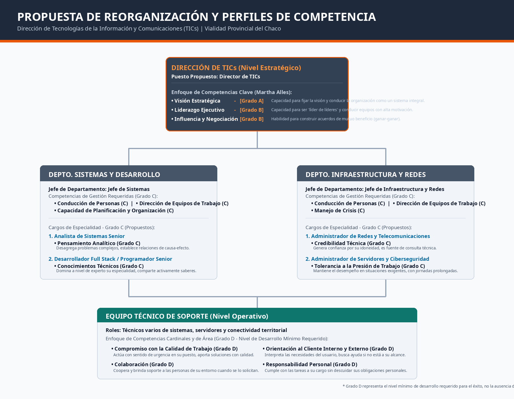
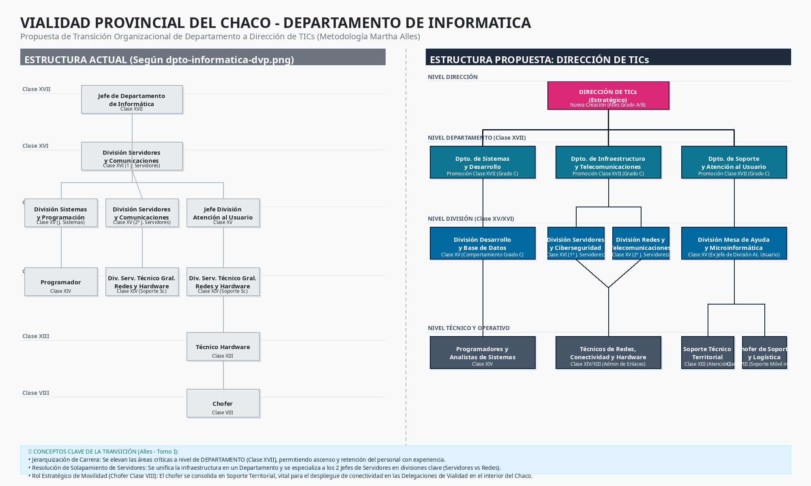

organig*lí*r*d*a*e*m*re*a*s*-v*O)* iea*rg* li*Ia*d*nn*a*fli*d*uz*.*ea*p*nc*n*ci*g*óia*.*n* )*y*. *Negociación*.

aorpcehriavtoicyv r voBei-sc)su,ie macnolitg*P*i eeohmu*e*ncrai o*r*tna d*s*os ore*oV* ieldyn*n*ó*is*n ot*a*ger*i ós*oilncca*n*, rto dre *D*ce*E* eaaa*i*n *sr*dr l*e*ala*t*roa*r*e*c*r *a* .re*c*ry g*t*as*ié ó*oy c*g*g*n* aap*i*e *c* l*d*leara*a*e*e*s z,An to*LE*ácl.l*i q*ei *d*da*u*s*e*ils.)*irp* .p*a o*Eo*zs*n*g*n i*o d*bla *e*l*E*e e*Tj e*es*rca*ntr*ub* ut*ta*uc*ivj* t*o*p*o*u a ry*(*an*c P*e*a*v*l*l*p*i*a* sd*an*ue*ci*a*f iid*lS*c* s*aa*tue*dc*d *i*d*ód*ioe*ne* t ca*ys*ol *e*lma*r* :*l*o *íd er de*

dclealv Ceh capatrorecalan qonrb au,pua i eeerjvoirsveafoaDeclS.tooinl rlurhfiieiusd isgdrcmpose cataoiseer etcprna diurm sutnllfi eoriotzitnmtálaee re as Gipnsmnpoim cenad rde i(anayóeuroGrrast dnnáfelodior lot vpda e ecJ dd obridfoeC soeeeesaomfe v n e nj( cpdoñiCqdostnole raa ue lc emdausrezeri ec an nlpop mpor rl lseeiDsersacpee tsi ponyestetts ioérm etvpdnupeedcosaecpprsmno sori edeuamtil yacaodnetesee oamget siaecncnsnít eaatopn ct.eoue n pisu rdasnngta aeoes ti r tevcsna oédbeicctiltpcov aoenalyeneoscm oj osgi.lraic l tó ó dpeunogsngeesntsuei ti tca qc rideeócei.oupens annseascpr c. cgaire fai oaaorecsrmlc íloe a fidiillsom clielot ooea *C*p Mssmnlat*o* . oqa cus*n*surtuy*d*ot e h(*u* bG a*c*du r*c*eeAa*i*b*ó*ndlle*n*oeor ss*d*áy. *e* AE l

eE ls ote●●●●12rg .. d aiPFFFNNanaaagiaiigvvsssrrree○○○○○○○aaeeeallm mlET123oaVLICDTD:::áassn oiTIEitc oierdfsnrrJpmelatenpajueiieverófclcdatoaerllefcéeenoaecurp nnugrj td zisacuEa(ecótcigeJ acc iemsnidsaleo órioa sDt óei defn rdo ytaEn a(jeoen eD e Dty dtNjc tu edrépeR oiEeiaMrerscegap ea erqigdu BiqrooaccsPfuaoetlurnnrac ieieve dc tpiieie Saxzóotric(eoaosslimGain h ó ss co/rsDc ( aenrte iadLnGeiaódesoó nleíaymdnet:rpd:nto s a oo ETaeAD a(T dd aG(rrIvsp(AreGoCt eS aaa drrls ylaosarboil Cmepsu ad )bda D Dlt:)aBdeeLiea oj:eeoCr opiní)mc rP gd:s B aeatoi (CouóeaaPaG cr)nl)enrtrr:)socaad: earr:: C io sar dmuesó PaRr ldl ec nljea a(eoIeeoci nG svdrln:fdu oo afeoeCortLrennso asl a vim )pi dpd dTeó:neyaa uoeoosnIPu rcrCcrtr tt aeéta cairBciuevsru vcrodo i)a alancoen :enonDr l ttsli Ent c u ecyiypl áin oarrsopr Voreapagdoe sreairc)orceiran as:oaldttec ntlcotu piacierlvdcinr aiaot Jsib aiucaeadrlneou,d oarnse cefs iy nleedr oPe ca Tdcd lotns rrd aaIue oíq Ceatrefrc viuregc slceil eaonaa,in ó sscs tn i ead le 4. Plan de Transición e Implantación (3 a 6 meses)

{width=76%}

*Ciberseguridad* (con Grado C en *Tolerancia a la Presión de Trabajo*).

(*C*c*l*o*ie*n*n* G*te*r a*In*d*t*o*e r*C*no* e)n. *Credibilidad Técnica*) y *Administrador de Servidores y* organigrama-vialidad-v2.png.
*CCoanlidoacdidm edi eeCn Trtiorsasisb* )*Ta*. *éjoc*,*n Cicoolsa*)*b*, *oAradcmióinni*,*s tRraedsopro dnesa Rbeiliddeasd yP Teersleocnoaml* y*u nOicraiecniotanceiós n al* El archivo visual ya está listo y publicado en tu panel de Studio como
*P*de*e n*á*s*r*a*e*m*a(G *i*e*e*rsa*n*ed*to*no c *A*iCa*n* le*a*es*l*n*ít i*e*Cc*n*oo* )*n*s, u*dD u*n*ec*i*s*v*ca*e*iór*l *nr*d*o* e*dlla e*d*d* e*Po*s*er*a *rFs*rr*uo*o*lnl*l l*a*o*Ss t*i*a*,n *cD*ic*ki*i*r* a*eS*l *ce*(*cCnióioonmr d*(*p*c*er*o*o* n*Em q*G*isu*r*oi*a*p* d*coo*o*sn* Cy *l aM*e n*a nejo*

estructura actual que me compartiste en la imagen `dpto-informatica-dvp.png`. ploesr ftiélecsns ieecrsovpside doceírfe iscsoo yps occrootenm etoec treirvilt ioddraeiad *A*l),:*n* eL*a*vi*l*d*i*a*s*el*t*u*a*raa *d*dd*e*oo s*S*p bo*is*ar*t e*juo*m*n c *a*Jo*s*em f*S*ep*e* ed*n*tee*io* nD*r*c e(icaposan rct aGarmrdaeindnaotlo eC s eyn

e l n34u..e vCNoai vore○grgl o OasDn pdieegeprr aaaEtmristvapaome ddceeeian tltSriodao andpdseo i cr(ItGnieófr nra(aG,d etroosa mtCdruoa c- n DtNdu oir-va eMc ylo í OnmRipmeoed opre auRstni ev(tqoqou u dSeeee ru inpdniaooifr)rit:c)i :daD Sa ol oeens xdp arerooc slpteoeos nl sadei teún a n claro para el personal actual sin generar conflictos de roles.

jDeerapraqrutdaizema rein nefrtlao áe rdseetar uI,n crfetruasroeals vvteriuar cls tdouelraal pC: ahmaiceon.t os de funciones y crear un plan de carrera

peospr eCclaiaceyslo nie*T*zm s*o*ato,*m*oc dt iíó*a*uapn n i*d*lc at*e*soé i p sc*D*drtnoee*e*iv mc*c*liaa*i*n*s*a c*i*ad *o*iidnea*n*mt .*e*et u*s*igns.r i asdlto raaslc inJióeenfae dvsoi ad lae c lhSaa edqrevusiedpñoaarpe)e,s le iazscatatcu iópanrleo,s pc uboeansjeotca et ibvl uindsuacedav yo metas

opcoragnraafln ilcoiztC*L*dsedsoao*i*ase so*d*cppptl n*e* iordóeoood*r*sencrr*a*fu tge í.d*z*erfc asoiA*g*e ccmnil*o*lolaie óios naissc*E*nmran rg)ce*j*ola*e*.oeoan il*c*n,simn z *u*l friaaaosoe*ti* rmcr*v* sg m*C*t*o*tgeuou*o* uása.*/ n* eattl*L*iie*d*óscr*í*dsto*ud*nro: *ce*u dd *cr*cyei *i*ta *dó*ubsr*en*reeiaa g*Ld*.l l ua*íe*eL*d*rc gai*eP*tdau *re*pa*e*ra *r*rd*s*al*s*o )( *o*dp,cq *n*eunau*a* eemel*s*asc p, cte iaa*D*nus mfera*i*o*r*enr*e*ersitma*c*nau*c*st aeoc*i ó*cplosv*n*ia óned rn *d*aeue.*e* nsco t *E*ooben*q* rsmad*u*c u*i*aey*p*cld *o*adiir*s*fae ó enl*d*nelt *e* egáp ar*T*úleac*r*ba*a* iol i*b*cn*a*oe*j o*s

darCaicosntemugñaoual n dne(gyfDuaiuCec n enciPdnva lt r DaulecGirecasosai enio ircoegónlapc.nan rn uidaXaeErae eaorAmsVlsntev a "atfCIdaaseo Iml() e c ncu dD(feis u"acónesinentidrnea óuei tnav,ero nrc evie olCv ecei(nal,deC iln v ómalpolC a lUnssalerua lee uaasnsdy s peasu s XeD beed aay XVuiT rmnr rXriiV)eeoIdoe.iCVnc nIro,dRI tsoIi) Ceeos ,ee: y nst rdlansr a ) oaedb pG.sl tc eoroerlriiaa senóa TX nsndcoeIVaCdo obndbo) msj Ae.eCl eu p(Vt sliCo naveidet aosltaBearee svl s vn t i(eeodíeXccan dosoiVX a tordmVr)"eI ea,)Xie os a tle ol cé lo c*V*insr gd ece*i* oSia*s*cunccf*i*udotoati*ó*wmrp msl*n*ad ea si lepeae*E*rrubeien soe*s*lait t,d*t*rleyo e*r*r bo *a*n/ g b ya g*t*cCoaa *é*seia aa s*g*epqnssre*i* lcue*c*gad se*a*eroze adn o yedrdes dleao e t o lsa

BAETu anc j ooo●●●●●●●lurn glgatiaaDEDDD*C*Dn mrnuneeee*o*i videagfppp*m* ioDestcraaaoqa*p* iieórrrtódum*e*etttpnaaanoe*t*naa *e*mmm,l de ord *n*ttaereeeegae*c* c nnn uí*i*m Sda*a*tCtttnuoooee *s*e oda túr nddda*r*mevln *e*teeeli moldipM*q*oc oSISeu*u*ao nacrte*e*io feseróDDrs*r*pttsanhm*i*etie*d*o rrecaymepa*a*rois t aca *s*A eCatusscr r ls*p*uenit:ylibeaó *a*c a PyetAsmnt*r*r uar,d*a*a:Dt se errlu nEoeeaa*l*nn*o*pslsgs t cy*s*eflop aiuoimc só,urT*J*rr atrinmlee*e*oedaoc sl*f*d aslaaie*e*rlóteo dol oc*s*á ncl: lUo o r(a d*d*(sedCmssPde*e*eae ulaudr a s J*D*aoa "nes ceDrmsc*e*i eiocfcoili*p*eg aovamoX:*a* n viccmds(Vp*r*aeiiJió*t*eooópI*a*n en) dnnne*m*D :r ce eae tdAeSoe*e* srneC qpmn:*n*ect uaelcl(*t*raaap*o*Uviri rzasd te:igDnad aesetSoimeoc if vsXe itnricduóeiie Vsecale nnseiiom óalt sys rodynpspeg e ea rar aSi elsemelcnaiil sgtevise ugtanvereara a amJlla nrmeáas fa a sel **123... NNNiiivvveeelll ETdáes ctCrtaioctoéorg:d iPcinrooa:m cCioórecnai:ó cEniós apn e Ddceeiap llaaizr Dtaacimrieóecnnc tdióoens D (dCievl iaTssiIoCen sXe VsI I()C lase XV / XVI)**

{width=76%}

*de Trabajo* y *Trabajo en Equipo*.

C(csGoohnpraasocdtroatoe.n Dttee, cpmnaíornalóim ginoics otpa eelarnor ecaall tibanlmteeser,in oatren d treeen tlaaads p oyrro )ev cqinoucmipiaoo. s*C* d*o*e*m* c*p*o*ro*m*m*p*i*u*s*t*o*a c*c*i*o*ó*n*n .*l a Calidad*

yodS e oldalpee org esratdoec pi doyoen rL tedeosa gt tedíosrestri i ctzpoaorr,oni arvaeli,)n c.e coLvinaoaolsl ucq taiuéenecnd nduoiocn oeessn ua de vteloalo dlionsar fs uoi nnrlmad nsiási vtdpieceelaln ei nsngaiecabiccaleielo s dnpiteeaa srnca o dm mheoa pVvbeiiialltiiedltiadnaracd eid al s

JSddHc*D*eheeia*e*sfas r*p*etSdaqe*a* owarum*r*rp*t*ceoa*a*aotñlru*m*slreooat, e.*e* (lp (.,C*n*c aEp*t*alr*o*aanma sr*d*f poaec*e*oac cXao*S*maIdr*o*InedIa*p*)ani n*o*seltiaoz*r*en*t*rsa *e* e ler ad s*y*ll e ot ctr*A* rsouba*t* nc*e*arbete*n*caucch*c*jrolta*i*eai*ó* vnomd*n*i d,e e o*a*ab nsp*l*da r*U*ld loaafeí*s*gsns *u* rizuáca*a*asarm*r*seu*i*,*o* aaafv iscrbbiia ioaróclasejono sr ód dr,epe eeclt s iotrcspoonaiodlss ,nadt oeede rlmnaci eCli aaonphscstroe oe,v fsvsei ai dnrdl eecdesi e arr.e a . ddeios

●●●●●●● DDDLLEPoonoiiivvvssr iiiV sssecciiiiaóóólaalolnnnrriggd, dDMooalaessdee p ssRddParaeeeorr ordpdPSoveuerelilseon orA sgvc yyytiir caaau TiBl omde,c a alloeaTas ncdy éeiso noc Modmfnrreleiiiacucds erDona o(s i aCcdiftnortaeluofarco mcssRirto emu(aenC rldXámealeatIs ieVescs (n s)aeCy tt s eá(XlHeaC Vad salilain)er s:dCst teXBrwehigbV aaoXruj)arfoV:eei nd Ar )e a( :a(l C cCB eDllaaaalnears j gopsdteooe ai ved X rdiVltos aIeDViI ómIelIe )n)ls ep y teddena geTertrournté ai nttcdormdnoeroeii ocd no et ol **45.. NEli vReol lO Epsetrraattiévgoi cyo S doep loar tMeo (vCillaidsaed X: ICII hyo XfeIVr )( Clase VIII)**
