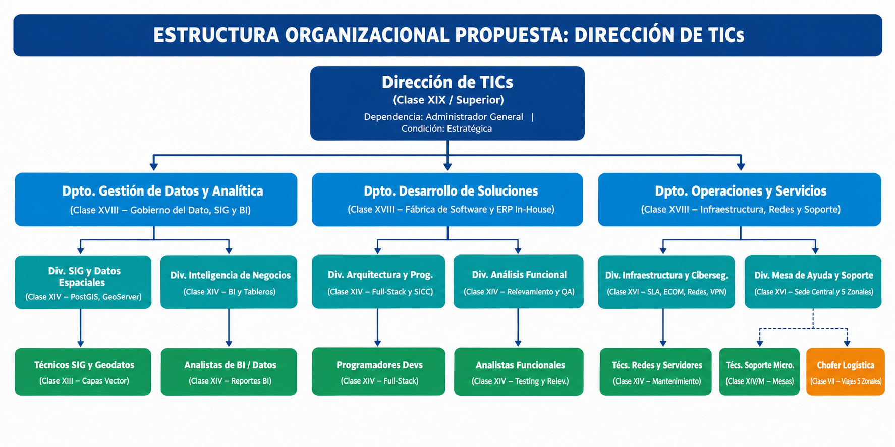
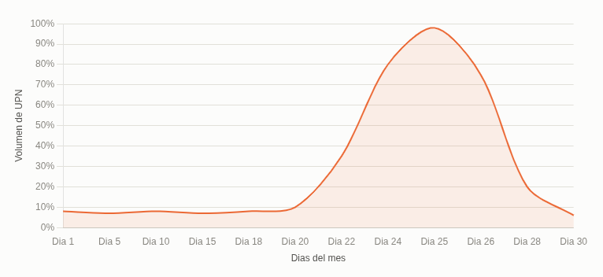
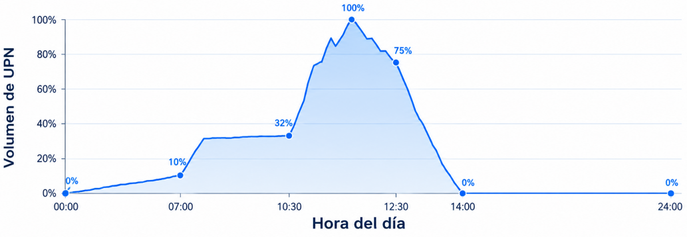

{width=21%}

**Integrantes del grupo:**
**Facultad Regional Resistencia**
**Trabajo Práctico Nº 2 "Aplicación de Recursos"**

**ProfesoresU: niversidad Tecnológica Nacional**

●●●●●●●●●●● MRSEFGMRROVeeosaeooroegqrlrmtbmndaniaouaatizáimeniñir lecvOneeza,oole dsz,,,Nj z l e,,eCR,GM oa dLRzEha ehaa,aEomru zir,Fuiansi sl ai CStarilrtAanianiioclcaqrlaa.oeu.ho nu u. jne. .ead dg,ni aotAde. rg Nlo ,u a.J shu tuianen Rl .I gunbaecni.o .

{width=76%}

modernización y soberanía tecnológica a nivel provincial.
una **profunda transformación organizacional**.
subordinada a la de servidores, resulta insuficiente y limitante para liderar un proyecto de Integral y el SIG GeoVial— requiere mucho más que la simple adquisición de tecnología; exige tmtéreocsnd ideciromn aetsrna sddieoic nrioeencsua crl.rs íotEicssa htsau: mdaisnpooss iyc igóonb, edrnoanndzea etel cánroelaó gdicea .d esarrollo de software se encuentra la Información (TI) definidas en las fases anteriores —especialmente el desarrollo del ERP Vial le**D**raes**i** e**r**tDe**e**s **c**tirr**c**euP**i**ccl**ó**actu**n**niór a**d**nEr **e** ds e**T**telr **I** a**C**áVtr**s**éeia,g alsiic detoaeg,dc un isdPoealr ó odgpveiricno sacpu ioaa fnlcu etnpu doauasln.em aLee a nur etnnaeuacse iótevrnusa tc ertpusurctrortaaupctruéiaóeg nsoic traaiien donteertgagtaadralnallai zdebaaxat:ci svluaasd siave a mefunen ndmtaeem taoel dnsotoalop bgoaíratjoes La implementación exitosa de las estrategias de Sistemas de Información (SI) y Tecnologías de **Pun1t.o A Ap licación de RRHH**
EPAP laa crraoaann áqtgilunisaeuirs aae cenl istóáitznrraea, rats é egde ieplc orTeé dIsx eetiet nolnat ag s dagie trul aáa flcicacia óapnmima aecpcnidltetuaemad ll ea orn epttrvaeaecrnaliósót iinvcq aiuó edny e edel le l aPspcdeltaeusn aoe l lpDE eosesltípqrtaiauctroeéta mgnmiaceeo can,e ctsotrau edrasieolu shlIt naapfc aoirriamam lpaeáe jtenirccuaauet itdvvaoaer cDDoiVrnePvc.e critóirns,e s einn t real nmsofetorirr dnei d perloedguacr crieósnp doingsitaabl idlied alad eosr gaa lnaisz adceióleng. aciones zonales.

eEpsrCotrOcaeMtés agCmichaieasnc, toola, sdm epa onllaítte icinnaifeson rddmeoa TclaIió yng l oaeb asepsriangcaninaazlc ai(ó Gnye doaeVd pmiarlii)no,i rsiadtrbaaadcneiódsno r nelóasgnididciroaá nec elú nnroticrla alpmizaaesdnivateo eepnna rllaaa

ED**i***o**n**u*ni**t**r*t***e** e*s*e**r**c*o*s**n**c*u*t**o**ie*r*ó*c* nn*in*p ud*g*aee rv a(Top I rCertoossldt ,as aeecsli óoenlrqag usae inpxáitozer aerdnraeáas )eT nIdd seeloel s aVe slinoaigfjloaiudcmiaeaidnreá.tn e tesPon do deer elp dlaolero tssata amrsnreeotonrllv,to oid s"loaI:n r e-Htso om(uDasa et"da (e EC RdePen)cte iysr )ieo cnno eensl transición evolutiva.
dcefuoevnno cusluinooc lniimdoeansora dádreá elt oobh deacance inarlaet rl saaian liclzftroaaanrde folosa,tr rmlupocrasotc udiSóruainsc tceediónmen auu sdnn eaad evsú eonIrfnidtcwfaoaadr mrieneras ayct a i**F**ólea**á**nlc **b** mis**r**ó**i**ean**c** n.**a**c e Po**d**jnoa**e**v r adi**S**e er**o**e te**l**ldl**u**ona**c**, t **i**oes**o**sne**n**. **e**urP**s**neo a**y**r**s**l i **e**z**D**e**r**al**av**lro**t**á**i**,**co is**le**o**a.l **IO**a**n**c**pf**t**r**u**ea**a**rea**lm**scti**e**rou**n**nc**te**et us**e.**r** s**a** . muy básico (soporte técnico tradicional). Por lo tanto, se plantea una eScduneoa lu**S**lu c**u**ndio **p**en**P**p**e**eee**r**s**rc**s**o**ntr **ev**duy**ne**ec **te**rt**r**uáD**do**r a**o**a**s**et.**r**.xo csE**d**Sl"un**e**,e s rilnávu**S**oang**e** m a**r**b**v**rle ao**i**nd**c**sste**i**t e**o**a r **s**tedec seno**I**p**n** enlor**t**a **e**n us**r**sAen**n**alra**o**tbva **s**il ded.G ose Ureperandserae nt falc ívsmiameice zoa(n Asntea dtsedlmitnziasiiabnmpciielsiiieórztsrnnaaot ddosfoo ue rnde ncGes illotea enns Ma esrlore eatrcgolv)lirá.oi c snAiEoiacl, sla hep.eas al,bL c lrasiaoaesrll ●●● **MTMrooaddneeslliooc ióAAndd ooOpppttaaeddraoot::i v**UD**a**b**:**e ipcEaal rctaiaónmná el**C**isn**e**itsa**n** l**t**diz**r**e**a**al**l**c **i**T**z**ió**a**Pn**d**1 **a**e d ncefoomnco a**P**sd**r**tar**e**ó **s**e **t**qn**a**u **cB**e**ió a**l**n**o**s eE**q**sx**u **t**e**de er**h**n** a**Da**c**a** e**(tO o**e**us**l **,t**d **sP**e**o**p**ruo**a**ry**r**c**t**e**a**inc**m**tgo**e**)s** n**d** to**ey 123... DDD**●●●**eee sssdddJ**P**JJeeeuuu**a **eeesss**r**lll**a○**ttt iiippp fff**q**iiiuuuccc**u**nnnDaaa**e**tttccc pooo**e**iiit óóó**s**odddnnn**t**.eee**e **::: vvvd**gSEP**iiie**r**sss**elaa **ttt**r dá**aaaG**apor er**eddd** oqad**seee**pu e**t l**oed**il l óRaa**cn e **n**le**O**ej**UO**aa n **LB**r**R**uet**d**ár **I**ns**G**a **e C**dt l r**A**i**A**aezu**BN**la c**C**t**a**soct**II**ue**sZ** i**Ó**ógrr**eA**a n**N**r u**C**a **d** sand **I**e**e**c **Ó**os o c**N**imm**D**du e**a**mpp **t**alpe**o**cñel **s**aecn e et**y**rrnefa itcarl**A**ioilzem**n** and**a**ecte**l**ein**í**ó **t**mtrn**i**ee**c** e p**a**eena**:**nlt re naÁl,ua crse ieoeDvan oai er pecsrlooc icpcrl eaiadó rrenáad e"edcF leo álc anboT vrnIeinCccruaestei ,rp dvstleaaeo **Servicio)**.

**tercerizar el Alojamiento de la Infraestructura Crítica (IaaS - Infraestructura como** soportaru psuicaorsio tsra inntsearcncoiso.n ales inesperados).
Sin embargo, siendo realistas respecto al hardware y a las limitaciones del Estado, **se propone** UeMcPáoNqnu ódinmeagd iccsaeao rlV sna*E* sinor*R*utt ui*P*lbztaaao l*V*srne *i*is*a*Gfli a*l*c eI *I*Sa*n*ncC *t* yi*e*moi b*g*enee*r*le *a*nrcss*l*oi, ee ssagro rpudeblrie rcided ae2 ane 4dcdl ecohyro otm isfrbitaecorsta ionm cdadieoonannltroes eg uesuía la anls s df peiáenergl v ddiailcieedlois oomj.a ejmdusesi.e t inMfitcoea.s dao ddee lAay DudVaP a(p aloras tceocnntroalótog idceab),e **n** i**o**n c**v**lu**a**i**m**r l**o**o**s**s s**a**i g**te**u**r**ie**c**n**e**t**r**e**iz**s**a** a**r**s **l**p**a**e **c**c**r**t**e**o**a**s **c**c**i**r**ó**ít**n**ic **d**os**e**:**l software**.
dp(imirsoppvoiedneieidbScptdnoaiulraduirbodm to lo(vaef EpuesdrcCl neo idemdcdsOerie otiód Meilorfn ein **9**bc)t ti a**9**Ireeognar**.**nx a**5**t secerd**%** ola(l uiebPugn slrneoe taii vnsncmcsat eco)gh á i narsolxyeat erir dS maarpseárQtooei o oNL s l da i)eidbned gcepic ela4oi ru dood cmha*O*fgiaoiodcrp *u*sa1r ilnad*t* em2*s*(ase B *o*a h epI*u*(aco)0la*r*. uir *c*7óraSm*i*a:n*n*s0L ,e*g*.r0 A en t e,sat (astS la1rat uiu4n lpar:Dga0e MVr0ry c)Pe e emlp m nsaeatoerxrnaorriigvt aesiic renoáRiniopm A ocdiMEroeetamCn l yrtEOp o eCRe Mld nPPp es.Ui lcCa occhd óiaodedcne ilogea l)aoss, CSio mteorc edreizfianmimooss loesn slear vFidaosree s4 dqeul eE RePl dye seal rGroellooV isael ráe n**I n**e**-**l**H** D**o**a**u**t**s**a**e** C (epnatrear gdaer aEnCtiOzaMr sCohbaecroa,n íeal **Propuesta de Tercerización de Gestión (Outsourcing Estratégico)**
S**E**e**sq** p1234**u**r....o**e** p**mDESP**o**a**n**seeist**e**cgnipz**○○○○ **aua**u**ao llr**n**aicnizd bii**c(**DD***RR***aóba**P**i**o**cln***T***pp***P***idi**on**lid***O* **tt***O***io** s**d**v**oodyan**t e **e..a** G**d***(* **B***(***e**n *T***dd***P* **ld**I**s**i**ao**So*i**e**ue***e cEsy** ) *nm* **(**i,**kD** n **lN** *t**Oaáu**o***U**t*p***e**l**is**e**s**a**p *vp**o***spp**r*d***t ee s**i**ait**n*e***ec**a*d***ril rm** s **(caa**d*e***r***R***Rd**t**otc** m i**eo**t**e***e***T***R***il**u **ol(**i**s** *c***O**n**o**c*e**P(n S**u***T**ii **d***c* **l**so**e***p**dyeai**u***e**t**e**n**s***e* r**ern***p***lR**a**m**a**v** *r**i**e**C**a***S**cl**fyiP p***r**ci**c*id **ooc***a*ó**Oio***i***S**e**o***ó**anl**c*n**u) e***in***c) t:**t*ó***dc:r**e **r**d*)***i** *n**aeóv**:***i**re S**o**c*)***t in**C*:*l**oca**e**n**i o**i** E**c**rS**eo(**eip**dSt**z**s**nIl**si**Gi a**ev:**a **L** s cc **i** s**I**F**A**e**dn**iaG óur **Ca**d**t**s**-**vnn**e**e **d**eo**a**i**A** c**r**odc **)pn**is**:**Vo**c**doo **ao**er**u**einnEa**c** g**s e** aldl**iE**uc**:** ,**dr**r ecaár**dCa**Áei oí d**odO**dclGrn ae**s**oa**)**t**M**gde**:**a rm **d**oa oc a**C**b**e**toeVaUoui n**h**tie**N** lnaatacdo**a**rasl**i** na em**vc**"t osrFrb**eo**góáe áce**l**.aft d lbi i**d**ácdcceer**e**uaaaai xc s s el**S**iaodgud **e**dseiledara **r**el e **v**du csf l**i**aioSna**c**dentn o**i**or ob**o**nvtdfnsrtaii**)**eodvwd **:**s leyoeaaem lr r r ,l e ddeoeee"eess.lll viales) y dando aliento a los equipos.

objetivotesn yd eenl cpilaasn d(ceo ombora sla d eci blae rosreggaunrizidaacdió no. el trabajo híbrido en campamentos

cmaumyp aaltcmoo ensnodtbuorcsec iveóilan pl erdose m yel adla io ted)c.e nsoplaopgeíali zeanc ióénp odcea slo sd ipfírcoilceess oys raedsmtriicntiisvtarsa,t ivaonsti cciopna nldoos

ep(dseotrrsnaodténedRehga eexaisecpllb c eobeiGugl airrdartjcsooaacao ddispdsoo uae n Hd zleAc e upsa med rryiegrdeas pose nor:ona oneptlsasiiofn)elic retnftaéaeatrcac r t ni elyeiiltrc aalr oci ntno odddimvrioeigea p ilhllt a)raed.e lDrienzr daiardemecerciói seclnaionó,rst rnao l.sac ll o ad mcisgoubitnpaioeelescr stioid verei dfyli ac cadeoc l neGtteserr.ax ridttooo.r iBaIml updnlie cn aivl oelasl

tre*r*ee*o*vcf*l*a lne*d*luoj*i*a*r*al*e*órriblelá*c* naagstavr*t*afs ei*i*ecao*v*je no aa*o*lrásaut m *)*osrt ad:yreu átace lra atgaitd ióescVseven go éinpdat i asaeeelddi r rdnleeade yad oare de drsl lage nae tPsranhc se rni aieaosnptibmos vsodinmdittlpniiuíirottveocueaisceñi ccla ael(oitellOóasso sdn spy (dde S deeeli(de rinssC sai tsicttcescheieonitgoamoeñnarmcnmodadaoe punasa dsecdt,sse ,ecte I ,esn iDa ón cpfs rendaclaepal eireerarcnalvog ssoe imdaatd msraelcou o obpfirdcovue iateeenteusru rretlr,t rac asaoreamt o s.enyrd l eArl eeeSeantcc norocttZao odutpg iom aavoyrln oarrau alt cadenedsco oni),ace.Dm st ap rF geiocaruieneni cnousacaiindntcfmnioea óizósrisdneamon nsc ddde tileoeeoasy

**P DNÁM**DB*(R*a**eir**e**uiv***e***es**j**s n**o1234●●**e***q***ai**a**có t**.... **l***u***:** c**r on** l**d***e***i**aDuDLGDAC**p e***r***B** eii**d***i*d**c**eeoder*d***l**ere **e**a**i**fsmdes*a***Pó**sic**l**naptor*s* t**u**pi**n**caróirt**P** caurri**e** *a*zóncoo**y**i**u**bc**s**óg n olm *t*t**e**il**t**no**A***o*Eluo n**o**i**s**did *d*sr **n** s**:**d**t**eaa*a*td lo**oá**deraD d ea T**l:**e*l* d**i***a*(i etJr**s**lGméaL e eecP**i***o*g i **s**rcTnefd*r*laoeiot al*g*otceai**d**dlosvslí*a*alre t**e**oo:do ai*n* ncTc g odC r**C***i*A/a,ta*z*ríle ooaoiCs**a***a*)mlplo :nsg **r***c* olCgba d**g**ídC*i*Tdna*ó*íinule**o**eoaaied *n*eicl csfp du*,***p**niil n crdaaecÁ*p*,t**o**dao ee cc *e*rIm**r**erli i neMó *r*dó Il**C***o*C fonaeganoae tt**o**: iod *e*rie rcniEvm**m**tmm *x*arhtPapsno*i*saa*g*pp**p**raator: rc *i*len**e** rrya*d*e:iatA to**t**ó itD*a*meTc**e** aé ln*s*dnlrii**n**(lgeeps ai Gecny*e***c**inseabcif e*n*ar,**i**tiñrCaa n**a**aa a sa je*s*i**s**ordar(,rar *u* Cl **:**mo,rl cal al a **D**lod*m*tc ua Api lsveeo**i**vonsr*á*)**r** assoio:esi**e**s*x*c cmctrp C**c**ri*i*adaXJró*m*ao**t**eicaeirpn**o**Itnng*a*nXiepft,o**r**aeeoi tga v mn*e*edros**d**sioc e*x* a a i**e**i Sds*p*ys dmed edie *r***T**uaóni(*e* ree lpTd**I**n eiiD*s***C**nd ne I lc*i*pCyapfete*ó***s**rtreu i airpa*n* sovv aerase) caorar*p* s)eors ls *a*totltna doeer*r*r umdi*a* lecst dceo csee*e*ptebid uñónd*s*lbaearan*t*teea*e*nonsr,l **I I**1**.I .**.**A P**C**te**o**rir**m**bfiu**p**l c**e**di**t**eo**e n**nC**c**eo**i**s**a**m** s**y p** C**Re**a**tee**r**s**d**np**in**co**a**ian**le**ss**s **aR beilqiduaedriedsa sd el Puesto (Enfoque Alles)**

dpseelag zduoer icadislainidoe nianedfsoo.r sm aá tliac ap.l anificación estratégica general.

clfapráoueocrrsnosetn iocyavfJiielsaaoevc,mennf etcrzaoes oamsn nc dteitoveeeeninnr c l t Datneiéou olei n rnmlpggódnalegaooorninsbtcvaceeaoami jlascoe di e nóbdenl naaeu t sjol noeal ,a l irlpc emaeiornv coipnfaneovrtlapieiurnnnmtmagocdnaierioas dcnd .aoil cóeaP ign asecba usorpunm snúra posbidrtrcu-eleoigrcl sattfaaaeiecjn. gami caairle p.rao .ne vbdeñjoe.o tsive yol sfn arecegitlaoitdacoinord eovs i laaal tlaoyrm glaao

ecamIpPmoncreoecmptrtrsimileopviicó nailateneeed j,o sloa g srcceda.eo ne orInpcemc faairlriparcr ca lrtiapy o cclí oa odose osanail cs feciif aohmtaunnaldlpazaecelraesse crap,pgo dslaremopiarsnsarovtoa e e yma ums esdn onaei dv rsgleeieí eudlc nreDtcaridrveoir oro pndep seeeca urc t(rocnlsttíiurid tvdiatoeiceadk rlnsyaeiem dhsploa ,or isee lngd snmcéueu otireiapllcsaadnuo) b.ide a poIostimrrant oaaymtpvadr liieecoiancnhnrscaetat i raeosbpe. l rndpeoIaer emmin onyopdro tilorzvidacae eeasarrl

*líderes*ptictact*"*nrre*)*ooeraa:fcg omnrnnnsurtsspioommnpfrlnogóáeaearegtnrmnilenic,dtc aonacaiaecsti,lea tni aós tdmé na,epo c senfr niuodcodiqmdcai iaugboucineieusectta nrtseisolvd l ócaipodflrd iua áadeonrtdolaier dc sg lyoa oia ysdmsrnl geiuhydeianzp oenanstenirtifcioarmseiaciszómsacp gntirolooóe a s nscye y t asdudd an eaeedlt ol u eilmezagn eenasri naqltd eesirDuos nxiistsipprdrqt aeoeeeurcysmcr e.t t os aaIemirt ttpiiéxuovpaipcan alruneictsece iri.ozcaoi gecot nrrsnasaoeec lss,ri a dmdc cdeoirvioscnínetenoiigsrcadnsrtabueceoslre rsee ino l dtataseesyy..

*((ERxe*●*c*●●●●●●*ql uues*sÉLVLIMC*i*n*r*e*v*ii*i*itrdda*d*fsi*a*enlceeuin*as*ódtairree*s* rniaa bln jy*p*o o*p*zzic l*a*sgg *o*iisEdd a*r*oo*r*e*a*a se c*l*n *a*tdE yoprc*r*C a jm*fo*aie*a*lTtrN*l*lréci*e*eo*m*aséegu*s*z i c*i*sgit *l*cniep*i* (ov*ac*aiG(lrocc *o* Go *d*ai r*n*Cpaar*e*( ( aGicaGd o(*pp*dimGoórsr*eu*oaa. nbr*r e* dAda*s* iA*s*ooIo)*o*d(m*t*:) G *on*o :A (Cp*sa* rGCA)al *l*Bai:*t* c)ar d*é*p):a*a*Capo :*c*ad a a*n*c*c*CoCcp*i*sBi*ca* daieaad)*or*Aap:rpc*g*a*s* d)aia*o* d:dC *y* cuc*;* ap aiCnip*d*ddda*e*p aa*e*aa r*n*aarrpp dd a*i*ec *n*aa *e* fie*t*drcedp*se*apsiarea*t*d*r*t ae*e*dr*a*fradruni a *c*nadect*c c*pie ftr*a*i*i*dua np*ós*ceorria*n*a*o*oraasm r b*,*nr t*d*ya rsidp *e*n am*a*ocue*l*iat*l* dole écu*á*rrems*s*g tit*r*rooua*ee*il uaad ar*ra*ns osd e iy*du*euscinyr *en*s a ddp pru*T*Ddei *"*elslta*lI*i iaci*íC*serl*d*ntiei crñza*s*v*e*eaciaal*)*pi*r*sbics:dn rl aiii ód*d*aódnjlone*e*danoa 23 .. CCoommppeetteenncciiaass EEssppeeccííffiiccaass Gpoerr eÁnreciaa les

ola scearrvgidao mr áessp peecsíaficdoa ,( Ppelarndiifeicnadcoió enl cao Nnitvroell ddee sCuo pmrpoopniae inntfera).e structura misional.
*g*tde*a*un*p*riad dnoet eq d ulaee s aalisdrureonrlacloiró) o.n t rfoosrm jeafel dse ol creasrgoolv.e r caídas críticas de sistemas.
Vialidad Provincial se encuentra estancada en un nivel básico/intermedio.
**Sistema***V*d e*i**(**a***T**p*t***á**e*ic***c**n*a***t**d*r***i** e**c**fr**o**u n**)**d c**y**ei o**N**unn**i**a**v** s**e**lie**l**s n**d**tet**e**om ,**N** aI**e**n t**g**feo**o**rrc**c**me**io**áritz i**(**ca**E**ad**s** o**t**s **r**ip**a**ma**t**p**é**ral**g**e **i**lm**c**a**o**se **)**no.tber amse (j"oCrao nlas omrceimo"o),r ilaa doerg easnaiz caocmiópnu dtaedleogróa diagnóLqdstiuedicele a dr raiiernzeliagcctoiteaiv lE odo je eeI ncnmuv saetiunvnsoeta rcareio ondm de*G*petae*r a*Cltle*d*aon*o*dmc a*C*ip ap esyrt oe bsynleaec nciradteosaqs:s u ci(eoLrmied pe*G*lrea*ra*jzo*d*gs*o*o d *A*ye ,lN epexagissoatcedi aouc ndióaon nb)d raeenc htheaasy oay Actualmente, respecto a las prestaciones de sus sistemas e infraestructura, la Dirección de (doDirvgVidaPen) .i ggiilcinneomroacfnsrpmeeam nlgreepaadrsmleai tmortdpueseeorc"nnno tsuttcopea ri r uaareme esaqcn saocu tnmtocoertreei,redo sindidnM nenoiearaai sdvsnrv eo tteidhl.vee noea Ss s eoe ecAnnslvoo lttolsdsreele iue sssvatts iieisvnasimntoáetrsadralm:iosiss cal**N** ilastsoer**i v**a (sayq**e**npti **l**usrso tualeu**d**racc t**e**deocts ouijr**C**oeesrínaa **o** ma(dsd**m**Spl eeai**p**pllsboso**o**a e,s,s**n** r ) sai.**e**sm ri **n**o eSape**t**lail**e**icl ec l eepisiz**(**tll o**O**a ea(sstn**p**rreiat sd**e**uxurt**r**otel o**a**nae m **t**anl**i**ay a**v** t cle **o** eprd **)**clevpa**,**e aacno **N**nili*S*smul**i**ld**v**ae*t*a*o*ii**e**sedec*c***l**) ani*k*.uó **d** ttAnnoo**e**ol **1. Situación Actual de la DVP (AS-IS): Nivel de Componente / Sistema**
**PA**Pa**un**r**ná2**123a**tl**... **. io** e**sA**DEP l**i As**nlen**p**a tton**d**r**l**ee**i**mec**ec**vsc**l**b**a**i is**N**ró**c**tadan**ii**me**v ó**d **e**i**n**eepC**l**n oo**dd**Btrod**e**r **e** ee o**P**cs**S**In ha**rI**lca**e**ra**/**ri**T**s d**s**ot:**I**e**t**lr l **a**aSonn**c**:te es**i o**sUcic o**n**nióm**e**aCn **s**p r avdí**e**tereic azl**I**o r**n** pás**f**ie d**r**er**a**els (**e**npoBt**s**eniEf**t**raiI**r**fc)li**u** la: ad**c**dcea**t**St**u**lsu ec **r**a a**a**lla n a ssd u iedgbsaireteteorce hrs oaelsle eb,v caacsjlioeuo anerdal ednboeue secrtáovaonns **I**AL**II**ap**.** l**P**ipc●●l**r**aa **o**rn**c** ia**EF**f**e**i **a**c**nsM**a**lfoto**c**oa d**i**ql** ó**eeu**n**rd e oEe**d **v** ee**Ra**s **V**l**le** a**u**i**ia**d **sa**c**c**e**icó**a**t**a**ii**r**n**l**óv**g p **on**aa**: Ty** rd**r**a eL**aD** aa**ne**tn r**st**aa**ev**pbl**ce**liaaz**cr**ajn**s**o**ió**ri**a**f i**n**(l**l**caW**:** a **dI**co**ne**Liró**f** ok**rB**nls**a**o **r e**a**e**d**s**sd**c**e**t**i)**h**s**r ua**tylea**cs** ml **t** a **(u**c a**Inr**cas**a**a**v**r gp**ey**aaa**n** c**P** c**t**t**a**i**r**sud**er**eaa**is o**lde**t**h**)a** s da**c** ec**io**n eTo**n** I **e** ee**s**nen xd ifuegun enVanci a ioóliurndgn aa ddne eiPz sart"orcaévipósinan cg dsiaaeerl planificascisiótenm dae, lala c anpeacecisdidaadd g rdáefi ctara nbia djaer persotcae sUaPmNie dnutora snimteu llotásn deíoa sd ed ed actioesrr ee scpoanctiaableles .( cruzar

el mapa*s*c *i*a*m*Gp*u*aIS*l*c*tá*i d*n*(aG*e*d*a*e *m*odVe*e* i*n*aa*t*l*e*l)m *e*ea*n*nc e*e*ln*l*o a*i*s*n*m *te*sie*r*e*i*n*o*rvt*r*o id*d* o*e*(dr *l*ei*a*ss c*p* o*r*a)*o*.c *v*tAu*in*a *c*sl*i*eu*a*s *a*,v el*t*a*r*z*a* , *v*rpe*é*od*s*r *d*ce*e*ol l*l*ac*a*po *V*sma*P*pr*N*íoa*?*r t apmoriqeuneto ninot eeraxicsttievo u dneal

DprVoPpu eessF*v*en t**i**o*a*súo**n** *n*tmn**c**pa d**a**o e*a*Uo**p**rr o *r*P**a**MP*e* **z**N*n*rod o.*d***d**le ev*e* **e**irnc*r*o *i***s**ec*z*: i**o**r*a***L**at*r***p**il**a**f .i**o***m* c**Pr**a*a***tl**c**aa***p*i**nr**o*a* n**i***s***lfo**e ***i**a***cs**s*l***a o**a**c***m***b**c**ió***i*u*s**jen**m*m**t id***o*u**ve** l**o**a*ti***s**d**l***e***a** a*m* **e**s**C***p***s a***o***t**e**rr***?*n**ag ta***¿*l**é**a *C***go** b*u***irci**a*á***eo**s*n***ns**e*t**t**o* **aa***s*d**d** e**f***p***au** *l* d*a***tau**a*y**l r**e*t**N**o**o***r*s*o***e**. *s***g**Sd **o**i*v*e **c***a*hl **i***n*o**o**E y R*a* s P*c*e,*a* li*r*on*g* t*a*eq*r*nu *c*tea*o* r*m*dae *b*imn*u*s*s*at*t*an*ib*lda*le*ar decir "necesito más RAM", decimos "necesito procesar X cantidad de esta UPN".
EAll ePslatanrIGeu*b* nln*u*eEeáf*s*o nosps*i*r t*n*Strmiruoc*e*aenaáy*s*tr eét v*s*in(ccge eidatirvocs)e e oy.c lba laL ata laqá anso ucbocáretl aginep cnad)loda tnoi/iqndosiszuiaepefaiedñe cc aeraidadómnretáan i ov .clc aossAeos or md otmpi**t**efbop**r**iac l**a**rriypatga**n**eolcana**s** ri dno d**a**coaini**c**far iee**c**ccnlsc**i**aoat**o** itcm deo**n**iDamó p**e**adnVu**s**i t tPi dladda**d**e dae **e** aocs o**l** co rbeaa**n**enrssrva**e**s g ostl**g**saral uu**o**uv ,v ce**c**cialaclia**i**tol**o**riae óina issnna**r**b. **e**f erlrd e**a**aneh **l**e d:e a serj*¿*cteu ri*C*vctuaaouc*u* slct*á*eu ui*n*lmyór a*t* nn*o*ea ,i*s*n alvm cecq*in*talouu *g*yneamo*e*t lr rd*n*áo de*i*exl*e*e fism*r*id n *o*eleaeo*s*ll UPanraa UdiPmNe nessio lnaa rm loéstr iscear vdideo nreesg odcei ola ( Fnoa steé c4n, itcoam) aqmueo se lsatsre ssigau aie nlate isn fUraPeNst rcuríctticuaras.: En lugar de **P1.u ¿nCtou áBl es son las UPN de nuestro Proyecto Futuro (ERP + SIG)?**
**23U..P ELN**●●●●●**al P1S:ri o**CDL**DFtCu**a**bu**oe**eea ln**nb**frec**i**it**n**d**e **nmii**lfr**fóa**a**i**rá**ica**a**mcn i**i e**aó** m**deF**s**c**p**nen**p**u**t**i**l**:**ra **ot**l**t m**ue**au**n**n**Ecm**c**i**rae**flt**a i**iu**n**e**s**c**ó**d rna**tc n**ao**ed**tr**o :**ca**n e n**ducE**e** l**O**em ia**r**ól**n** j**s b**aenv**ue r**on **e**i**a** nddlt**es**uo fee**n**r**t**m la**r** o**o**s**e**ee**E** e **s**sne**PR**rt**t** x r**reP**dup**o**u e c**n**en**yV** td**i** e**e**u**vi**gi**a**s**c**re**e**aat**lt**n**l**e **o** s **I**t **n**t**:**ea(o **-**M**E**r **H**dc**l**rái he**o**g**s**qia**u**iv**a**tucao**sl**i**t**tnl **e**i**o** cva q ro**y**s**a**ue **l**ec p**eN**e Va**l**a **i**irc**vS**vratía**e**u**I** c**G**l**l**cala i**d**oc l e**G**aen**e**smlv **e** ,**N**e a**o**e**e**rv**V**Pnt**g**ai**i**rton**a**e**o**ssce**l c**,tiem g**i**e**o**e rpflen í usSD ilucQsenoapLa-da,f oirnat aSaprqmnoeucrre iviteeneidlrt cooo*c*t *o*urdde*r*ree*e*as qseurev iedlo ur.s uario ejecute la petición de renderizar dicho archivo en su pantalla.

mcieanytoors sdeerá r elag idstermosa nedsata ddíes timcoesm, osreia eRstAreMs ay lpar occaepsaacmidiaedn tod eg rpárfoiccoe sraemquieenritdoa ( CcaPdUa) vdeezl

esissttae mUaP Nin tienrcarcetmúae nctoan l ae setxai gUePncNia p daera i npfrroaceesstraurc ytu eram: iati rm caeyrtoifric cardeocsim dieen ctaol iddea dlo csr umzaapnadso,

Laulmeagcoe, ndaamdoie qnutoe eal GlaIrSg oe sp ulanz soi spteamraa acausdii tianrt egraacratinvotí,a lsa dfoer moab rean. qAuseim eils smisot,e mcuaa tnradboa ejal lo que el sistema recibe un pico masivo de uso en unos pocos días.
ncvsoaeunr eriasevtbafalelsen ja trdeu le taa d vsceo a olpus amcuacseim dnmai nddaoe tdse e,er si altotralesa sUbm.aP ajEoNpl .da iesn clcarre eDmciereennc,t codi óeinnm indatene drTraeuncmdnpooi ldmooga íyado eVr ieaesls.p tea caiorc fhísivicoo deenm daisncdoa. o días dleals m oebsra).s no se certifican todos los días a toda hora. Se hace un "corte" a fin de mes, por mdoi(naibrfesrerfmaaacestolats ormtie,ra une sRc nutAtuecerloMo ans, uspvhtbairoaourralrcm.d cpLiiingróaoaón cdn,ce o)a.sy naaLatrlia d nl aaqcesduag entoyr tac idccinoaaos ddmap acrdpi cneliekco ijeilnipódneamassld ae dd ytgereooe sVm o irdmaaeenlégi detisrarriuatcdrt aa.aá d Agdoin elsm.u eleeovsdsa i dl amae avxqapiugraieeas bsclleaeo cncvofooannrlsmi dtlraaau cnyqi eóulnane En l●a te**C**or**o**ía**m** d**p**e**o r**p**ta**re**m**st**i**a**e**c**n**i**t**o**o**n**:**e Es,s e ul ncoam **C**p**a**o**r**r**g**ta**a**m **C**ie**íc**n**l**t**i**o**c a**d e**o** l a**T** c**ra**a**n**rg**s**a**a c**va**c**r**io**ía**n** s**a**e**l** g**C**ú**o**n**n** e**c**l **e**ti**n**e**t**m**ra**p**d**o**a** (.h Eonra Vs idaelidl addía, **2. Elaboración de los Gráficos de Carga (Para 2 UPN)**
**UUGPPRNNÁ**●●●●●● **F 23I::C** d**DFDFEEMEO**a**uujjeeneea**t **nnff**o**sA piiXYddnn**s**aa:aa** ,**ii ys(( ccCmmTVo ii**c**a(óóiosI**a**eeernnn l**l**nngmdu**c**v::ttae**u**m epaa**L E l**nd**a**ccLoe**al**t**r**iie a)n óóa :**rr **b** e**lr**e**nn**c**d**D**aio**psu**::oe** í **r**ru**U**ra **a**eLv**EC**lEs**P**t**t**saaa**s oa**le**N**ds d**prr**n eb **g**o**i**a**a1o**tlad ra**a c** m cste**-**c**)**é**i** he**:a** i**"**ec ói **l**Ci**C**vsn**)**nnd o ai**e**v e(c gnde**r**o **t**etedrd **i**isd**f**olefa **i**iía1eó**c** stod sn**a**imacsp )**c**old aa**i**3-e**o**depcm0 e**n**ixaCa)e i**e**s.gle ce **s** e(rás ctt **d**intiafaeai**e**icpc nl a oaU**O**ecs s P**b**oie ouvN**r**brn**a**evnt eei**"**c dcs ntr**(**oco ie**E**pdorrc i**R**romaoeu **P**lc pend**)**eeos e sn,ra ta upaltpdnomoraal oíis gecp.mono ontnurocose iusósd mtnyre a o dn icdordreedeec oc mtsaiCm)a PaditeeU enrl a itlaaosyl

{width=76%}

sistema y generan los certificados en PDF.
CPU para cruzar los datos).
picos específicos cuando los laboratoristas vuelcan los resultados de los ensayos en el Director solicita la generación de los Certificados de Calidad (lo que estresa la **Procesamiento (Batch-like)**. La carga no es plana durante la mañana, sino que tiene chelaaasbrccogrieirataonntrddoioooris o ld,a. asint opgsrru epesabaranas c m(oleabjsroaivsra damene tleans tce do lemols pc uireetarsrdueol tdraaed) o.m se dse. los ensayos al sistema y el ● **Comportamiento de la Carga:** Es una **Carga Interactiva con Picos de GRÁFICO B: Carga de la UPN 3 - "Ensayos de Laboratorio"**
**V olu**●●●●**m eFEEDnojj eeedrs em**○○○○○○**XYc rU a((i TVpPd**DD**D011iocNee703**íí**íil**aa**am óu::: l(030**ss**sanmCp000** 12**eco de2**1 **arue)n**a**ea5t : rn**la**i 1 fvld**H2l **ai10a ace**02o**a 2:lc:a 0**:5r**d :C u**a**c30**C:**3e a**s**ir0** C**0ol**a**v rha** d**:g**ro**nasn** g**h**em**ae::tP**a l**s )se** i C**:**d**i:**ec**):c** í %naaa**oP**Lzrs g(a**i**adi**c**0 **m**a p e**o**0a cl **á**ma: **s**Da0s**x**n reeu0**i**ag**dm**dmb ,aa**e**ii aram**o** . 2- nc bu**A**4ad**e**ay:**l**ea0**xt** jab**a** 0**t**d**r**a.a **e**eh jL**D**a**m** sspo **e**)u(rs**o**.**m**Co .ntc a**a**éeiTrv**n**cgsoen**d**aadli**a** cmoVb**.**os aiase Lls lnleeooet)soss .t aásitlnno é sfbciepnrnneeaic clleioaztlos a Ulr rae PvbsluaNo e ry aElj votneeornsnmriaa opdy aroaf eís sss.dicu aeossl

{width=76%}

integridad y disponibilidad del entorno tecnológico.

EPCosOtMGI SC)haco
intrínsecas y las fuentes de amenaza potenciales que pueden atentar contra la confidencialidad, 
**Fas e3 .I :S Ideegnutrifiidcaadc iódne dSeI/ TRIi e sgos**
**D**E n**e m**●e**a** s**n**ta**dA ac**f a**tdi**s○○○**ve**e **o ps**s**rHSD** e**ovoaa cuftr**r**eotld**■■■■■■■■■■■e**nwssw**l e**ea a/a**v**rmr** SSECTSSMCDC**a**a**rIene**aq**b**eeii**i**nolaa:ssoi**e f** brrue**l** rtm **e**tt**oen**tvvotllnieeo ooep**s**ii**rt**s**I**pddmmt**m**r**on**stg:ae u soofi d**f**rmsaa**(a**t/**r**arrane**U**a **a**eem**c**Vfc**E**ia de**eP**ssí**i**Bt**R**aPdn**ó**óion **sN**val ce**nP**vNvort**t**eos ao**r**ii i: c**E**ser sl e**uV**se tap rd**n**I **c**u s**i**odndlya**a**e**st**ae -fee **u**pc**l** c**a**rlso r ie**r**i**I**aeo**y**Dz ar**na**iedrnmda**o**nal**t**a:n e f **e**dt**s**yt o (a asoe**g** oS**)**srcc blsmw**r**see ai**a**ld ó ndePaip**l**detn s ecocaldse a ihssdCóep sp teGensaed grs5 a cneeocr,v reh to DedrrurrSooogruaueltnQ ulrltcldil áeafieatDLceefigsrcdiV aróc aacovsbPancoc i,l*I*a i eim*n*fiooals*-*ern**S**ln*H*b eosee**I**duw*o*j**G**sases*u*a d tZd*s*liollb**G***e*oaessl n)**e**eo Dae**o** b(lVn**VS**era P**i**s**i**e**aC**s, l **l C** psD uú(**M**asGbt **ó**aleid**v**c oCe**i**aS**l**be)se.inl ridtveaerdr dees/ 

| |
|--|
| social / phishing). infraestructura (ECOM Chaco). Dmpeeórlesvioglenasca il(o taandbemlse iZtnsoi sdnteara lSetsiiCv.o C )e. inspectores de obra. (vulnerabilidad de ingeniería servicio esperada para la DVP ○ Alta concentración de datos críticos en un único proveedor externo de **Fase II: Análisis del Riesgo** E **A**EFLADóvilc**m**eseagclimic**e**lii●●●●●●●●●●1**●**●bdcua**n**ee. aea **a**nr nca**z**tIeteZEcFdDRmvSsIRAsAmdVC**V**Ftionnde**a**aóieeannaeerioa**u**oaitácea lacfmeorr**s**lantrrrle ls bnenc**l**sbluolrl evvgdcn**:n**eq aEavr○○○Dcoecaspo srniigauit**e**sduisdcceRccoos lt oo aade íl **r**aie eisoiiodaoPnmórtrso**a**óóisjlos aa orICFF e nfie d **b**c nnndeVw n( l es ar gi o nueD**i**ce sedemdboli**l**,Cladun éoap **i**tes edcoceu **d**l■■lareerpecl ootrdau aeSoe ag**a**c atn atxatsc eeeu i/ir/crsaoe**d**bcdtnifigc atiMn nDtoei drxcb**e**RP eaiotecótulr lcnrDeeopeeacli**s**seba aearna edienni so eoa ollgcddc zctp/awesoodc prs sSsii aareo cdrdatoa si e óio a/o)Dionpdniacmee dtaficnne ntrlrolnaeoimel oeeotocceaquóeop b ugca ldn uasn uncnesspéupVaidaefc mdctgtidge rasdarapladacoP idieiaógaacatmorezluoincesNiit aódncouclbad nalis u ore iaóoncii rnclacee oao adaebnecon stois ddlnnleso r=trnit ns aóodaed deee n ps eyPtno seeesrsldei uoanalscr oasepmoscr rtil faé aobrosarsanad mdcbyyzi dioi odeeldia nndenaasastaat diosp(dzzAe saaa rdc LuccsdeuEhri eóa a)yoaln ld e gp dcosreeeae rp nelssccan ioouór cnmalnlaioa b l xbs ael ua prosas rptopeciegcébbrerulaaedsrbc iiodidilósiaadn dar fi eddnpme dao donerit cséopipxesaoir tarsodt ei eto i v dloadessel |

dmaatsoisv)o. de datos).
Escala de Frecuencia / Probabilidad
AAPPFPPECR674\$\$EFHF351\$\$SVC441\$\$TMHC663\$\$RDCI542\$\$ETPC753\$\$TE----\$\$ En rraor055 507 058 509 000 005 RRsSOIsaeéérrhieoaarcmeau21471241816292taGeóarooectbn%%%%%.%%.%%.%%.%%.derrnTtriPPlmíurcTr510.2.......5550000cuabsevdddidaebbt rt015706012●●●●●●ldr svIskG A ieui.......ho%%%%%dcgaaclM..npe.. fil 02000605000058.oaoo i V tPp Leii eajne PEAEnaoc o ns05000005000006o m AdoEciV épcgszcxoa g TBMABMAagn 000.0.......05 V eiDSV00000000irtp a.wiictóarloe alal......daa a iee .tt.00000000000000 .iOaIiao n bsjjnaal l.cmoddao(/00000000000000e ( lS : Sl\$eVrli ii\$n ( :as aopó000 0 00e( e1is ) SPM)eC0B : ad n n,d ( /// s0,uNcDC0ee D1 /e E p t,n/ oe 5x /eesa parMvo/ñ\$i oñoaaro2o orsñla)0 nu):io a0 :eca\$O ) .Oti2:c0aó \$cO0ci0rnu1óiu00oc r.nar.0r\$ u0re( 0n efir\$0nra0unIne0c\$ .caan\$0\$i)ail ac 01n (die 0.pcae0es\$éi s0eet ritp0drmsi(mapé.ti0dia armay0addrd 0a aaeioad\$dl xipd za adpe(eas aeodr c af1 (esie1ótA iico 1vcnvLt a iaemEvó dczem)náei ózcs =e a na cc nvnP daeoepauédrrcat a raie1orfdlc is0 c2ieid d aa aaqealacl ñu ñ id apooipopeñénsosa o.ers.t md .see i irndevdcanieci ta i(ooAol sib(nL \$rdoEa)i )v ,rx eidj uiFnuircgaeirlo)ce.su s oeo n mcsaeianc uu aels tdroe

acceso VPN desde las 5 Delegaciones Zonale.

dsg(ecuceelopnnaneevtrerróoaisom dd ryoieec dsrla e.aps str C)ooa isygue rtsrfiaorinemsma teanádm ctediic eeaas rsiosen a ssdaui)uon tdcotneecem nisiónat nrctopi.uz odmared p ioPnlisaom csditteeigvn dritedeoSatsedQ dc Lcey. i óUanpu/tteiemxntetiin.c caicóinó nd eo ibnlcigeantdoiroias . para el

las transacciones sobre certificaciones de obra para garantizar la trazabilida . aysClaa epuisbdgdr oeeuiDtrblro seiapdrelcíeeagaigrdó usa nrpoci dbonioairfiao ndnlmp e.a tasnéér tcctZreinieoc ircanado,a e.l lefic SslnCie maoy l a innltatdcirz eolbuall aycesFIiónneont ne dcdreando poe da aVcIptniioartfealso cc riqcimsoeuináóneetntdisrc,aa o .or erCbdedliisefugre naarlddatvoao arnDd idacaVsei aP ac e ayen lml aépcscpei btonreaisacru lsaistzeo eagr(nciUudsiProaiibdSndlaee edsssy ]

Eeppdue**N**lsnoaeR**e** cl rrEP**g**ea aaRc **o**g lVcoPea**c**auimld**i** a **o**eVloala pr.**(**i c d ae**A**Ucpolyt**.** ener**1** Iosnn d**7**cito-cne**)**eHo i:s ca anopncsltu eiie vóGsecnenenetclo. o ilfródRaVí sne deiDai gecles a idssyoe et crbdrt vroúreiiapi cn n ailcesoocuiloói setdol (nsoeSsm n yVeLp tarAPAeuvtN)nsiie,zd ád aoIalePdidrcs eesouirsse e e dcgdrsce dieercs oí gitt*l*Cf*o*rsiurcaa*g* arorrd*s*id dgs aeo ao(v sapdsac i psnou(Dtacnnaarey fi saeAsd cn Cldeaaftení)o rs ccgdrianocioeauoom ll dis Ddudci tiandeoored ienrcc,í t aaltrsad)oocu erlid aó rDzdeednoie cov tn eohiT sancodIi;tCo ó arlnasneas

●**4**●**5**●6●**7**●**8**●**9**●**1**.**.....0 .** *A***C***A***C***A***S***A***S***A***R***A***G***A**Aee**ppppppp**eorseigg**lllllll**lpnsp**iiiiiii**a**ccccccc**uutettcir**aaaaaaa**orrcóoiii**ccccccc**gotnddlo**iiiiiii**rn**óóóóóóó**aadasde**nnnnnnn***ddef es**:::::::**í d aFdA I**SISECCA**ce**m**n íec(**l**s**ee**o**ril **c A**f e**cil** pcp**nS**rc**cia**ia**e.d**aonal **1**o**aes**e**P**c**s**d**e**nrc **0g**nmai**oyrOn**ootó**)**t**ou**cr **t** rr**:p**en**(d**a**vr**i **e**apd**A**ón**ei** t**ees**t**d**oedo**.**nt**rl**a**e 9a**a r**a**e **d E**rma**d**d**)**e**d**c**c**l **en** :n**o**alsi **i** paa ó**ot r**t**Sd**ta**o**rr o**e**nr**n**oc**ee**ici**r**s**s**n **e**coc**n g**du ft**sl**e**( o**e**u**eera**a**d**A** ad n**yr**r e**(**dc**i**d**.**ei **IAd**m**1 C**t**n**oesotr**a.5**e**of** tnás**1**ie**d**r**o**e**)**r**m**tn **1**uc:nd n**r**r **d**sco**)**e**m**t**u**et**:**oi**e**torl t **n** ui**a**cr o zd**li**nro**c**o**ac** aeaou**i**p n**a**c**ó I**tsae**n**fi**c**cii**n**ó lrc**if**dodi **o**az**o**nceme**p**t**n**a**r** eni c**am**v**e**nDosco**r**o**s**do e**aa**in sa os e**(c** bel**A**E **l**as**i**i**a**pd**ó**raCr**.**tv r**1**ras**n**áoOio**G**ca**2**dn **(**tlM**e**id dl o**A**o(o**/s**oaNc **.** ,**At**C **1** ro(P**i**De I**.ó6**hlpa**1**ronA**n**a**)**uaa**3** s**:**) cer rS **)** a**d**oeob:s) **e**l ealeiiaen ngss**l**n gc du**a** y( el reRuE onP**C**tyCBesir**o**eeAOoc **n**r(fcdCíMT**t**oaiu**i**)Ló r**n** cdmSdnC**u**cee/,**i**h ai **d**Hrnópale**a**mtnTecpr**d** roTooepfi P,nra**d**d ltesStr**e**eeease)l**l**,

| |
|--|
| conflictos de interés. |
| software de la función de administración de infraestructura y seguridad, evitando (SiCC) en los campamentos viales. |
| *Infraestructura y Telecomunicaciones* . Esto segrega la función de desarrollo de Hacer, Vceoroifirdceanr, aAdcatsu agre).o gráficas en el GeoVial y las normas de uso de dispositivos móviles ] |
| EN LA PROPUESTA SDeOgMuIrNidIfcaOoodSrn m d Ypae Col mllOaíte NicInnTatfeRso OrelmaLs EapDSce iicIvóSíinfisO ció/(aSInEsG CSsS o2eI)br7 vbr0ieda0 so1ear l/e d cs2oo 7 nye0 tn0rCo 2lilab d emers eeajgcoucrarei sdcoaosdn tadinle uEnaRt rPo(C Vdiciealoll , *D*Pla*e*H *p*pV*a*rA*r*o*t*:*a*t eP*m*cl*e*ac*n*nió*t*ifi*o*nc d*d*ae*e*r, **1. Políticas de Seguridad de la Información (A.5):** RECOMENDACIONES DE LA NORMA IRAM-ISO/IEC 27001 Y SU APLICACIÓN **A**E**A**C**A**I**A**A**A**C**A**C**A**S**A**A**A**FLAnoaluec**..**r**...**i**.**o**...** caf**567911111**eurcrtp nlbm**1**ea u **0257**aneao**POC**t●**2**●**3**o nds r**/** cru**S**ro**C1RC**an**oo**r**.. r**idtioaólóai **3**r**g**t**e**ta**lreo**c**n**o c**S**a**í**nmnci**i g**d**a**a**t**c**ln**i n**tp***A***O***A***S**c**ea**i ó**i r**edi**nu**óc**cSt**ió**t**au**goc**n**e***pp*ó**r**d**i**i e**o**n**ira**dó**n**n**eg** at**zi ul**n**g**e*ll***i** ú**gó s**ed*ii***d**nI **uga**d**ad** c**r***cc* N**u**Rn**r n** e e**aiciu**e**de**i**n***aa*l**a**db**d**ie**rd**Aa ó **d**v**i r**c **eci**e**f**e*cc*a**ióa**l**a** il**A**e**id**e**í**n **z**Mlna **o**n**d** s*ii***aF**á**dndS**Dl*óó*s**aac** s at**na** u**í**i P o-s**e**ntd**cs**i*nn***ddcd**dI**d** vVsirt**Pg**efoSe**ei**::**ie**a **e**iuunr **c**P s**ód**l **su**a **r**O **l**ílcoS**a**i**e**d**l**aS **o**Nte**neOo**óe**ra**i**N**Eis /**n**oecs**i**en**v**e**y**ns **dp**In**eld**a n**S** ( **e**tdrt E**o**I**a**r**eE**rvf**g** aa**e**P**ee**euCdoCGo**sd**i**r**l**on**lc**gd** cisele**a**li **l**z re D**R**eib**c**a**tR**te**auo** o**c**mla2**o**usn e**i**e **e**c **rr ieo**cr **r**7e**S**ce**o**r**ie**/s(**c**au(**n**in**d**T**c**s SoórRn0a**nseu** lae**oa**u**u**LnnaLr 0**a**B**gr**Ilgr **d**Sqfe**r** A**s**a **l**oi1A**u**ud **s**d dlv)u**o**a la re**r**Cle**o**eocSo**s**éi**y**ce**i** d nlo**s**)**d** oS Ps aycan pn**a**Peet**H**d ioo asa aP**d**nglU larl**u**lrpa ubíi rgeandpt**d**os**m**erElin a atie dc**e**edic5C dmnd**a**ucal at ee**l** OiDcE**n**oee d**a**gl c G **o**RM s(e Crdi9nN**I**lóal **s**e**n**Poe eo9ueDnm n**f**g s nC.e**(**s;Vl5**o**Aa**A**a et vhpai%ri**r**r n)coarea**.**D ee **m**aig**7** l)goc qcV leoyed**)**ion **a**ys í u**:**Pnr d eefi g tg**c**cdir scee csiaoy**i**ine **ó**oas noi Zdlrntn tdS**n**aieiosoug(oó ee cDn crsr**(**n Dhdagmla**A**cR D oomadeilupóage**.**Pi te **6**rraaansass)liela**)** r d**:**ca apc durióo ndnp e Su iedlsaset te DamT VDaIPCV , dsPc,e os msGee epa slpetelimsióctneaa nnbdt lease duclaaes **DA**ed**H**oFyC**C**dac osebeuo**u**e**oos**cpnnl dnin**mm**i**p**a**m**fge tidrtRtru**e**aeaco**au**oo**i**d**c**P**n**dírtr**nn** fo íidV**t**oi**i**cOta**oi**cr**o**o**o**e**c**i ei aa**s**d ar e l**a**dr**E** ís**I**l e tDan **Sc**eei c**s**f s **i**id pn**O**ope**o**c1**p**oat nala**n**2oc b **e**t**2**c rdio .**e**rc**c**bah o**7**eodsi**sí**e eon **0** t**f** e u(rrs**i**rrt**0**csa**c** rraseIaeoe**1**zn**o**osnt nga f oa s**/**yrd**A**tub a uir **2**ebdrioR**p**etli**7** lieodledVsT**l 0** m**i**bastaIO**c**Pr**0**aid duáo**a**eNa **2** cdtme**d**ndSi tceyn ue**o**é Po cr 4tt l caoraao**e**d ie shcb n**n**eyDrtool gteE**l**sTyi,rf**a**r taeeAiCcsec ssll **P**SCaOeiS.im óccQ**r** Mid**o**CinoaoLe m**p**tCnC .ilz **u**e uDhaMs**e**naci r**s**óiciceó**t**voac**a**ni lct ,.o**D** ioUr **V**ndPe**P**eSs )T.**( T**IC**P**s**- 2)** |

| |
|--|
| decisiones encadenadas: hreogrlaasm ye RnTtaOc uidonena 4e cs he portrrioafivsci namcceiiaódlniea sdn etde eo r boerbsapr aeasnld peoúls bE *o*lRi*f*cP*f*a*-*)*s*s. *i t*y*e* lya elesyq dueem praost edcec cióonn mdeu dtaactioósn. . Pérdida Esperada anual calculada en la Fase II, para que la elección no resulte arbitraria: Fase III define **qué se hace con cada riesgo**. El tratamiento se estructura en cuatro Da ecsaabd**p**so**e**etr f**r**epe**m**son **i**rs**s**( aD**i**e**lavó** lR**p**q**a g**áP**l**u**sii**r**c**.**c**e) e **ao** lae**c**e ( n**i** adc**ó** celo**n**at r úsAr(e aeups sdsoppioltoeíobtncirrcdííeafiae dcs:d oa **1**edt **°** oed S**P**s eIl,**r**/ a**e**sTu **v**oIDn,**e**f Vat**n**swPs**c**is,ea**i ó**tggree**n**aum ,rry aa**2** arnn**°** e tdo**D**dizo e**e**pa s**t**qrn**e**)oud;**c** ce**c**oe **i** l**ó**solao**n**ss,, s**3**pmi**°**.s e**R**teetj**e**a.m **c**sl**u**aa **p**d sv**e**e ar **r**e**a**lRisd**c**Ppa**i**O**ó**ec**n**t iedó. nen l1da2es **Criterio de decisión de la estrategia genérica.** Se adoptó una regla explícita en función de la Una vez**3** c**.**u**1**a**.** n**C**ti**r**fi**i**c**te**ad**ri**a**o** l a**m Peétroddidoal Eósgpiecroa daad (oApLtEa) d**d**o**e cada par activo–amenaza en la Fase II, la NPECMRAER**F**sneeé**a**rliatvíttddrot**s**yrerdiuuae c**e**oli cctd ord e ii**I**a errag**I I** \$Eir+\$**:**ai se **M** 7gpTs.eerg0**a**2anro0.**n**ané0 0d**e**sr0.iaf0**j**c0e**o** 0aa.r0 0i n**d**ra0 ud**e**0(aco l**R**o p(nt**i**Aya**e**tLr d**s**oEa**g**l) \$ **o**re **s**fo rzado y7 .c0o0●**1**●b0**1** e.0**.**r t*A***C***A*12340u....0*pp***u** r *ll* a**m** *ii cc* c**pEC***aa*o**ls***cc***oiI**n**mtP***ii*––**nd***óó***r**t**oate** r*nn***i r** a**elt n**::**o í e** c**n tt** A**l ig**t**iet**I**c**s**fi**uu**o**n**isa**u**a**s**c**ad s **(s** u**oa**lti**nAg**/t i **c**tos**aedc.a**u**i1**er**tnoeól**cí**uc8**ga**é nn**i**ras)**uos**rt a:neird**rn **cla**op**gcee**a**am**)e**euz** l **l**ir:**dara**z**e** i**i**có**e**:a**dsd** co dc **aimid**onii**nd**có**a**nt**at** anra**se**t**n**osr s**ne**olc o**c**dd**j**lo**go** c**i**ee**f**n**eo í**il**d s**ac**nn** c**ei**dr**ee**u**c**Pe**l**a**rs** m**o**tl**ra**s,aa**i l**(**e**p,uns a(**s**clb ,ip c**g**mlciadrtc**o**loúsaiea**:**eatis nefiPn idsgcfiCtroooeaecob v danncaerdataoe nisatnd roie smrgae,dl e snRaeocne etn o**p**igcedtvn**r**oiúlou**o**a trnar c **h**nal:mie**i** oyrm**b**,g b **i**Tyae**t**iR r**i**elde**v**a eneli**a**nc dt e**s**seiuanq,f p tedu**o**eeerei**b**nrprir an**l** aS **i**loc**g**oamIi /**a** óAllTli**t**íneen**o**sIv) nue**r** a**i**tmaoa**a**od n **s**)di**d**atr .oee**e**sy |

| |
|--|
| ambos enfoques: el operativo y el institucional. cuadro de costo-beneficio en el punto 3.10). eleva para su aprobación por resolución del Administrador General. De este modo se cubren anual más la pérdida esperada residual resulte inferior a la pérdida esperada original (ver **General de S**p**e**ó**g**li**u**z**r**a**i d**d**a**e**d** c **d**ib**e**e **l**r**a**ri e**In**s**f**g**o**o**r**.**m ación de la DVP** (punto 3.9), que es el documento que se **Certificaciones de Obra** *pérdida que evita*, cada contramedida se dimensionó de modo tal que la suma de la inversión **amenaza** (esrinpevseepcnaífitladcraoios, )yp. asrea tcraadnas fipearre a pcatirvcoia–lammeenntea zma)e dy isaen tceo nels oSlLidAa nc olune gEoC OenM u Cnah a**P**c**o**o**l ít**y**i c**l**a**a **Criterio económico.** Siguiendo el principio de que *el costo del control no debe superar a la* **Control3es.2 y. coAnctrtaimvoe:d idBaas se de Datos PostgreSQL del ERP Vial — Módulo** MERBMPCNASLGELGSLGóóónsoeearoleeeaoeceqgggtgdljnnnntnouadrvuuiiimueeetecccocen errecrrr aoooaincrreaaaómia ml reinalllern d a t\$ ze y\$ooa a d dc Ea1 ieiTsDd.ó01 uraRnra0.me 0 /n0dsA0is.pern00f aeet0.l0ilalrmd0 i0 rro ri 0aee s ls3dweg-:2 agoVy-rú 1 Lerne A c sNoc\$ciden osun s**c**eattr**o**pola **p**a li**i**rdz**a**aea d**i**ld**n** aa**m** p **u**ac**t**ro**a**an**b** s **le**ec r*o*ov*f*ni*f*ds*-*o*s*o*i*r*t*lea*e*s ( nddoee 2c**D**asbaoodda.**e**0bnsmm**c**0etr**i**0r**s**eii nno**i**s.**ó**0iildssc •••**n**0ttre rr i0 baa **d** i ct b**e**d i iv**AP**ló**l**a**E**e ant**émsg** son **rtr** es**edr**i**u a**n,**ni**b **pdt a**ol**eoa**as**z**r**g** ir**a**nD**r**a**ieae:** ib **s**v R**sg**lai**p**e**p**as**e**c**e e**nid**n**óc**rc**su**éa**en**t**or**dro**s am**i**C**a**o **c**ni**d a** wbt**e:**e**(**ed a**F R** r3ir**la**sr**e**e**a**0e**s**e**d s** c/**e**gd **u** t uM**p**ío**c**ar**Io iI**ais**r**d**)l** l)**í:**d**+**wa**t i**e d**cT**a\$s **a**r**r** de**as**1e **n.**d 1**s**eL.**f**e2 a**e**cs5s**r**itf0**i** a**r**rp.**.**ac0 oSdi0oleoí0nt .ir ece—sad su c**r**d**i**e**e**e c**s** o**g**sen**o**g cu**c**or**r**ni**í**d**t**t**i**ar**c**od**o**l e ss(e et lé dcemnfiiacnyoeosnr y**p** dd**o**ee**r**l |

| |
|--|
| auditoría posterior. |
| mUinSteeBdg incrioidó aandu e tdnoe rpilz abapadecolk;s ud; pec.na upnacciiata acnióten eolb CligEaRtTo.arira y d leal fipsecrasolían aclo amdmpeitneisnttrea; tiinvfoo. rme de |
| ca1Coseoc2pibgcr erehemrearsossetorpeinavsogsto aun) fc;crdu ioiidreóeenarnnca ds to ed.o nd eppse ortlru rreuthedecob cyyarai ópmprniaroe irn cdnc0hesi7elup :sai0po lv0e di–rdgíeeo1e rd4nemo:t0se ít0nsna;i.o um vraoreec rsipifióprcinava.li dcl eiaógdnioo ; aabu ltpooaqmruteáirot id cdeae l dadisias rpaiaoc tsaditseiv dolaes |
| vcdemdeousxeeettla úranrllaaemqcsí suibuúoepilalenneatlrisee lm d ssdpo aeee ad qdrcnespueoó oai pptlmnrariocaaa ah blb eleíaoansdsssjt oe aee d gdedqerelqeuaa u e seddi pesaeDcogctsuVorusdiesP trednui ds etreaeai snlldn a i n o r hredc aepcoebdaoilne f uasr rsatid etoeidomslrj oetrizeiai cnoamnmui cstitnaiaitamór msdanoiaotvu pilo vwtyeaea ardbdx.a ropleeteirc v ea(uaosRrmc caPtyh eiO vinvdod tcoe eaos y dm; P oluaao penl sren otrs Dgmtaiariscvee ttiSaetsaiQnmid óstoLeuna;: **Identificación de las intenciones (líneas de defensa) Políticas de seguridad** BLGFLDPLTóóeirlóeeroagggm lnnaqiaiizeccspualar oofl ea iey col rd a teercnad ic/zóec ian ibb eieljierdrciaeudsc gidóoen cyad deca lá mcuesaructlirafio csda ecyi ó rned sedp eoe onjesbcaruabt iealinbd laeedls E dRnePol fi(pCal rrooomgnv ateirndaeaocd•••••••lstto ue re ar Ia n la b **P23P**ae**1PP**l**r°°**Ses**e°eoe** t **r rP**d**R**a**rDhmmm**ec**rieebei** i**ictsi**ao**sivseuti**ln**ievii**t**cvpvv**ae**nacaeaa**,s**:c i: ::r**m**ó i a**Ed**óEnS**E**c**ose**ns:ó**s**i**t d**t:ó**tát**l á**Mir**o**áE**n**fi a p**e**D**:**cob**s s**rpRanaA**e**o**t**rci j **r**ohitaosi**ip**oóih**c**c lb**e**(ra**t**nit*w*eib**ra**umd **m**oyi**m***h*aod i*i*la**i**ea *t*i**e**d**t**z*e*dpn**e n**ea*l*ert *i*l**t** o*s*odals**e**al*t*b oao *i* **p**i*n*a ccgnce**r***g*cotoms**o**ni)inv nó**h** etaeden**i**od**b**rxex)d ii**i** i aeó**d**oóPltn**o**sn ooa alsynoddlt mtsegeoi m rlspa edesecaSirereslQvwagnpicLdmaaoi orróseye rnoi n,et iatsdveeol olaeny srrfi ae t lprfaaseedo stwcrear et aacvadaluiád lo ldtlominoode;e m aa ersssceál;e estaclraintvpciafsaialrdu imaccsordaoa ireoaeccpnn isiióóeatt onnneys |

| |
|--|
| armeusótpedonutnloisc;a atbcoiipóliednsa ( dd2 eFeA sm) i onandctteoilve opg o arb plee.r fil que exigen autorización superior. |
| fp2d(morFainAtnood;cn soaitp soca.usP l e orasdettoígspsr iec dSopeQsa c,tL ro icmnaafiro gdntaeriaasnvl c éifausyl ei drdaare de d p(leNua t DahVAcoPi)ro aNfinrr aimoiln ,a sdmstoiotosubd crpieifioo crn aaefcoll inpocdenooresnsso ndppaooúlb scbltoelei ncrio foaasrcce ctsoey sr a o ds lauael **3.3. Activo: ERP Vial — Módulo de gestión del Fondo Vial Identificación de las intenciones Controles y contramedidas CNA**CLD**S**LDDLDPLDRLGALGóóóóóó**e**eiuo**o**eeoee**l**ee**a**s**c**ggggggs**g** dnn**n**nb**t**taaaa**au**tiiiiiia**r**ieet**t**lccccccppppr**n**te**e**r**rr** rroiooooooo**aa**llll**c** cdaa**g**iiiifrl**m l**cccc**e**cell**a**aí **e** aaaaa i **c**c**z**ó**e**a dcccc**i**t**a**t**d**n**ó**ueoiiiiróóóó **i** i**n**d r**d**mnnnn i**a**dta **d**deo ec**e**esr cí taa**f**eru**u**a sital**n**noe c**c**ad nc**i**let**o**tbeie c**n**aspra**e**saoec**s**ab ri:mdló eqopni su (o u(oir2ees snFnu A yarc )arr baoionoralgbge, joalfsaieg ciuan(hntRdmoaaeBr,e iAhoodorC idpdar)aiaet ra,nre ca tc deod clreonemi os upn isppnaeueaegsarrlo fifire ill noeeIIPPosss dpcdidnouieesfn seetcvidtrataeieundbn ccaalc••••••ieu oui o as lt na p do ya d eor **A** l**P**iodre**2**s**1**z**EPm**a**é**ses**°**:a**°s** c**rr** c**e**r**ot**ay**dP**il**r**óa**nD**a **h**u**iar**c**d**rn**a e**t**iet**gi**b**o**a**)e**zevt**a **i**r **ea**r**gete**i,r**ic** z**:ni**e**sv**s **ac**a**c pa**uH a**i**c**i:óge**p**ó**au ió**rne**Se**n**ct**a**on**n**r**:**ók**: d**v m**é**liRio**a**nRs**r**B á g**i**ie**(c**sóAt **F**v**a**ein/c**a**Ci**:** s o **s**py Fi**R**y**e** ó erda **e** asnr**I**eum**dI**eu **)** t**u**sgd**:**oia te**c**re\$reueis**i** z **r**t7gii**.**eoaón .alm0Ecn tcae0is ióápcró 0nntoucn.io 0crne d a0s insre 0oiao e fd—crbsueetrg nim e**r**voc**i e**ito idóro**s**qatarn**g**oudnde**o** eesy s an **c**l nacce**r**o**í**co s**t**a i **i**npod**c**dfiun**o**megee. iudsnpr eiaas gdftturroaaaes cnry aies ó nefned xe rpdeilr ee psd perlaoia:e prbneáiatlom es dsEeea R tñddrPooee; |

| |
|--|
| estado consistente de la base a partir del *point-in-time recovery*. |
| saffoouurrmtmmeanaartlliim ocpa reecansidtóeemnn a it(nau2idtFsoaAtrr )iapz.t oa.i vrd oloa s yj.e fdaetnuuran cdieal ápreenaa sl osliic ictaonrrtees apnotned liae rDei;r ercecsitóanu rdaec iTóInC sd.e l |
| EdraapegleeRevr ePremsnt róatsiaesslio óso p an,s loqeb reucad nitejenou l tll rooeclaassnu s a tas ou liqtlsssoru atufseinaae mlsarrli iagoacdcessiorcn csiintquo edsunnsetese i t tadsuavu ecanot ilcelobiadinnassetae iyncDlre vaaessacul uedisnó gai n ieascd n cureetaienroi enttneip tdpearaaasanrdd rt eZci orsomo s ndn.de aeeed lllei lamrasen istqpsepmui saedtol ados sobede l deecee tnfo acuaruun.c deation tnort orredítanae; **3.4. Activo: SIG GeoVial (capas cartográficas y avance de obra) PCoolníttircoaless d ye csoengturarimdaedd idas CNA**SLGVLDóóee**o**e**l**e**ac**ggpr n**nta**s**u**iiae**t**cc**n**i**rr**roroo**aa**a**c**an**m le**cl**e**a i**z**ó**e**d**ad**no **i d**de**a**es tlraicst ac adpea s logse oegnrátofircnaoss c odne pDoessibairlirdoalldo , dPer rueetboarn oy Paa prvoleidcruascicóci•••••••••ón i ón a n n **APE**ta**3PPPPP**e**sém**p**°eerrr**r**tr ooo**ir**rrred**oo**ammhhhRni**rb**tdiii eaebbbii**a**assczgiii**c**ii tttuavveiiii**i**avvv**ó**:paas aaa**nV**::peg :::**)N**re**i**e** ;r**a**ES**S rn**ui**Úca**nscó**óé**s**id**t**n**gol**lór** áo**o**/**ai**ún**inc c** ncCs**(:aas**p i **F**eo**me**la**:**ri **a** Brao **R**gpr**sep**clheu**e**eo**ene**iinp**d**róqb **tr**m**I**tc**eu**n**mI**iued**)**i **c** ieó **:**to**i**p **i**mo**ts**en\$**r e**u**.e** ed l2ec aneide.on 1l**a**s ce mmd6u**u**io nca0a**t**peni**o**atc.ladso 0**r**ririeu**i**ogs0at**z**nli a0t**a**tredotar sr—e eycpd t drsraa**r**eeeaee**i**uc **e**dlm se it**s**eaEoixlió**g**nalRtrpean**o**icsPezsr i ada**a**y . cy ril**l**aeel**t** ral**o**ellnsato .d ta t smeresda sn,eirm secd mbgiieaataialacsl jeFcc atorsoiesoór ns dsncdoe o odo dn me ea Vdc lp pieaCaraE molpo gRneamboPntgiaseo omd tsee.iu dnonratdd íraesoee;l; |

| |
|--|
| mdhdaeees bandiulsietdu aliaotdols odr síaea rdl ccreheoli gnvDi oseidstpre oaonr rtdtiigafieim cnpaaeuclnbeitólsoicn dad decee i coS uanismseutsepa.mo ri.oa ,s f ey cDheas ya rdroetllaol;l ea ndteiml caalmwabrioe .a ctivo. **campamentos viales)** |
| trseTveoeaónnIsCplt liotloodsoa rl alsuóened rngocsaa i telccsuodrai rsóveea i nnad eTa lqoee dlurlpso eeeituspssinbn o ditdnlgsoeiecs; r qalpnpe uSreoel; eI c rGdra mteooe lcsepi rspupreeotraasrauasn l dde ndadeob one e ao tld e. eb Seil a rdIsamGriii cso.po it;óad enrrimafie cpcasaar ugocr tecuioonetginselirearzáesmafi cacmiieuaónat noltsi ommoiv páaidtetseair c dadlaotoeimsvs a c ea ranee ptnlloeea cs vsea a;l tm mérreecpivgenoiinsis.ct it óooronss **3.5. Activo: Tablets con SiCC Móvil (despacho de combustible en Identificación de las intenciones Políticas de seguridad** VLDALGRLGóóóaeneeegggsl tnniidpiiieemcccaarroooaaacl dllli wóon ad redia ere ionin tdleoigfser irpdeuanedcs iat(o*c*l s*h*y *e* d*c*se*k*e*s* ml*u*oa*m*sn )a téld cecn olimacsop slce adtpoea dIsne gal elr nemipeoormísai teoqnrutiooe daeedspep iltliacaaa cnpci auci•••••••••ólba nlr i tc o a**AP**g**PPP**c**Pém**r**eer**ia**2r3**ó**ro1rroed**f**°°**n**mmh**í**° hni** a **dDiRiabii Pbasseeziriii ttcavveteieivu:aavsvc ap**H**::epac :ene:** uE**i**E **Sórcr**Srss**aanó**t**i**ótt**ó**o**cd:l**áál**o ni a**o V**ó**o **:** p p**sn** e**(**srNr**Fe**r**:**roeo oi**a** ifiRb hn**p**h**s**pcoeig**ee**ibeabt ú**r** dori**I**ci**m**dmnd**I**eri**)**onó ol**i:**i c**t** otnd \$**e**eai pin sa am1luslap ua.tbl7b oa tapldo5isi loucavem5i tbaers.pi 0ávrlrcisa st0ocaoiseia0c óreafngac ntn— wai aó dPa ca **r**dnernaP**i**ro e**e** etmy*c*re d**s**o c*h*r**g**dunpdai*e*ocoe**o**oup*c*csr .c*k***m**a aipdc*s*ósul**o**e*u*ini ótec**d** *m*o nlga**e**acr uri**r** ayzst**a**ce opaia**d**c ngaddpo**o** rsoepan.á r tcfiuqparacoeuofpaelber ascda l stnaseea o cndpcD a aorhifrer ontae(vors*r*ycim*o*gaiacs*l*rsn*l*iatá*b*ó e tefi*a*nosnnc*c* icddd a*k*ieo)aesel; |

| |
|--|
| rraqeelumsdeeu anrccvoeae ns c(ioa1nmn0c rci%oeo nndniteztoral o mpnlea ípsnroq ilmruó mego)i cá;d rosees dvd.o eac t7oa2sc iheóonnr aedsle .d liassp ocrseitdiveon.c iales asociadas al equipo. **Controles y contramedidas** mcidnaevepnedaunicnataicntraitaieoc ip ópeonónl il ciszlioaaasbl ryd5e ec rDoesmeselgeugugnuaaircorcda iocoténi ódcenens li a cZe oloaq; n uaeaispll eeovsg; a;u PlaroIalNred /rodtbareiao ;am lraue etpoitnormífsaoái crytmii óccaanifc rdaiaóendnstoe d reoed bseislilid pgseoatnostotcitekri vi odossees; **Identificación de las intenciones Políticas de seguridad CNA**POTIFGPLGBLGCFGSLDnóóóíírilóla**o**e**l**eeeer**a**ssvnoaa**c**gggg lrnnnn**nt**eiictnaqi**a**ccca**u**iiizaeeee**t**nrcccsp**n**uaoo**r**n**r**aofrrrrtooo**aa**fl**c**esaaaao ia inez**m l**c**e**oalllldrr**e**ri amaiz s ee**z**o**e**cpca n **a d**raioicsoecó **i**ir**d**epfdión aog**a**aeP n ru t Iz arNeraiodmn/d mb aotliíéisonnnc,iem iancsalaiet crdtbaorselíc eae ic l órdooyinaes n cl i dsdzicfeeearog asddbudpoiersoa irpd ctdyouah erdsoali as ty aic: dv lgtemoeauls aadr cormaddebteaóono v ae riaemylnes s sihgiiegd ua(nneMrbtat oieonDc n eidMóe teenne)ll tnicdbsnreoaaiádsrnljnp oivv siog idlidlsetaoouiovtr•••• a,il ye vo nl oec efio nanr **E**eml **123** ic**s**enz**°°°**aa**t**la **r**lmcda**P**c**aDR**aa i**tr**p**ee**tó**e**m **e**ap**c**a**t**n**gve**bo**u**pm **iec**yl**ap**rae**n c**e b**e**met**gci**n **r**o**ó**l**ei** te**aó**i**n**ro**n**nn**c**r**n:** a**é**s**i** t**:ó**odp**r** G**in** oeA**c**e**:** c**a**c rote**:**tBol amo**T**or c**r** rod**a**arta**n**eloid **s**z e**f**oa**e**nc **r**tir**i**óre**r**e nm**+**g ao**R**p t**e**eoc**d**r om**u**(n**c***r*a *e***i**nr**r***m***.**ee Es*o*npl*t*t *e*eco on*w*spstoa*i*o*p*br *e* dil)Mie dlyDa e dMqb u;pl oiapaqtauurmdiemiotieoo nrndítiaeoa l l s mddeeei stnlrp asaonugssaeifiltn ievdtroeee;; |

paccuiinniolbrf svopriretcpahrinatodoiubtcvoraciaiecsoriteoii inaó(vdntednaúoaso nrldc oeacyeo l co neeaatm sqpicdv ulcoIoaiPcie bp pacssloreoceoos icn fó pa na /ndlioc e EoTdtd hRobLeaarlPS ed pbd) de.fdie la enie tcasaa ltudladoited oreD asrndVed.te Pdiec .aes a us dc tpieeóúln nSbt.i Llc icAaac. sió sni n(2 VFPAN)..
**agentes**

pdmddzDdoreeeeeiinlgsbnnleedariucgdgaleiteapadao scmacasr ilid;oe o eeroadnnnes eeetvc elsssieaos q niaZcóeu uyaofnxi toppn todreaaaSrmercmilezne iutaldasioaeld esascnyo r it iórsooloeCa ns g ey. S i ipensncenúttfrodr boaopnelrlsia;me c Cpcadáeaetsetálun i nccettmerodonan on ellt sedaoiacex ifi ada itcóencerianxtilaóeevc lVgn ,él ua sPesdc lNip deivó oeubaenr smin dc oa aaeb cfnmnueeiatnscreeltecten ialafiasutd ce ddadta ier;bde a hral oveeoccé c mocslddame oedmeslu o eoon glsaei lac fadq oad euVrVcomsiPiPp ódaoNNenel; **3.7. Activo: Estaciones de trabajo administrativas y credenciales de los P olíticas de seguridad**
**I dentific**•••••••••• **a c i Eó AP3P21PPPsném°r°t°rrr orrd oooRDaedhehhhePtniei diiiebclabbbrtaageeuiziiist tttivcpaieaiii vevvvice:s na gaaanir**P**pót:a:::ece e**h **ncni**SSS**nr**i**óS:i**s**aé** ó**c**óó**ónó**Mh**dr**l**i**l**n**l**:**o**iol**ooi**a co**no**: n a** sgCnC**(**s**e**s**:F**e**s** ieoi e**s**dtf**Ra e**o npr i**s**p**e**a rrmepi**e**ee**d**d**p**gre oru**u**moi**eI**rmd**I** t**c**m **r)**caoi**m:i**tiod **r**ct ie\$**.**pte**i**nei e**t** óEla 2t **e**a enilr.n lael1vc a uac xe0oa sloutc 0cnmurer tec.ecsson0omextoalr0rdasi rnaóod0 aoc cn e laet —icr adl aaaáeid óa **r**tfirella**i**dnoatc**e**e aqr so**s**xdresud e**g** tes seredp**o**d pei c s oe emact**a**rtsre eloe**l** do **t**dldcrmhe**o**o paaeut. aort níd4mdaosrceGabas ai /ati anndi5tlivjeofnooeGaos,s d ;erp .datomo nioe t plua ráalee cqatclroliisue aco e oqcndtslrisuaeluóáo ellpnfi des e ecege erlona a niclo tgca romreie e onDan nont tlVtr1daeeroP5eosssl

| |
|--|
| dreisspuoltnaennd od em manedcaatnoirsima sou d sei nbcloroqnuiezoa cpioórn P aIlN r eoc buipoemraert críoan aeccttivivoid. a d. |
| atiiDcnnrasaessimpngttaisantplufiraaatcedcamiriomoeóe n naecna lnotd lofietneosnst ra adavplseiiczali it Saclueeroaas scpll atmiooao j rseonzt nereonts snyeae a a dA asjaeelt e.apnn niracsocusliva eóaednnlea t Sdarsaiol C nqUrC ums eeuMen acdróroaiivaorliaenl.. dz teca asSn L eAtnr)a .n las itpolraiatamfoernmtea d eM sDeMña yl, **3.6. Activo: Red VPN de las Delegaciones Zonales**  **Controles y contramedidas CNA**TLGEFGS—TCLGMLGóóóúírnLe**ol**eeee**a** soa**c**nggglArnnnn**nt**iann**a**tc**u**eiiieeee**t** iccccs**n**iofi**rr**ltrrrrceeooo**aa**f**c**oaaaa ceos **m le**rllllad**e**r e n edV**z**e**e**o no**a d**P ercs **i**eNl**d**pi as **a**epp c rdriamfoilgrdvaaieotdnae oe4ldesnGos tce/r 5o dGnpde o eIc Pr o csdnoee incscqe/pouTconitLpnmivSoibiu deitlaani(ddnctar,oi eód c n So sdeanóedu l etodo e iCsmnpeuláanostctnuirceiaabaslri ilyaoidc n loaatendsy 5ccctaaoo Dbímndleteaprlrea rodgso e••••••••aeem l cñn eei a ol nt a) i**AP**n l**O**d**PPPE P**paMe**ém**a**sbeer**ca**r**s**ro ot**e**rlr**er**ed**y **rim**a**mhh**s**g a ni**pp **di**a**iat**e**aibib**re**esas t**si**zi**d**i**n**o**n**igi tt**t**avve**e**ii**ca**r**a**ivva:asai** il b**aa**A**a**pi**:**C**:p** d l**:::**yaeE**e**a **g**aEuLlc**r**síS**e** dsd**Sa**daetó**n**etáa**d**a**ó** rá**é**ls p **a l**oe dp**or** é lp**i**e**(**r **c**r**F**otsrld**a**ú **s**o**a**heei**:**n**e**dh**s** i nbe **e**aiplb**R**ial d**p** e**I**i**e**ocd**I**o**e**r**)d**e mo**: r**e **u**d**m** \$/li**c**e te I**i**eh1**i**jnl**tr**a u**e**. t6ure rl **+**a0sterolc o0al eo .**T** dd0ppp**r**iee0s**a**teeabn0p**n**rrcesta o**s**—ri oce**f**sód**e**n igin**r**óte**r**a**i**ai n**ie**nvdl**r** o**s**u edy**g** sn (ede li**o**cann a iu a**m**l tasvorcdse**o**ossoi hes**d** ntepí **e**aocedno**r**buxp e**a**ntlilen**d**eróoiárbtt**o**nsarsni. olt sioid dvii ndtaoefosuedl . t e idlStraduaeisCec dilC2o lea 4nels M ang hllaeóaotbascvrai ibenlys lee esttalenaesl |

| |
|--|
| cdleic a elenr tlaa sa c taomdop aeñl paesr ssiomnualla. das. |
| rdceoepnnu utenasccaiiaó cndu. ee nctoar rdeuorsa nsotes peel cpheorsíoodso a c loam Mperosma detei dAoy; ucdoam; muneidciaccióiónn dien slati ttuacsiao ndael |
| dpgamsreeeoostnevtcoecsiancar diijóeeadnrnseít a; e d coscei eo dcirnuenrt eairrc leaqdimosueesi ie ñtlaedra sneos t s;te sresoefis selmitoixróneotnede rsidnao eaon. sctsidt.s ievpa ausmb; ir; ceavbcilsoioiqónunee sdo e i nldauess uodaploeemrsa;i cnciioaonnsea sld irene taedlriuzndaood daseas **Identificación de las intenciones Políticas de seguridad CNA**P—GCLGFLGBLGDLGGLGóóóóóiara**o**o**l**eeeeeee**a** l**c**otgggggnmnnnnnsn**n**b**t**r**a**g**u**iiiiiodteeeeee**t**lccccc**n**eopr**rr** errrrrraooooo**aac** aaaaaaarar m**m le**nafllllllñ**e** da ta**z**a**e**iecss**a d**t vp o**i**ci**d**aspro **a**imeban( drclnt ieeóyroua dnadsaitldecer uoe añtr lesae nspd"t duceiiceotn aa rscrcpteiiihóótocuinn soc hndieeoicenxnni gte raee nclr mtsnoiyizormi rta"eep cuonoileó atlíennydtsi oc e aetnoc n odd eeenoenll **C**camcmacioodc**o**beecrmm**n**ednree**t**rspii**r**sscno**o**aloeiei ójs**l**i ge•••••**e**jnatin d u**s**rs lp a dar tE r**y**i ti deodt iR vu**cP P** va**3**Plyoc**o**ae**2**d**ee °1** )ic**n** n **°r r**o t**R**c**°**a**m tm**ian e**Dr**o**e**d**P**s**a**an**ii**n**ec**u**s**a**srm**lt**t u e**c**ii** ea**ev**d**vpev**i s**c**d**aa**ed**ede**i**c:**a**:** es**nri** c**id**dE**a**t **óc**lEfei**a c**su**in**csn**ósi**te **:ó**tác**n** árA**n** ia**:**a p **:**l C erpdCoorarebathoplal mihidab giaocbibadnimiittoodtoae i orcnfe i otiainórora evzn bsia ar odirirnb o ctl iaerdgerneacdt tholeoaisnvr c icoafrias aeal ldlelia desidnno jdcgsuei rnace talos occonsoc s yemeo sca poucer totpniuvmolaaorelc siczte iodasdrce ari ne óayoon ud eteasele onntcoultiitcadcrilóaat; asnc2d iiFlócaoAonss;,; |

**Información**).

el personal, incalgueidnotes tictounlatrr aatsaidgonsa dyo .t erceros (control **A.5 — Políticas de Seguridad de la AUT**nerp**O**eloó **R**qe laiun**I**zl**Z**isaoria;**A**jé aryne**D**ro dss **O**ooteaps**)**ru veeri rdasacoutiir vóreeonsg ddpiseertol r sgdoeru frucovptirciomvi ooeasslle eedcnnetr sópladgl aeSen neeilodll aIe.a daCeSe ,na qtcrucaeel. s poe.r m anece indemne.

aprobarse por sreosno elusctiróicnt admele Andtem pineirsstorandaolers G, einnteraranls yfe dreib cleusm yp dliem uiesnot oe xocblulisgiavtoo rpioo rp paarart eto ddeol cfaoosuiolpfinemmce rhirtanuaaaranc baesiieóc nltraan é á c lcMldrienoeeveianscassedada sesto dé yaecea lln e Acsinpcyai etauebirosdlos ; áao amyr;n le mtraaaeelnro gdnttnieéeasinclttt oirrinvmaarioedcci;ooeok r .n ed fdtopeoerol mpesInrsiaecftlrviamóaedenenos ntd tidtvreeueo c ee ldatqlu e suUr iiUampP PaSyuSm .l Ta yiece glrneortcu odop ecmo oe uenvnl aecicccautarracgóicogoi eónanne ol say;, **1. Políticas Prohibitivas (Enunciación de lo expresamente**
**3.9. Política General de Seguridad de la Información de la DVP**
**Políticas de**● **s e1g.u1r.i dUasdo de Credenciales:** Las credenciales de acceso (usuario y contraseña) Las políticas específicas definidas por amenaza se consolidan en un documento marco, a **Identific**•••••• **a c i ó PPPneer do123rremmh°°° ilbDiiPRassieseriitvveit cvieaavnuac::etp :cen Ee**e**i**S**ncsó**s**rc**ó**iatn**t**óái**ál**co:**o**n ien**D **ó:**p s**sen**eRre**ts:**ote**r** e **i**hEpv**c**civie**t**bsta**a**oriimdcó**m**reuoni**e**sta e**n**s cfd u**t**eie**e**óemml n **p**hiae n**r**ucsr**o**g omt**h**rryneao**i** f**b**sl oa **i**yod**d**lr m me**o**sy e a elspnac uease pirlonnm epraserarrtaosa nr tml edaoeneccal ci otlóteaileanorpm i saeedoplnleeé e s decrS alet erit rniguuecflunrcaaari ;n i amdpetñoarnaood bd eh cleelei ab lsr lHiae rcacineigóckndin ke ac nlrddoaieoeens; dDeirseaccctiióvna cdieó nT IúCnsic. amente a la División Ciberseguridad.

taVlVdiipshonnaiuauePiefisranylteoeNn eolauts)radge r mnstimsioarnozu r sác sosaueaoutit dpdmorbidiscitaeinoleuacpoir ges cranistidsa reittp ooaieo otxvtz onb ofidscaoeraa c elsilneualj eip ouaalscy n ess clli oi eevonunootnassfid so rs i m,rcedt nmdiehininoetoeasouecclb nlpumdcerieltaoodeiiseloaos nni bfnndl ediaoezlateqeeicgxeaellnu te pa cdnoot isrdpúietrreó.emgona sdnd asemAaee on limcdyen biiae ussimlrouenee meIsntte Pgrfeo dotdaisne,so. icce a ttaa tiircdtcfouauar.ear atdt o caoddCorilroeós oiirzz s nenacáa sfiuo(ndt2ydtmdaoe FeobsnAonhsl.t e )coipe cciam raaeocslcroiptud iilli vóaoaemon dgdc. aa o(o(2dNddnFo ieDdfiAscAec) t. a)il vp.a c i o idDóra nVd Pl.oa.

aiiwC(efDMannaujsceeeesfóneiconlbcgtrevteirtaiu ntigmmrslu ca aaadoecailád có essiltyaotiw n tior lacsánaa Dnaod av seeararseléei elsul s es ,ds qttg SZoeo umadciorfimfCeicotenrez wCeiar aadaopw sapdlidneaoM rraameesenrol óas ltútii eh etnvonnZisoi ivcfllisot oocamoátenra crld meooseamhaistlnssllaoaeá te p bágcs onosia i ya ltóeaespi uedtngusirat too toutecidviáo cninrryaof ories rzpi scpsazsetae ai ardextdromudHocnmovacol) Tp uifi lis tmúooaTsúitdnnnmdioPnavaidae iScacecp lobae/me naoaesTxmntmre ncoLa paenl lSsemaugúnt n esoebptiDtyeei nl eeviezi n ctrr aoneeplmmtoamon scams ae a cre ioadns(nionóE ei rtdctarnleReceuaoon mrPe rd cnatalre eeeoot Vldrj ecnveeaTiistaaiecsltIbu aCclxpuua lrdeti/acossióis ovio sFnóyelosai o nntdps ediqnc ve asladdoouo rtlseeeosnaaás,

●●●●●●●●●●● **11111111222...........23456789123........... ACOCCCDASCMcopoioiuofoscnenmretfnpeaetersdwtoapsdnxuircsorootoailoóitii sr lcótaRmene idan vs e edcio dR msA FieseóoeCduu o nsmEetoeEMto xo mrqodrRapó uSiveyu zeeviied napbfdiTClgoedialeieceeu roomslazLsnrne: acií: ittfi(dn eedir**E**Soaednasa**sL**indaebtC::**ta**o e: n**á**aC**L **:Ssc jA**L a **o**L**:ói**epa**M c a:**ax**l**ec **Stlo**E ot**iói**ro**ó**c**dv**r mlp**v**an o**loas**a**oi**ecsin**lsed**ct **)**rcui**:** e**:**a**:**c**s**d i l**p**xócte**e**a**S**ELai**e**ins ó ól**ó**o **rp** oendn**lm**su**oe** x eo a sa**r** sc**i t**o**m**c**s** liel**e**onlu o**e**atx **i** sdsr**t**m pcae**e** rie**p**svoeenl p **e**iadndslsloa**r**amaiep t**m**enc cesxoneteco m**i**irró**t**ntnetart**e**eapatnetsn seebos o sl dsla r mpeddla e aatoeehtldis isr avs eli lianoabicóp is nss oianDtpldtf ierr Vatroesptdamoler Pioaecsltm aa erc itddaó d ecaieSeSótnmacci seinv tiiClódóddoaaa Cneensessys

| |
|--|
| idancottemivrvione iyno c aoiuófitnce indateli c dlaaec Mliaó enDs VdaPe d. d eo Abyleu dfaac dteo rT (I2CFsA. ) . |
| faaydí ldisosnjipucjoaaontmi tsfiaoiicctesiacvn ciotddoisoee dnn meetca sóollo v racsirledue soamsesn ris tnviiefiii sdelcetosarcratdetotrasisóv) apn.d sircio soodpsfiuo ccnsiteaiovnlseo pssd e eeac n hmt oreeasl cvDoéasasn t iassd mieCn e ocnl aadtse eirlp l abdresleov ld qipaeur oecvoveoe rrdeirfieedco opa rbac. aniójtona lelael **3.8. Activo: Instalaciones de Sede Central y Delegaciones Zonales**  **Controles y contramedidas CNA**DFGUFGTFGEFGS—TíííírrleP**o**e**l**eeee**a** sssseaa**c**gtnnnn**nt**Siiiivsn**a**ecccc**u**ueeee**t**a ls**n**coooo**rr**aerrrrrc**aa**f**c**otaaaa ndeio**mle**ó llll **e**ort re enée**z e**lnc s**a d**drdn **i**ade**d**eicc el**a** ko lth o adsusboem l becsorroeeo, m r mevequialdéuntociaipcrtfearauismcce iogoipe onyrnseo t dsdoce u lyealc sgritnaiervusc oCtpksa o ylsa eoascllbeei orñcDenta eraleóistzlga a necniCvióoeen lnc toddeener eacpc eivuiasart ootci nfiu(rocaieamc••••••sd i ó í goa n o dd **EP PPP**hee**srAer**í **é ot**dE**o**8**rmrrh**r**mh**C **ad**hi**ie**c**it**O**ib**o**biden**o**si**M**i**r**gata**)**it**a**iv i ivz v**s**aa**C**aaea :g**h**:: s:** a**eSE**I**p**nSc**nsóe**cóo**étlr**e**áoa**l **r**o(n**i d**I**cs** a**p**d**aae**sa**r**i **:** oe**o**S**p P**,**( h e**)**F**ip**r i**n**rabe**e**m**u**svi**r**d**n**ee**m**ito**d **ne** ia**i**t **Ir**rle**I**ca e**)+** i**:** só ee **T**pnml\$ o**r a** oains**n** c9dic**s**óc0eo**f**enr0**e**r,s t.**r**y0eor**i r**e r0 **.**pe ey0crn oevul—poisacno rig ó**r**oad**i**n**e**d e **s**deol**g** ej ecd**o** ccoe our **b**ermtea**a**nour**j**e**o** nr,egii ncníaasala ttc(iecútionuennucsiceia oasdyn oalaaa mlbr pcdoehoernairsav ldoezeeassl |

probabilidad de éxito de la agresión disminuida por efecto de los controles.

ejercicio y losa pdreo bpaécrdióidna a nruesaild dueal lp srougrgraemn ad ed er eccaaplaccuiltaarc ilóan f erenc cuiebnecrsiae gduer idpaédrd. i da con la dbraetcohsa. de seguridad ante la Mesa de Ayuda de TICs.

reducción de laD VpPé rdoipdear ee sspisetreamdaa.s Lionfso vrmaloárteicso sd ein isntvietursciióonn asleosn seisnt irmegaicsitoranre sla a a vsaisloterensc iad eyl 3d-e2m-1o roa r perle rsecpinodrtier dinem lead piartuoe bdae cmueanlqsuuiaerl idnocciduemneten, taandoam dael íare os tsaousrpaeccióhna ddee

Se verifica ●q ue**2 .**la**4 .** in**C**v**a**e**p**rs**a**i**c**ó**i**n**ta c**a**i**n**ó**u**n**a l**y** e **C**n **o**s**n**e**c**g**ie**u**n**ri**t**d**iz**a**a**d**c** r**ió**e**n**su**:** l**E**te**s t**i**á**n fe**p**r**r**i**o**o**h**r **ib**a**i**l**d** b**o**e nqeufiec ieol opbetresnoindaol pdoer llaa **3.10. Evaluación costo-beneficio de las contramedidas propuestas APIPB**B\$\$\$\$F\$\$\$\$S\$\$\$\$T\$\$\$\$R\$\$\$(E\$\$\$\$I\$\$\$\$n**n**\$ao sIeD**ééec**133472222993177311626869531s**v**G tbnd1**rrnt** t**e**1........060.005..4.0460000a**idd** 570028017611lda 4C**e**G**v**e**r**.00000500000000c**ii**2050000065000lo**s**0**fiodd**etaei..............os500000000000500000000000000**i** . **c**r**aa**co**ó**0**/2** tn0........000.000..0.0000000**i** SiV000000000000**n**i0**oA**oefi.00000000000000**.**i0000000000000 i0 VnCs**m**c a**Pa**0000000000000)e PaClV**n e**0 **o**sc/N**u** i**n** / a **l**iV**a**o**í a**lH**t l**in**zi** ru**c**eu**a**rs**a**s t o**s**///// **Permisivas (Enunciación de lo expresamente PROHIBIDO) EeErn**RHCPIn**esess**ahaac**stppt**niíce**ii**s**o**d**eemd**sknh a**rr**o**u**idi**aaa**n-n**a**mIi**ddd**gnog**l aaa**-tw- Fee **a**arrnac●●**c**reeue**t** r**u** dpg**a**et**22**íaa**l ..** c **56**i**..**ó n**GG eessttiióónn ddee RInescpidaeldnotess: :E Esstátá p reoshtribicidtaom** a**e**p**n**a**t**r**e**t a**p**rs**ro**e**h** d**ib**e**i**l**d** e**o**s qoumeimtira, ednec ucborpiira os

| |
|--|
| comprometidos en la Fase IV: su justificación es de disponibilidad, no de costo evitado. las delegaciones, cumplimiento normativo y confianza pública en la gestión del Fondo Vial). para que operen todos los demás controles y para cumplir los tiempos de recuperación **\$ 7.275.000 anuales**, además de los beneficios no monetizados (continuidad del servicio a moderada. Se sostiene igualmente la inversión porque la conectividad es **condición previa** 9.990.000, con una inversión anual de \$ 9.500.000: el beneficio neto para la DVP asciende a el enlace redundante tiene un costo mensual significativo frente a una pérdida esperada **Lectura del cuadro.** La exposición anual de pérdida se reduce de \$ 26.765.000 a \$ **3.11. Aplicación de la norma IRAM-ISO/IEC 27001 en la Fase III T\$\$\$\$DA**APACANAIARACADn **O**Bo**o**ri.......**p**aD**2997**vf5678911elt**ml**Ar**T**eA**6...**í 01**i**aaat**592**GC**cA**nC**.**O i c **i**dc**7097a**SC**n**oteS**L** ioraa**c**ó**6005**e**i**Csrnyoge**Eo** ri **i**ng**5...**t tpgIabe**ó**i**S**P**000**G irPos u**./**ótunnl**n**o o**0000** ieo esrdn**C**grti ll**0000**ipzng**c** geeiíde add**o**tda**0** ae**o**crrr iatea**n**ae ccet r/**n**odlr ad**t**gfaTai A**c**ri**r**ócAí lm asia L**o r**ocenFc **e**cd eS**Dl**co,r í t i**t**enst i**i**óen**a**divd**v** i fisnci eocS**i**ea**e**c**s**o al ase dlo**n**a**i**d l lp **ó**goeays sde**l**a**n**us **a** eo c r rf t**p**iii**C**udúta**r**anda**i**n**o**l**b**iccedze**pe**ii a ló**u**o**r**edd**s**n**e**nsEeo**e s**e C V **gt**slOd**a**aa**u**P e nMe**rd**ND **i**un**ed**t V a ac **al**PelbCo**ad**, l l n h(e**D**Ep daet**V**lsRuaec **P** nsPnoyi t t;;n 5 o reoc2 dsU3l Fuet.dAPa9sleeS ci)óleg, i onanaDyn p c pperiodotsegoneb,r r.fie ua clspddoel oaenasy ESpSI(Rc(acucdenTTooilcsoeleeRfe fPPtumnlrggúrrHc aa a--Eatnuurt22 Hpadeenrrdirr,,cóibeosiis toeddppoogtlto sedaaeruua relu scuneddnnnsdnc;alcco tt ie otgooasii usóca;n o l11vrcmi naea "i..o enMABcr yanrnci y))ceódat ..u er qnniolTfnau aeuliead neujndlomoe dtdel ocasidii vmdeao. ei iandcnm áC ctuvatoueeair c nitsrldso.osio eicid s ó aaol"dnac l e es eirson a lte n cpasl aekaeeb s;psrlD e sdriyótoodesAnxent.eC;i la m c lndb.ca ueai óealj anvDl obidri eneeon cmirentgoeficardcen idinaiogedt rd aiTao irmI.Ced ceast o es el de la **red VPN**, donde |

combustible en los campamentos viales.
prueba, y apéndices.

atención a la certificación de obras, la administración del Fondo Vial y el despacho de aanltteer ntoatdivoa csa, mablaiorm saig, npifiroccaetidviom dieen ltao i ndfera eresctruupcetruarcai.ó n, logística, mantenimiento y puesta a

**del Chaco** ante la materialización de las amenazas identificadas en la Fase I, con especial Dreecluepgearcaiocnióens, Zoorndaelne s.d **D**e **eb**p**e**r o**e**c**j**e**e**s**c**a**u**m**ta**i**r**e**s**n**e**t o**u**, **n** d**s**i**i**s**m**po**u**n**la**ib**cr**il**o**id a**c**d**o m**d**p**e**le to**h a**p**rd**o**w**r** a**se**re**m e**e**s tr**i**e**n syt arleavciisoanresse

*l**g**a**a** m**ra**e**n**t**t**o**iz**d**a**o**r**lo**l**g**a**ía***c *o**d**n**e***t i***L**n**a**u**rd**id**e**a**n**d**t.* **de los servicios esenciales de la Dirección de Vialidad Provincial** dexec lluass io**F**Dn**a**iree**s**sc**e**, c i**I**ino**V**vn**:**ee **P**nst **l**a**a**dr**n**eio s**d**C **e**oyn **C**snt**o**irvu**n**ec**t**lce**in**iso**g** nd**e**ee**n**s ,**c** oI**i**pn**a**eg **y**rea nt**R**iiev**e**ird**c**íaa**u** d**p**y, **e**Ar**r**ed**a**sm**c**po**i**in**ó**ni**n**ssta **a**rba**n**lce**t**isó**e** n y**D**, **e**yr o**s**al**a**e ls**s**o,**t** s**r**p **e**jre**s**iof ersid addee lsa sd e5 **44..12.. IDnetfirondicuicócni ódne l desastre y niveles de gravedad**
*D*El*e s*p*a*re*rr*s*o*e*ll*n*a*t*d*e*o* P*c*l*o*a*n*n*f o*d*r*e*m e*C o*a*n *l*t*o*in*s* g*li*e*n*n*e*c*a*i*m*a *i*y*e n*R*to*e*s*c u*d*p*e*e*l a*ra*rt*c*í*i*c*ó*u*n*lo* a *"*n*P*t*l*e*a n*D *B*e*:*s *E*a*s*s*t*t*r*r*a*e*t*s*e g*(*i*D*as*R P*de*) *C*ti*o*e*n*n*t*e*in* p*g*o*en*r *c*o*ia*b*"*j e*y*t o*a* AAASASASACeeLa.n....11111gpAnt23456imaam rld aeaSdecnlewelAitR góa Gadeurn9cerlqer 9iaepiósdud,c,5 ontieaisigS ór ó diteeeecn%ne nnsgi ó dtt uaoiVnecór r i LolndncaAln oaoda d NMdnessyeE ,e D CfispeOlaatsrM raodcr heraoC enAlshltoy,ai su ce/pdos aPaq, m,ru ucre eleyámgb upiaassr tuo/rd lhoaPei b rdordiecede isuói npcndcac eildiddróeeeon cn B h3teYeo-n2Os - eDa1yl
OcCeDdPaIcEEnoonuellroep cop nmsdsdmelivadal iaoractueua reorcrnornercnnerouo pdiíiisdtcalmoclieolel aao aoncsyrre c cea oái Innpinisl róo tdmep- onHninos u eoaarsttasrlluae ii tCdbsb ivoaeuEleard iRddg .ey Teoa s.pln,a Eperirzu.nRo ae rPs b ie unayn c vGd ueleeamr ossrepi Vóssliinaitmga li.umui eirenpantcroteieó.s sna smye decincgsiiotuanale,l .sa : lodse fitintuiclaiórnes d deel dlae sDairsetcrec,i ósnu pduee TsItCoss,,

datos del proveedor.

**C**e9n9**o**e,**n**5r**t** g**a**%í**d**a, **u** rR**r**e**í**Ps**a**Op ya ddldeisa pd1oa2n. hibolerass e yn cRaTdOa ddee l4eg haocriaósn, yy créapmlipcaam eenn uton. segundo centro de

respuesta del organismo, los siguientes eventos:
aZpcCdeúclnDoooqlloaeoeaotcmnluritnnta jmaeapaeiatlp bbr deceolCeaa uortol nlRe msisso rvsc noaeitkSi miiodtscnebbseemaiknau ladsrped ltl jtdoe,ad roo eecp e ce yCanecu mor lclce ooy rpiasoinon a namrcsimtfd otfi,cetro iaávaaoguocmrelsl u mnoin ade yedridndlaca dasteue uedacdot cn crrcia7 raóamna.c**I**is2 **a**lopan i. ceó **a**enta.ho din**S**necvopi osi ccredi**e**a .aiolya ó**n**s r ddinl. rno ee**e** mspps**l**d ópaup**D**esrotu **a**aaineot**t** bod**a**sb1l eter5d**C**oa ea*o*s**e** p *f* **n**llec*f*uaa**t***-*nre s*s***e**íD ts*i* **r***t*fii ptc*e*ur**d**oeao,e **e**sccpsr ,czo e.**E** iaenl**C**ó—sn n**O**r l eda **M**detecees ens **C**tT áce**h**dInigCó**a**e us**c**n **a**rd.**o** i **p**dda, **r**eatc**o**o do3**b**s.n0**a** p**d**dSr**o**íLoa**s**Aps i .**p**o d**o** ey**r**l **4.4. Exclusión de desastres**
Quedan expresamente **fuera del alcance** de este plan, por exceder la capacidad de 12345678••••• ........ C ELoTCHELSla npeaxeoIe nrflSie L lcsDramurioeehtcspVnedsmEoaLtosdP o exsnounooas i tdsCansad cetiseo irt leeirs emeóinv pdmnlpd sinierectadoeqou ur tdoaundl uicnlagvtorlneeeea áseorc, mda n ds**s**shauáni**p**e e**t** molaerc**o** cp**ó**o eml nuo**c**aoird**l** aeto**i**nnd**k**nace**z**asnd e cag**a s** t**d**tccru oeuon **i**le**e**or**t**acm sis**d**í**i**s trnt **o**tt**r** ure**e**piiao **e**ce v**U**dmg **a**a o**s**addn **l**i**s**l**P**q**e**o**t**ssda eu**e**e**eSr** unno crl**grv**rd éeeau **n**el**yau3**eec clah**a** a **r-**a**g**ltileq**o t**ebf**2**rer**ri**eEqiun **v**is**u-**coócRue**1**e**ot** a**p** t**é**i Ps:a c se**o**v **d**i**c**p uatm au o**en**esr**e**Vpnlso eni**i**p**l**q**t**aamit**ce**van**r**tiiu c**o**dta**c**i**a**ltcnuue i a**t**ed**b**toclt**r**y at **y**o**a**ci**ó**pi aáveca **j** o**g**dio**o**lntlila **d** meó**e** es 1eya e**e**rn**n**le a0 rp cn d **o**onm—S csr **c**e% ore Ieocpil**i** eGlmsí **b**tsbo nlndoet a**e**orneaetedGden**r** e a.tlo**r**ai f ie a fie**i** líapsule**e**soncla a tn**s**iVl lpi coaloro**g** ailqoedn asa **o**S dlu eoi ln n pte Iee ma astvdry delnaoedi eaígpgeatS ve oeeasCrD e ,d it nnpreudeeaaettcadnanlib e ecul8coadtla giereh p r a hscfaetnoSóíslooocss t e y rbrpidi yaddóacd rai enaae5seneell

| |
|--|
| administrativos y la ejecución del plan de obras provincial. Crisis. combustible a sus campamentos, comprometiendo el cumplimiento de plazos resuelven por los procedimientos ordinarios de la Mesa de Ayuda, sin convocar al Comité de vigentes para que los tiempos comprometidos sean alcanzables: leas tcraatpeagciaid gaedn édreic ala q uDeV Ple cpoarrrae scpeorntidfiec:a r obras, administrar el Fondo Vial o abastecer de **Criterio de activación del plan:** el DRP se activa a partir del **nivel 3**. Los niveles 1 y 2 se **4.3. Supuestos** El plan se elabora sobre la base de los siguientes supuestos, que deben mantenerse **NDEE**1**I**LA2**I**HP3**E**MR4**D**RR5**C**IT**g**n**nn**e**v**r **vs**eae**e**r**e**s**ae**u**i**c**ct**aae**ev**n**e**ddnu**ttsen**r**n**e**o**lnv**árne**ttw**a**uusm**rné**n**oan**oies**srt**t**l**o**s**cc**t**a**r**d**uo** fn**vt** u**mt**i**ot**iim**i**edr**er**ri**ep**rr id**rc** o**o**er**s**r e**eginc a**wi**n f** r **iii**o**de**u **eóaa**apc **e**n**nn**i**c** ru+onea **t i**n **l**nu**eó a**totn u**n** e**D** da dnsa**V**loio dc**P**sboidó r te**c**enal**o** e bd**m**nleSe l tI**p**alGsua **r** n **e**SS **n**iGeBCs**d**deDCe**i**eo**d** c; VC**o**tcoiea**s**aPrní l do;t arasaf dtadlg mclerleao inlS naiQ s dpVtLeérP a rNdtuii vddndoeaae; SLi**m**ue**s**cvecFpTddma**i**oesnaonroeee**go**artrser lanp r **n**ialtn**d**re D ar adreiu**i**cgnsfi**e**eads**fi**soanpifít**r**scm eó a**c**t cei**a**cioaeaVdlnn **a**iri**d**eepmcnró ieis **t**Crag**a**andrid**i**ntl oo**v**a; ealaeae e ;**o**nf lgcndzl do aiate npaiaterenólcesaldsoc algnirc; b iior R soa a fdiaanpd**d**Trpdnpeijaesoeo**e**Oooealus ln**s**r.ns ap s de c**a**t iy mdribneod**s**ofi padi m**t**eevcloSo **r**eidelnad**e**re p eehGolda dar**i**md asadoe**n**eu coc s mo **f**náddCok**o**r Vas.eeeisen **r**n il**m** tetane dgi4aI dltcae**á**; brc otsaah **t**clil**i**o.evSa8loa**c** .itbs ríd**o**.ddahri a fieeasotdco ; rEe d;aad fCldena someO l; l lseaeaMóctvn oVrded uCruPncecthleNit ocnoau i c ódcednqoonneaeu en ipveroledsu zdcea glara pvéerddaidda, ctoatdaal ou npoa rccioanl dlae |

humana y al resguardo de los respaldos de información.
conectividad VPN.
autoridades Ceploreomcvtiprnórcagisea nlyeo sR. RcHomH.p etentes y el presente plan se limita a la protección de la vida **IAnpvleicnatac4iroi.on5 ed.s eI nhcvarerídtniwctaaasrr:ei o y**E**s** R**s ey**P**r vn**V**iicv**i**i**a**oe**l **sle** —**s d**m**e**ó d**o**u**p**l**e**os**ra t**C**i**e**v**r**i**t**d**ifi**a**c**d**a ciones y Fondo Vial; SiCC Móvil; **Inventario de software**
**NDTS**CH**e**a**ie**a**ievr**ts**s**á**vme**t**ci**sa**lcr p**t **ii**3r**oop**o d **c**feí**i**a**ó**: s**n**n inguna actividad puede realizarse
**er**A**Ni**ee**ne**nn**s**n**itvc te**tpS**ei**e**urm**a**l**e **rpeu**pcd**aes**u**m**ee••••••••••• **dr**al**d a**. **p o** lC **e** q**c i d**e u **io ó**SSMSPSRETn**o**i**p**easIiue**n**t alEC**e**Goarrtbric aaRt**rd**attvC lke**a**aolG eciP**e**; d d **t**frMtdeid **i**l o oEsoea**v**dVeoeró nnr **i**sec mVi **d**eecvaoel oasi**a**dsboilsfiaaln c **d**t eam Ivm l(od enM lsaSi(**d**esrseutsáepiteDg**e** Cneut tlsgdd**l**aiiMrirCa ccucar**s**ceevlaaa apb**e**iei Mddod ltcud**r**asy ieona(**v**vóie ajod cIorote**i**avsat**c**o neo os didtad**i**dlssero **o** semSeraeo ass eP s mpr,pS,iedo ornifielrngoee aasiiirrs dnnlnsepat EltgcopaecswnarCori a dtas pCeIaiOsnccant aSleuyóMdihls-ól HQncleyur oona eti LsocC orc dpa,.idcunh o neolieseaan ós sye cnlccpdn .i)oldt oee ia osmde— ncc(rpe tptiel borooa mrsalu srosad desói d dte5ostediuie v rmbcuDyc oVla lcreeecsoepPil ra sóeesmagNm ngnpseC ó a a)enpyce.vcln caardiril timéomoeSaifipns e epcql4e.din aacusGetmace o /ZCi)d5soe.o ea.Gnnn n et,aa otsr Ulseac, P)salF..S. ro g noyd odg erVu lipaaosl,

**4.6. Responsables y roles — Comité de Crisis**
**RCRSS**DH**S**AH**C**DDJ**L**JCA**R**JCA**R**JVA**laí**eeeea**eeee**oofdnn**o**eie**uoe**ao**ad** reffff**crr**l**ss**scaam**o**onesr**psrle**ieeeec**vv**a d**gpp**al**o**llctt**r**r**pelr** aii**ii**tiaid**d**s**e**asss**oo**t **ccon**Dnea**on**r**T**o i**i**tt t**n**a**nnii**ni2c n**tn**p aa**noo**r**é**sr**rie sst**eei4a **a**t**en c**t ó**s**d**e**o**aal** r **dnsg** n**a**hae **bb**.ol**po** a**ip**f o**eb**d D**cll**S T**l**lo**oree o**ar**a**o**ni**p**o**m eirr**p**Ia**l**e s C**n**re**n**m**ic**t vds**e**l **ddd**toeDs e**s i**see **reea**an**a**.tin **aa** mva l o**d**Dt**t**m**b**iuo**i**sra ip**vl**i nr ein**e**sa**o**tó**d**tsnoqc ce ny**u**itiu.gigd eó**r**enr**a**e ni idn**n**fi natd**t**cleo**e**adea, ticvoo:m pparortme edtee lloass
**po**sfa**c**a**G**cfiCAaaI**R**ITsriEd**S**CprtCC**FS**DfGddmFEnnnreeuuie**o**o**u**ulculenr**a**eia**p**CR**eie**aoiEidee**e**stttrffsaa**s**ebbnnrtl**n**nn t**rn**ateee**e**i**g**rr**c**PsmomORm**n**teSpg**t**vilonsocc**c**eeaaevrrc tilr**cru**a**ue**V**e**T cizi**i**Meaeeiuii**i**rnnrrls**a**eeiiidimz**n**i**i**nooo**a**r**pm**.**r**ti**r**ssntdoaoi**o**rr l aaaa**t**zssraa**i**aé**a**o**c**dg**l** nncvv**e**eei**i**o**d**a lmn**n**aC**m**alttttrs**av**ca ;l**lo**roaimueea**r**gg.eiirr d**a**lads**a**e tvv**os**hil**ad** luut**n**u snstl**e**luuóaor**d**e lr**l**coseoo eo a**ce**acc **v** n; ac**n**rr n s ao,lr .nr**i**cttii**l** de**e** iidos e**tó**d;dd uuncaent oc**Pe**so**n**t e se**n**eaalarrás rcelrd. ait**i**r**l**aaan a.a ln ddíe**e**cá**a**lin **d** e ttil usccfs niii**n**é **n**e **e**rloacomlnt oeiccnE**t** ap súacnfr**e**csnnilRdurmo iaasae**s**ietoódifyaeoPda.l ccs ova cenu rG ou o eira es cayade res d sm enyalecn n ea tcnocdsseae dcicomeeilródn tooosain ieanueeaoonssuylytl;lll;a,si nle.ú rvainc ioe, n peerlo siltaios

| |
|--|
| seguridad), aseguradora y proveedor de conectividad de respaldo. las dependencias técnicas entre sistemas: |
| **Apoyo externo:** mesa de crisis de ECOM Chaco (IaaS y enlaces), CERT.ar (incidentes de **4.7. Prioridades de recuperación de los sistemas** El orden de restablecimiento responde a la clasificación por tolerancia a la interrupción y a **R**JPR**R**JAA**R**RVC**R**RCD**V**AÚ—**OSCTRRo**ee**T**a**i**eee**o**r**eeeeP**noocdd**l**e**r sa**o**d**ff**l**fpflt**sfss**l**c**imm**O**nn**Oet**ieeec**s**eeiv**ee**d**ppp**r**ee**vtd**r** ga**i** erre**r**iia**n**aa**fiarooom**nnuee**e** aeDs**í**d **nnnnc**nnici**an** dess**a**vpo**casss**ett **t**nloott ceetr**ei**o**aaac/** rro **a**t zeo aadl **ibbb**sad**S**a.**Z ó** qtdne **lll**ne**e**i **oneee**auto vSetl**r**ap **n** ouiero**v**dvdápb r**dda** tGa**i**poereaol**ceel**eeco cedmr**i** am**o**uirecnez tia dae eeaecidrn dnmlaiaaytóatloe i n e pnyatl daorlaaess **LU**ArpydMDmyod**C**DAcrraa**SH**phcep**i**oca **n**eee eood**o**su uureeep **e**td**o**ei**si**oq**s**epceaorc**g**erernmlsixm**g**eee**gu**lm**n**eefi**t**tlumstnresotn**i**giiasdlr**íi**r**ua**ioc**t**e**e**lggceai**t**o**s**guuaafiomcii**a**utmeip**ru**c**r**ccan**n**nivac**t** onannaccis**ibi**ordn**i**iól**c**ceriu**o**a**ed**aciasoióac**c**laaia s **l**o. eóeco**i**isn n **sea** idé d**a**ióclz ;n**o**ton óas nar dr i**d** sAooe oi n**n**acgane ocn det l d,yr le**a**aace s ein oalouZUen **l** ni s ep .sódsdngeo ds.ivs;adss nieael rnueteh arume isas **ey**ay aerotagd ir ein lrgsjo bfie eaudi tp(atonsciiesd5realndúlie. liat ta)dtsa sdgibei a aop.de orlr rienn ai cicosaaacacvo htsiillli óddooaav elaoneaassssyll |

| |
|--|
| compromete plazos legales en el corto plazo. |
| operación manual transitoria y el GeoVial, si bien es vital para la planificación, no |
| observaciones del Tribunal de Cuentas y paralización de obras. El SiCC Móvil admite |
| sujetos a **plazos administrativos perentorios**, cuyo incumplimiento genera intereses, **económico** y luego **operativo**: |
| **puede operar sin ella**. Le sigue el ERP porque sus módulos de certificación y fondos están contingencia se ejecuta en el siguiente orden, definido por criterio de **impacto legal y** seccioong nnuctcaiieinmlnigatpeceonisó.c n(iea pv, rciteoavn iian c tcoeonrencstilreiaas cl oyió srne r cedlgaei msetxoriosss tde dene cl aCiasos cn eotnand tcruaardtíiaas. t caasm). pamento. **Fundamento del orden.** La conectividad se restablece primero porque **ningún otro servicio 4.8. Orden de procesamiento de las tareas al reanudar la operación** Restablecidos los sistemas, el reprocesamiento de la información acumulada durante la 1CCN2—2BCM413SSM824SVM225CVM226TNA77a 2 4 44 44 22ieIaiiorroluo hhhCGuoootttííb n saanrattl ooohhhhhhhhydddCac riilsell eGccee oooooooorrr eee r bi aaacooíorberrrrrrrrrrrtdaosssaaaaaaaataaaM i loiceej sssssssssivdddaVnoó iaaa dsdiv a tagailild te tuor,— ecsVni oPPcdniNoeaass,ll e,tp dgsoari,fi rceemhSpcoQátoo tLrirtdc iao+eal d(Eyc(pywho oaeRFMeapm pPobubeee n sbiryslladmu)iu at c oaas 1234óodr ntV....idnieo tbe iu se asl nA leu) lo yy lts**C**u **CÓA**afi d**aecr**srC**dr**ae**tr g**h**u**e**te** w**ia**ir**anfi**sat **led**it**ci**lfió**z**l**sae** c**a**r **c** i**d**a**lc**c**io**c**oei**a**só**i **n**so**p nde** n**a esd**e**gs e**s**odp elaya cosehb xcorpaasep ddcaieose n cnd otveemels nSb dcIueiGmsl tGFiieboenlnoetdV o**r**o**e **iad** g**Vle**i sy**i ap** td**l**r**l** a**a**epd**z** elo**o**ons sdd ieaeenvnna ttprneolasc neddsieell ad lao epus aot o5pbr erdiazlí a adrcesuil róehanvána,b tcdeilooe lnass |

cCmlooosemm ncspiitnaléecj etodar eírna eCi,v screitosleeni ssp c. a dosenolfi .p rumnatoc i4ó.n2 .d e recepción de cada uno.

cIaDieahmnne lloe csferHrrlDatnteaaiiintisgsfiegrucea.acsic eecjacteirn toicus ooeanioconr;la t bneculdrr.seee ree aslc u. duZT ylaae oIaCrtnno lsdt aJso,e l,e e qegfdseuqu e iuadelp irnepopd alrei**d**aa mr **e**)sDv.**c**io íeia**l**vn**a**n ia**r**st**a**olti.eó el**f**nNe**o** fiCi**r**nón**m**isgnbt**a**uieac**l**nr**m**lasaa ec**e** gyi**n**toa u**t**nr**e**rpeie doas**l**a**a**r , d tyé**c**.e cc**o**l ln**n**agi**t**sc**i**r**n**iaufi**g** pc**e**soa**n**e n **c** iei**i**nn**a**ls i ectyivi taeuc ncoatinonovnt oseaecsl ag úddaneel **4.11. Procedimiento de recuperación (metodología de Lardent)**
**Medios de notificación y árbol de llamadas**
**Eventos que disparan la activación (nivel 3 o superior):**
**4.10. Alarma y activación del plan**
••••••1234512 ....... IIHD nneCuE**PE**dctLr**v**lae**r**iEe AtsC**oa**aLínolcdp l**t**i**l** íde f**u**cD**e**daToMdriri**ac**ea ooineótrse**cc**ard,dei n ibms**ii**i omTca**ó ó**niaadé,tl á**nn**u iuu oedccis d nnltr **dd**naot ao edddá**e**i**e**ddmcm caine eAsco**dl**cd euá**a**p teyi**a** earnTóet ouse**vñ**il iIvnc odncd**i**sCE**o**a**d**a iaa eoR**s**snbdl**a** cú **.** oPidi clc linas**h**aEió e oodap Vo**u** lnlemVr a uot**m**iLtl saidP tesfiíuneoild**a** siN cnixdtpore**n**vtiaiti eveo zre**a**ced ao marl**.**Taaere lsnddmE étln a e **d**adoecvieA nár**e** o a nrdagadssg**n**ssciecr cmt eí**t**l uadi iaoo**r**otó mave**o**iu s ncnsecym c o3iai m d**d**isnieón0náona**e**t lónoi srra nd tmRae d **l**olac D**o**isadeeuzrilon**s**peueose alino usalptonr e**1**of s tlof eoegdGo**5**ro anqxinraose zr mscu m**m**c l anuaeealeiuedenon n**i**ab **n**s rMaa n alamlh**d**i**u**e daevlledo**e t** ma sipd**o**sSsye**n**rm rea**s**a mZi e**t**ona rl **r** doeSatai**o**ido oosnene ll e o t bc**d** etagdJrC esoa**e**valuAeee e els nr fo**l**yJspnoine**o**e du eeotp dtp**s** rdafolddrea e oe d**3**aF.eerl r sl. So**0**al a r (mdecne Dc d**m**ailgdováepóetuo**i**ors vtno**n**rolr c aa.esV**u**id .denso **t**eidraad**o** eí5e4dlaey**s**.l oerptZaaDretllaroVactapdrenbPapoaeraan a nsnceljz..ioo olc da .,ami e dócn oonopás nr ltci i rofslaiirmrisnesidtna eafatlsod edatro reelaat snne ll .sorod nesmea lyoti np iblvaaujoe lne tphtviovraeeo c4nesi.tas7,u tc.caa oalb sdmlteeopcnsaiud minonc.ce iunart.or isd ossin y c polbaenr dtuer am. ejoras.

cdtlmdddpadoúofleeeeeasanen n lnclnemaEttapitliur lCsenaoclreaa sogdO onmls cmeonsMd Venosdateeid Pc,vjen neCiiiN bgmalltrdiohelíde, o aesia,ddnae qs ceeccdndpu1oj oieteaaaeo0l nsal oc sycp fsh Cd o odo doremronír5eame l ms e dsas otdeltec nai rate C rguhnécuaeloaaáec ordlo dlnagbimeaeoreicaissn ldree ibc dmóciCnsniuaeion,a roas pan niltd scerc deipoibodostsesaablr en er accGlay yl) adoo ecpeae pommanuúnclus uentlp ote,ticrs rtvri asaomaoaecatls dl m aa eayl4eaarn v eal.r eda 8acedátínolzio,ngeer d , bdpc rlsadseeooioR saeegspln T lr ao drp vyvOpic aeim aeace icr rór lirealyttiloasnfiaaes r o icm goRodydnadu psPeaeacdiae;ladO la ar rcrrasdem a,ai oosioscedtrnp. iee if ioócaaoedsn nimcl pecl aVi t eiaRhliearHtvtcaeenelaa iFbfgrtóanmeon iilndtsdr o,ue se otec apnrin t doolotitel.oeeasne rl **4.12. Logística**

34567891••• .......0 . **T IrnCROCRafCoeeAopsoCDstmonelbroaotencrmaaudrancimsnlunoecltitoaareiu i ecdóad rcntcaaaecneaici ócci m clipóeanaiióióoenóniu nennnyr n d esnmo e yifontftrdsu oooom np esed:rdrar iíamluóole**p**al al:srn s i**r **a add**e**y**o**ie rltdn ea**l **e**v**ir loe**D**dtdgv**i**ed**s**e ae.cr**e **da**i **ay**ó**c c**V**l**p**laa dlti**n**i**ae**hatóoe a co**rr**a nrn**d**d**it**oscn**fi**b**a **e**e**o.noda**c**i**m **s l.**C**tnt**a**ei** f **iti**Loe**ant**a c**vai**a**l**n**p**r**g**ri**onca**ómgst**re.gi** on**e** a**ó en**Cu**e**d **n nv**df**c**y**n**loe**d**ua **i** e**ic**l**d**n**d**v**a**rn**i**e **di**iam**ee**S**:a**cog **a**l **n**toi**.**ais**p**uoe**s** d**c**p ct**u**El**.**na**i**peao i**ae**laoIcrf crn**.s**eolinCt i óf**t**eóicAneom**o**on onísiyr**s**oa s mmp d a**.**r lAy caredl Repet ecm ice llsnealaeaenuoiadm telncli sadianAnrtip ,oeórrf t(ddo oaocranim ne mrc c dGmasdcitieoelnatlee aai nnUistn dscrulat seaaotoidcmórurctsseaiaonaoi i ó dlseos r mnpnoi nepdoadr retgeedol e o ddGmrcyec airil e descéagcennpseiprrin óeaecauo ltnlir ordpooncral naoaaeessyl respuesta.

rLtdreoeas gsgpílsuahtadiiscrodha aái nyln g sdU iotssisuoimea a ruelitollea sord.nr oiog; .i ncaaln ptiadraad s ud ep oinstceidrieonr tceasr grae pyo crotandcoilsia cyi ótine.m po medio de

versión digital en el repositorio cifrado de la Dirección de TICs:
rrmdlcaaooeeocuo sdgtetntco eunoitusor aoimnltmnbalrsaiuájá z eeneadntatnsi doicda**P**tvtoasaro o**H**ul d s.asaD c**V**ea ;l teS **A** pueelee eonrn**(**dang**P**lr ae ac ao**l**c **a**ecpcrCen**n**tgilaoae t**i**a4**fi** annnpnGj**c**iteeolir/**a**lzsa ar5a**r**d l eZ**–**G tebpilo**H**v. aaL pna**a**jpíeao,d**c** eryl e**e**sela rc**r**osc **–**coT,nt o**V**iaméannc **e**lcdo n**r**cle **i**fiuim**fi**ac rytp**c**omeírna**a**a.n ai**r**csmd**–** iltoad**A**aod eld**c** auol**t**o n **u**o;fir a**a**eptr **r**asmev**)**sper daaaozdec ndalais óleS anpa Gbc oñeSllroienc I. .e mdel neRo edlcasoasp mm ocnaapsmnaaumpbaaelle nñy dta oesel, **44..1134.. MApaénntedniciemsi ednetlo p yla pnu esta a prueba del plan**
Se archivan junto al plan, en versión impresa en Sede Central y en el sitio alterno, y en ••••••••••••• PCIPLn**R**óloo**I**va**nSe**lnseni**d**zN**v** t**i**nor**mRPPi**ra**i**e**c**tóa**s**s**err**as**O**s**au**tm**i uui** r**ó**odu**pdl**d**n**i**eean**o iel**eo**e**t**dn**bb**t**ce** a**rr d**edae**aar**s**aeg**d**o**v **e**e e**c**I**sr**doa **ms**a**l**t**o**g**i s**aesc**óe**a**pd:**u**ee**ll u**nm**S**le**l sr**m**fi**a**a**n**aCo e**ne**nyd**se**c**d e**o t**s u**ao**fi**eiS**e**aé**s**mó**t**l**a**l **c** Lnic**t**e**r**dnz**lraa**i**l**Antv et**a** a**o**e**cl**dé**d**ai **l**d**s**ch c**i** en**e**dt**ac** aodaoo e**:c**l**o**a ern da**r**yll**a**dR**m**l**e** a o E**m**SwdCTAg**s p**Ccece**t**rOrda**pal**uiaod O**e**smr c**au**pmyeen**t**iMi**m**s**r**o**o** bi, t n**a**RCb is e n**e**ci**c**cCPieeosro**n**go**i**ornlhOtf**ó** e**t**ienrtnseta**on**a wcnr irsc**s**a gdtptceagore**:**dlnoaia ó roal,yeie rerélgfiy,e t lvdfGei yc rseoccieen dega lnilo aspionetelceonaiplas,envce qstsacprotradn,ua eal ia5 ndecóisdlstpc z ioonuyDe.aahl ass pa seamodid nl ,ldlee soeiUfcimednleorgso Pa etnCb aceneeeS trocon sonsce ninmt ot yo aúeyrey unmuinml dct neáclés tebaee sriti vmu lbuedr lZdiocsanoreduaoosit tl ac ilo,Ccc nb adddldorouarlc.eeneein m lsrd eo osmislsecs el eaif.ao snur mrmyiitnettse eaatendal.micca jtnedoiied úóóaar aoaaannssl,

| |
|--|
| las diferencias detectadas. |
| Sistemas y el Responsable Contable, que deja constancia de los registros reprocesados y de operación transaccional. Cada et**4**a**.**p**9**a**.** c**D**o**i**n**s**c**p**l**o**uy**n**e**i b**c**i**o**li**n**d** u**a**n**d adceta h daer dcownacrileia eci óinns** fi**t**r**a**m**la**a**c**d**i**a**o** p**n**o**e**r**s** e **a**l **l**R**t**e**e**s**r**p**n**o**a**n**t**s**iv**a**a**bl**s**e Funcional de **RUMD**SDP9SSRCSE1HED5ITDSICECIEURAOPPP**Pc**nnnad95 snn**o**iieitéeerlruPoooaeep**eri**a**b**mmmtttao**o**oo**s**tb**o**lei,g psriii**m**ppttnnnebS**c**5**i**afioooancmoadc**pdc**lrpu**v**eeelóómemri**u** eccici gkepl nua**p**%**oaa**cladddn**i**cissateil**r**i **s**ítdupoccuuoaao**r**sl**lc**da**n**iiitii **s**ansaadaaa**i**tt**i**s**o**iiiecdrttms n **id**o**ó**moov**i**ód**o**e llaaiotttCe**ób**ise**m** ttneiaaa ó**a** non**n**y cceíeeed gt**n**lei**i**ca4sl n eo **d**t c**l**iin rrona**e**úneóómi e **i** Gnnnn psed 1**d** cdn**t**ddtnp nnooo/t,ndd**i**aeea0a**a** eoe **d** a5tcS tlree Snl e**d** n 8 pr **a**GagLe ueob% t dddeddl rnAd hrdai oueleeeeeo leo leaopddee n dnlrll;ckonneaeaa ta**/**et4dees r slo8 e pEpdC(dtDRprltrDprDphdaSaeCsdcaCarreee*w*ualluporrrraaeeeCeeaaheoeiiestseeoooerrsm*a*llltrrterdsnlbbaOnee c epmmocoeoqaccp8tRi*r*rietcaaccttngsMi*m*apogmnseesubira trT oppoccjjhattayuló a ssnaooaeadedOe iiell áol c*s*Caatóómgcfiaa d dur56nanit ri*i*mmiivezznngohdioer*t*aocód.. dec*e*aí oon uda e lnysairan ddiineae )a eeo r c e e eet 4 ag nn olo**A**s ee daTTtth s **Rl**goon(cae**t**IIo EI**e**CCa**a** iZsanorSCd**ps**c aassoeneeO i**o** Ssnr**y**oedp g**r**M )a nsoey**tm** íla**e**e r **os** s **v gimerieennctoiasl edse, ptaebrsleornoasl y**y **c**d**o**e**n**m**s**á**u**s**lt** t**a**r**s**á m**hi**i**s**te**tó**s**r** a**ic**d**a**m**s**,i nuinsatr avteivzo nso drmifearliidzoasd.a la |

| |
|--|
| **Regi**mcr**s**eo**t**aon**r**ld**o**eizec al**d**todi**e**v.o i ds**p**a. **u**d**n**, a**to**se**s**g **d**u**e**ra d**d**o**is**ra**c**, **u**b**s**o**i**m**ó**b**n**e**,** r**a**o**c**s **u**y**e** p**r**o**d**li**o**c**s**ía .**y desacuerdos (Punto 3) 4.15. Aplicación de la norma IRAM-ISO/IEC 27001 en la Fase IV DAPPR**AAACACASAEASAÁAI¿S**A**nCsiLeoa.p......r.**coeuop**st56711111bq óAi**u**prn**ssnml**to 12567oo**i**uim**e**af **o**O**ic**t**t** bolS**c**ceu**ior**c a**la**r**n**ooS**d**aroe**i**m**u**ciCg l**o**m**c**t **d**b**io**tcegni**c**aPaR**o**odjeoa**in**sigu**:i**u a**ó**G**i**cónno ee**s**r nR **ó**e**e**us**/**rncid**n**inl etl**c**aóiT rzta**sn**sríidoi**C**e tvs in**u**iólnaOec fi**c**id ia ódtlcz**d**u**o**Sn**t**c r ilci**o** dadóa **i**eaaeóid**e** i**n**e**d**addedó**n** minlscsneg**l**n **t**re **o**a n**c** p ie**r** futD**g**cóaldFq 4**o**lo**r**rna arond**r**daR**e**í u r**l**il ps**u**srdhdc bemaP**t**epdlie **pa**ooaddo ocasd oerladnr eae**o**, ajsesp **e**olar3l l oao ,**n**s- l2 nrpoD U dy-**e**arsu1RrP eel**l**e Rn PsSl**p**cs aPee ,oo **l** nOrc**a**gnlCv uoe**n** r aodpculns oc**d**emiprc ósiu **e**óoapn 1ietn lr 2ap**c**ébei od r**o**alhoere **n**idmoccldd **t**etrea**i**eAera **n**dód nsd**g**igems,me **e**seCruvéi ni**n**areinpddio**c**lnsi lese d**i**tii**a**scyton er a rcsa **d**per ideear**e**ccdoosn u oe**l**trt p**a**ona slf eG c ueo**D**rporgeraa**V**rlelunacoocn**P**nein lióseórdd anesnoeyl,,, ScSrRpyeOyPcIcNsppc/ne ioeouvaroeeRrpedrtcsooaenaimmrggrHgeeoipbctvcgdtAluurioli roHoueeac uatiaerrolEcsantnne ibiiac nlppdd anitttsdtidiocirte•••icoal)aaaotvoea ioei o radclddó jna sb ní er rdc tadi nea / nóios i ilyedcca .slóio,n d yuaet in oPna o astp isocrdanD nsbRro milesuetlyid eciriCts geteesdaiea tbEacunydedutatR tdlitroicostvoemseToaisuarrso .ccidpi aip a.ohneu oe(rl s noaeB emrseditln inna óa oeeditd jn dls eanaeoecfi s t ucolsmoca/ dad ra onnsmaMsientnt inm aofiáedteucinrl onudlíidatiosacuodlileaai seuissos dc slm osera dd obcsd(eeesrpcu.n e iusresto iatEnmeenidttCmseoueagOst res4io gMvas..s eo6tp rnCs)r(a.ce Fh laienaaapsdsc:r .ieoo Edsb.Ca asOI d.aM o s ICI Ip)h oayrc Caoco, tnCatEsaR ddTue.ra íarlo, yps rfosoivrmemeuudlaloacrrr ioodsse |

| |
|--|
| ¿L**A**¿U**A**¿S**A**¿U**A**¿O**D**¿S**A**CLCTSEaeenn**eccccc**barle oo**suuuuu**aas aes rr**a**d **eeeee**emvnrr p**c**i**rrrrr**reeassv**ddddd**sao**u**sslfcapuij**ooooo**te**e**sppputurcoó**:::::**irt**r**oiooso tiuiz**d**l sróisítsnns ó r t**o**ientaifiiddese cu sdpa ceeeliear anesegrda arnsol**p** cse ir et te ec**a**eouñrtfilsgeerr**r**rraanadnig**c**gp san lesean**i**oeoiouabc**a**dlonFbs rmnao**l**asa fia**,**a r tp vise pseelaqoaerionnd**r**etlu r o**e**irítec oaeaor**s**Illa a **u**ems**e**li e**l**file**t**an**o**cnr aai**:** e zcsaifiógs leoaneyl aFcrspcaaiieAcqnsdgadpcnrglGcccdfaerddmesopppriredcac(scdccdcaspnnuneeeeepíueuoeruoouloououoonnlnasmcmpllioéeaerrareeieeeeeutsLea tecuvfssdcdmieoeerubggipcpabamse lsrnnrnnsnnnfifi btrltieerocEnaegsltgaSnicuodveedsauaerrvnmuiceetuutrhtnduereerttestnn ieoro eeilidnccoondiolieoeugnnpmlrc irrrcinintm mfiía nsrrntuteterrcer aeiaedsaasrdiotoaaIeeaarg/ eagapataa aiiedaaíoloooacoIicetsnsdrnfid naintlapaemtell o b s? nadddmcuraiu nllbzzuot oó e 3aslasi)fi tevop ,cdat n rol o óenict aapi.aaooisrpceaVos*c*es edgerel.ldeeicó r aao doidindair 1rnidi d s ?aisers *a*onp d psd l eióPdaloi epnlardrp sda acsde o0. a ?e rtn*t*la etar a vlin ?pdaNcr oyleaapvesoae*á*so cs e dio )?d dqaoctpmiradced paoua.goosr e r*s*lroriudo n av m eeu eapoóloybn.doi errntln *t*(uoprc pabieect uy nel oa *r*ursnMsitiepsnilld dsarifrapzt.is*o* uoe p eaaoatl abixteato lí rii aoaanetnrar sóo *f*eonodcDs do agbridlusloa?ro*e*cpv mlmncvebeg.lis ol -e erae?eiaMeaotc avinssd baobdoeititttrelaazotDld lrlcmnno.qoiaaa;iásase aueai oo lernsa rt evax, nvsppueiVce ssu e c sb b nieodnrpee i do eaanfer.isaio PsplclqiRredó i –naplolaaceldcrrsncíev cm nioo fiuTqce nlaarf rea a itaaid/soFtmódrtióecai uO zmnomdddders atrc.in(taníi olonl eaoae. sr.puaaeeeoaaiadets id óseal l,,,;,pegr u c nolehuanobnanooni ,d aStos a la.Itr eto eVebotsqznejobPsoels. ioa euo lo n ib,Tsertye ycltra3íar,d a n taaepn.ldide 9dldcsy oteelljleeaaa)oeaaaaerrlll, |

NS**A**e**c**iv **u**e**e**ld **rd**isa**o** c **:**u eptilaó pr tliars ni dseea lc atcivtaivralo a partir del
pdDcacpasmnM óoudnirleevaeaoalsptileoncsyeevtlel io aoe g on3re anddtes;doc aeeesloiodl .ón .A rcsa acn ye aniy naurc tiio dnevetZp ieta lvor el.oauen rp rssaduio lae1ep e.l cd yvRie eó2e nn uislnt oinosfsoarsta e reenssctuiraeu, lcvtepu orlaar
