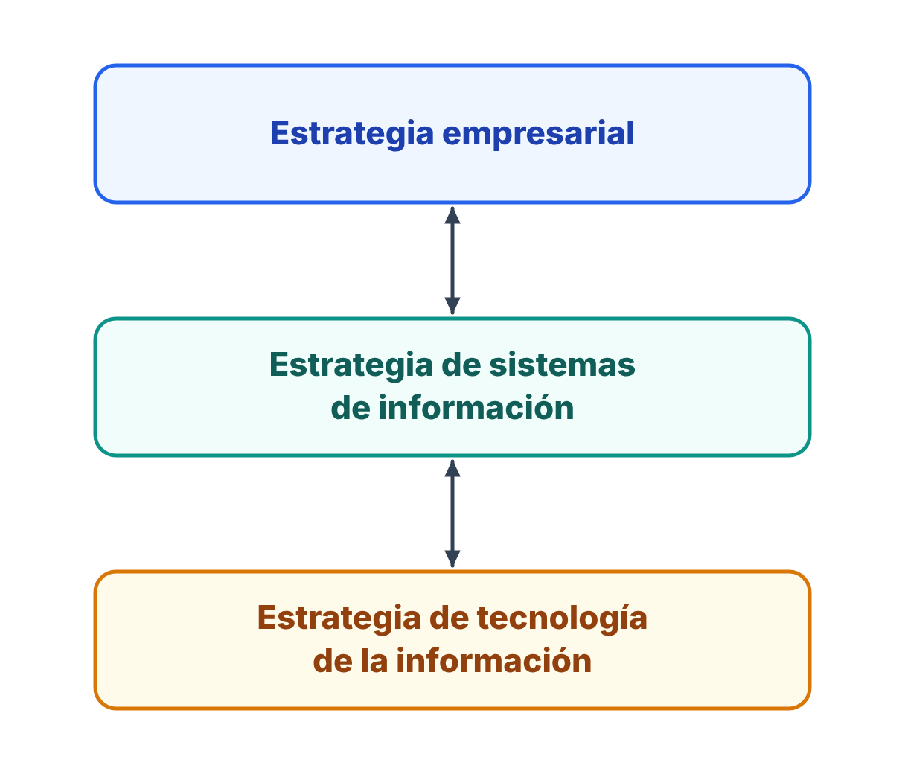

\newpage

> [!NOTE]
> **¿De qué trata el TP1 en una frase?**: Aplica las **4 fases de alineamiento estratégico de Andreu, Ricart y Valor** a la **Dirección de Vialidad Provincial del Chaco (DVP)** para pasar de tener **11 sistemas aislados y planillas en papel** a un **plan de SI/TI a 12–18 meses**, definiendo su **Cartera de Aplicaciones**, **Estilos de Gestión**, **Tipos de Beneficios** y **Tipos de Inversiones (Robson)**.

# Fase 1: Presentación y Compromiso del Equipo

**Objetivo (Andreu, Ricart y Valor):** Asegurar que el Plan de TI/SI sea respaldado por toda la organización definiendo responsabilidades claras en tres niveles de compromiso.

- **¿Qué hace la DVP y cuáles son sus 4 Objetivos?:** Es el organismo público que planifica, construye, mantiene y administra la red vial provincial (rutas, caminos y pavimento urbano, por administración o licitación). Sus objetivos son:

  1. Asegurar la existencia y buen estado de los caminos (red nacional, provincial y urbana) para la circulación económica regional, la integración social y la vinculación entre provincias.

  2. Asegurar que los recursos del **Fondo Vial de la provincia**, el patrimonio y la infraestructura se usen de manera óptima.

  3. Proyectar la red provincial de caminos y los planes periódicos de obras e inversiones (elevados al Poder Ejecutivo).

  4. Coordinar actividades mediante convenios con la Dirección Nacional de Vialidad y otros organismos provinciales.

- **Conducción y dato clave del organigrama:**

  - **Administrador y Subadministrador General:** Ejercen la administración y representación legal (designados por el Poder Ejecutivo por 4 años). **Dato clave del TP:** el **Departamento de Informática depende directamente del Administrador General (Ing. Omar Canela)**.

  - **Ingeniero Jefe:** Asiste al Administrador General en toda la faz técnica; proyecta los planes periódicos de obras y su orden de prioridad, dirige la marcha técnica de los trabajos, integra el Consejo Técnico y preside la Comisión Paritaria Provincial.

- **Las 10 Direcciones y su función de negocio principal (en pocas palabras):**

  1. **Ingeniería Vial:** Planificación técnica y diseño de obras viales (estudios previos, topografía, cómputos métricos, presupuestos, pliegos de licitación y liberación de traza).

  2. **Planificación Vial:** Definición de políticas viales y análisis del sistema en los 25 departamentos (evaluación ambiental, inventario vial, censos de tránsito, balanzas de peso/dimensiones, seguridad vial y **accidentología**).

  3. **Tecnología Vial:** Control de calidad de materiales (ensayos físicos, químicos y mecánicos de asfaltos, hormigones y suelos) y evaluación de pavimentos y fallas en terreno.

  4. **Construcciones:** Ejecución y control contractual de obras por licitación (análisis de ofertas, inspección permanente, **certificados mensuales y finales de obra**, control de plazos y curva de inversiones).

  5. **Conservación:** Mantenimiento continuo de rutas, caminos, puentes y alcantarillas (por administración con equipos propios, por **Consorcios Camineros** o por terceros) en Oficina Central, Área Metropolitana y **5 Delegaciones Zonales**.

  6. **Vialidad Urbana:** Diseño, adecuación hidráulica, pliegos, ejecución y certificación de pavimento urbano, más mantenimiento edilicio.

  7. **Logística y Mantenimiento:** Mantenimiento y reparación de la flota en el taller central (Resistencia) y talleres zonales, gestión de repuestos y **despacho y control de combustible**.

  8. **Administración:** Sostén económico y control financiero (Ley 4.787: proyecto de presupuesto anual, compras/licitaciones, pagos, rendiciones de cuentas, sueldos y patrimonio).

  9. **Secretaría General (RRHH):** Trámites administrativos, mesa de entradas, resoluciones/convenios y **gestión integral del personal** (asistencia, viáticos, ropa de trabajo, calificaciones de desempeño e higiene y seguridad).

  10. **Asuntos Jurídicos:** Sistematiza la información legal, emite dictámenes y lleva el seguimiento de **expedientes judiciales, amparos, expropiaciones y liberación de trazas** en las 5 delegaciones zonales.

- **Los 3 Equipos de Trabajo (Andreu, Ricart y Valor):**

  1. **Comité de TI/SI (Dirección estratégica y aprobación del plan):** Ministerio de Infraestructura, Directorio de Vialidad, Ingeniero Jefe, Informática y todas las Direcciones de área.

  2. **Grupo Base (Supervisión táctica y consistencia del proyecto):** Directorio de Vialidad, Informática, consultores externos (**ECOM-TICS**) y la **DOP** (Jefe de Sistemas y Jefe de Servidores y Comunicaciones).

  3. **Equipo de Trabajo (Labor operativa y análisis diario):** Integrado por la **DOP** (Jefe de Sistemas + Jefe de Servidores y Comunicaciones) y los **Representantes** de cada Dirección de negocio.

---

# Fase 2: Situación Actual de Vialidad Provincial Chaco

**Diagnóstico general:** La DVP tiene **11 sistemas** en marcha que sostienen la operatoria diaria, pero funcionan de manera **aislada (sin integración)**, casi **sin explotación analítica de datos** para tomar decisiones, y con **procesos críticos todavía en papel** (como el combustible).

## Análisis FODA

- **FORTALEZAS (Factores Internos Positivos):**

  - **Sistemas y bases de datos preexistentes:** No parte de cero; ya funcionan sistemas clave (*Viaticar, RopasDVP, TallerDLM, StockDVP, OrdenesDVP*, etc.) que registran la operatoria diaria.

  - **Proactividad y visión de la alta dirección:** Compromiso del Administrador General (**Ing. Omar Canela**) y los directores (**Kutnich, Viola y Derka**) para impulsar la eficiencia, transparencia y tecnología.

  - **Aceptación del cambio:** Éxito comprobado al digitalizar procesos que antes eran en papel (*Calificaciones* y *Viaticar*).

  - **Capacidad de alcance provincial:** El sistema *GesTaller* ya registra vehículos de distintas reparticiones públicas, posicionando a la DVP como referente técnico en la provincia.

- **DEBILIDADES (Factores Internos Negativos):**

  - **Sistemas «Silos» (Aislamiento de la información):** Logística (*TallerDLM*), Stock (*StockDVP*) y Presupuesto (*OrdenesDVP*) funcionan como islas desconectadas y obligan a hacer cruces manuales.

  - **Carencia de herramientas analíticas (BI):** Los sistemas solo sirven para cargar datos operativos; faltan tableros de control (*dashboards*), alertas y reportes históricos para que los directores tomen decisiones.

  - **Procesos críticos manuales en papel:** El control de combustible (*SiCC*) se sigue basando en planillas físicas completadas a mano, generando demoras y riesgo de errores.

  - **Falta de reportes de control de gestión financiero:** Desconexión entre los sistemas informáticos y el control de inventario, sumado a la falta de centralización administrativa.

  - **Deficiencias para la interacción ciudadana y control operativo:** Falta un mapa vial interactivo para que los vecinos denuncien el estado de rutas y puentes, y falta un sistema para registrar infracciones en el sector de balanzas.

- **OPORTUNIDADES (Factores Externos o a Futuro Positivos):**

  - **Implementación de Inteligencia de Negocios (BI):** Explotar los datos ya guardados para predecir fallas de máquinas y optimizar rutas.

  - **Herramientas para trabajo en terreno (*Mobile*):** Usar aplicaciones móviles para descentralizar y digitalizar las 5 Delegaciones Zonales y la carga de combustible *in situ*.

  - **Integración Interinstitucional:** Aprovechar *GesTaller* para brindar estadísticas a otros Ministerios sobre el mantenimiento del parque automotor provincial.

  - **Integración de sistemas actuales** en una arquitectura unificada.

  - **Participación ciudadana como fuente de información:** Crear un mapa vial interactivo donde los habitantes reporten y georreferencien el estado de rutas y puentes con fotos o videos en tiempo real.

  - **Digitalización de procesos manuales** (ej. combustible).

  - **Incorporación de tecnologías emergentes:** Asistentes con inteligencia artificial, *chatbots* y sistemas avanzados de georreferenciación.

- **AMENAZAS (Factores Externos Negativos):**

  - **Dependencia de proveedores externos (*Vendor Lock-in*):** El sistema *Consorcio* es cerrado y tercerizado. Sin acceso al código fuente, la DVP queda rehén de los costos, tiempos y voluntad del proveedor para hacer mejoras o extraer datos de certificaciones de obras.

  - **Inconsistencia y pérdida de datos (Riesgo de control):** Si no se moderniza rápido el combustible (*SiCC*) o el cruce Taller–Stock, hay alto riesgo de fugas de recursos, robos o uso ineficiente de fondos públicos.

  - **Limitaciones presupuestarias:** Los proyectos de TI en el Estado pueden sufrir recortes o retrasos si no demuestran rápido su Retorno de Inversión (**ROI**) ahorrando en repuestos y viáticos.

## Los 11 Sistemas de Información Existentes

<!-- cuadricula -->

| Sistema Actual | ¿Qué hace hoy? | Limitación / Diagnóstico en el TP |
| :--- | :--- | :--- |
| **1. Viaticar** | Solicitudes de viáticos y sus rendiciones. | Cumple lo operativo, pero no analiza gastos. |
| **2. RopasDVP** | Pedidos de indumentaria laboral del personal. | Sin herramientas de análisis sobre gastos. |
| **3. TallerDLM** | Pedidos de insumos y órdenes de trabajo mecánico. | Sin reportes de rendimiento ni costos asociados. |
| **4. StockDVP** | Movimientos de stock (cubiertas, repuestos, aceites y envíos a zonas). | Solo registra operaciones; no explota la información. |
| **5. OrdenesDVP** | Órdenes de provisión y de compra; administra partidas por dirección. | Escasa capacidad analítica y aislado de Taller y Stock. |
| **6. SiCC** | Cargas de combustible y control de tanques en sede central y zonas. | **Usa planillas que se completan a mano en papel**; no explota datos. |
| **7. GesTaller** | Constataciones y servicios mecánicos de vehículos de toda la provincia. | Clave en registración, pero limitado al plano operativo. |
| **8. RRHH** | Legajos, cargos, inasistencias, licencias y certificados médicos. | Central para personal, pero desconectado de los otros sistemas de RRHH. |
| **9. Calificaciones** | Evaluación digital del desempeño del personal (puntaje para ascensos). | Reemplazó con éxito al papel, pero no está integrado en un legajo único. |
| **10. Consorcio** | Certificaciones de obras y contabilidad de Consorcios Camineros. | **Tercerizado y cerrado sin código fuente** (*vendor lock-in*). |
| **11. LexDoctor** | Procesos judiciales/extrajudiciales, plazos, audiencias y cálculo de tasas. | Reemplazó al papel y es insumo clave para decisiones y auditoría legal. |

## Cartera de Aplicaciones Actuales (según el TP)

En el cierre de la Fase 2, el TP ubica los sistemas actuales y las oportunidades detectadas en los 4 cuadrantes:

<!-- matriz-2x2 valign=middle -->

| **Estrategia organizacional** | **Alto Potencial** |
| :---: | :---: |
| • Mapa Vial Interactivo • Inteligencia de Negocios (BI) y Dashboards • GesTaller (Integración Interinstitucional) | • Asistentes de Inteligencia Artificial y Chatbots • Herramientas Mobile (Trabajo en terreno) |
| **Clave para las operaciones** | **Apoyo** |
| • StockDVP • TallerDLM • OrdenesDVP • Consorcio • GesTaller • SiCC | • Viaticar • RopasDVP • RRHH • Calificaciones • LexDoctor |

- **Próximo paso en Clave para las operaciones:** Integrar *StockDVP*, *TallerDLM* y *OrdenesDVP* para evitar cruces manuales y duplicidad, y eliminar el papel en *SiCC* para un control sólido del combustible.

- **Próximo paso en Estrategia organizacional:** Evolucionar *GesTaller* para compartir información con otros ministerios, posicionando a la DVP como referente.

---

# Fase 3: Elaboración del Plan SI/TI

**Estrategia Organizacional (Cabecera de la Matriz de Necesidades del TP):** *"Garantizar el uso eficiente del fondo provincial de vialidad y optimizar la planificación, construcción y mantenimiento de la red vial."*

## Las 8 Necesidades y su Alineación (`Estrategia de SI` y `Estrategia de TI`)

<!-- cuadricula -->

| Eje y Área | Necesidad de Información (Resumen) | Estrategia de SI (*El Qué*) | Estrategia de TI (*El Cómo / Aplicación*) |
| :--- | :--- | :--- | :--- |
| **1. Control de Gestión Institucional** *(Alta Dirección)* | Ver indicadores simultáneos de ejecución presupuestaria de todas las áreas y cruzar costos de RRHH, flota y logística con el saldo presupuestario. | Facilitar decisiones estratégicas de la Alta Gerencia con acceso a datos consolidados y en tiempo real sobre presupuesto y costos operativos. | **DVP-BI:** Solución de Inteligencia de Negocios con un **Data Warehouse** centralizado que genere **Dashboards** y **KPIs** en tiempo real. |
| **2. Planificación y Análisis Territorial** *(Ingeniería, Planificación y Tecnología Vial)* | Conocer con precisión geográfica el estado físico de rutas, los puntos críticos de accidentes de tránsito y los reportes ciudadanos de fallas. | Disponer de una visión integral y georreferenciada del territorio que cruce el inventario vial con los índices de accidentología para priorizar obras. | **GeoVial (GIS):** Entorno geográfico interactivo que integre capas dinámicas, mapeo del inventario físico y módulos de accidentología. |
| **3. Gestión Misional y Soberanía Tecnológica** *(Ingeniería, Construcciones y Conservación)* | Contrastar con exactitud el avance físico real de cada obra vs. su avance financiero, y tener el historial auditable de certificaciones y consorcios con dominio interno de los datos. | Disponer de una plataforma unificada y **soberanía tecnológica** para informatizar, estandarizar y auditar ingeniería, obras y conservación, asegurando la trazabilidad financiera de las certificaciones. | **ERP Vial Integral propio (In-House):** Desarrollo evolutivo propio para eliminar la dependencia de terceros y centralizar licitaciones, certificación de obras y Consorcios. |
| **4. Control de Recursos en Terreno** *(Logística — Combustible)* | Saber en el acto qué vehículo, qué operario y cuánto combustible consumió *in situ*, y el stock real de los tanques en las 5 delegaciones zonales. | Optimizar el control operativo en terreno y la transparencia en insumos críticos, eliminando la incertidumbre de las planillas manuales. | **SiCC Móvil:** App móvil para reemplazar el papel, con registro y validación digital *in situ* de cada carga y alertas en vivo ante consumos atípicos. |
| **5. Trazabilidad del Gasto Operativo** *(Logística y Administración)* | Ver al instante el stock en depósitos, el costo histórico de mantener cada máquina (repuestos/insumos) y su cruce con la partida presupuestaria. | Disponer de una visión unificada de la cadena de suministros y costos operativos con trazabilidad automática de los gastos institucionales. | **Interoperabilidad por APIs (Logística):** Conectar mediante **APIs** los sistemas **TallerDLM**, **StockDVP** y **OrdenesDVP**, erradicando los silos. |
| **6. Visión Integral del Capital Humano** *(Secretaría General / RRHH)* | Tener un perfil único de cada agente que consolide asistencia, calificaciones, ropa entregada y viáticos. | Contar con una perspectiva integral y centralizada del desempeño e historial de cada agente para facilitar la gestión del talento. | **Legajo Digital Único (Visión 360°):** Ecosistema de **APIs** que unifique **RRHH**, **Calificaciones**, **Viaticar** y **RopasDVP**. |
| **7. Control de Calidad** *(Tecnología Vial)* | Registro centralizado, auditable e histórico de los ensayos físicos, químicos y mecánicos de materiales de cada obra. | Disponer de una base de conocimiento técnico auditable que asegure la calidad constructiva y respalde el reclamo legal de garantías a contratistas. | **LabVial:** Base de datos centralizada para registrar y resguardar todos los resultados de laboratorio, eliminando cuadernos o PDFs aislados. |
| **8. Retención Legal** *(Asuntos Jurídicos)* | Conocer el estado procesal y vencimientos de plazos de expedientes, amparos y expropiaciones en las 5 zonas. | Asegurar el seguimiento estricto de los plazos legales para mitigar el riesgo de sanciones, juicios o pérdidas patrimoniales para el Estado. | **Retención y Mantenimiento de LexDoctor:** Renovar licencias del estándar legal nacional para no desgastar recursos y enfocar a los programadores en el *Core* (el **ERP**). |

## Tipos de Sistemas según la Cadena de Valor (Modelo de Andreu, Ricart y Valor)

- **Subsistemas circunscritos a actividades concretas (Sistemas de Nicho):** Gestionan información específica y transaccional de forma independiente para resolver tareas puntuales de un área: **SiCC Móvil**, **GeoVial (GIS)**, **GesTaller**, **LexDoctor**, **Viaticar**, **LabVial** y **RopasDVP**.

- **Sistema de Información Básico (Sistemas Transversales e Infraestructura):** Son el cimiento tecnológico que coordina a múltiples direcciones mediante bases de datos integradas: **ERP Vial Integral (In-House)**, **DVP-BI**, **OrdenesDVP** y **RRHH**.

## Valor de la Inversión: Los 3 Tipos de Beneficios (Relación 1 a 1 por Nivel)

> [!TIP]
> **Regla 1 a 1 de la cátedra (Nivel $\leftrightarrow$ Beneficio Genérico):**
>
> - **Nivel Operativo $\longleftrightarrow$ Eficiencia** *(hacer lo mismo más rápido y gastando menos — tangible / justificación «dura»)*.
>
> - **Nivel Táctico $\longleftrightarrow$ Efectividad** *(tomar mejores decisiones gerenciales y mejorar el RoA — cualitativo / justificación «blanda»)*.
>
> - **Nivel Estratégico $\longleftrightarrow$ Avance Estratégico o Competitividad** *(transformar el organismo y cumplir la misión a largo plazo — intangible / justificado por «acto de fe»)*.

1. **Nivel Operativo $\longleftrightarrow$ Beneficios de Eficiencia:**

   - *Características:* Son estrictamente **tangibles** y se justifican mediante técnicas **"duras"** enfocadas en el **desplazamiento de costos** (eliminar un gasto actual reemplazándolo por tecnología) y la **evitación de costos** futuros.

   - *En el TP:*

     - **SiCC Móvil:** Ahorro neto de **USD 18.000 anuales** en papelería, impresión y distribución física (*desplazamiento de costos*) y **reducción del 45 % en el tiempo de carga**, liberando **120 horas-hombre mensuales**.

     - **Sistemas logísticos integrados:** Reducción del **40 % en el tiempo de ciclo (*time-to-repair*)** en la entrega de repuestos y **15 % menos de stock ocioso**, evitando inmovilizar **USD 25.000** en el primer año (*evitación de costos*).

     - **ERP Vial Integral (en su faz operativa):** Reduce el circuito de aprobación de certificaciones de contratistas de **45 días a 12 días** (*aceleración del valor*) y evita pagar **USD 35.000 anuales** en intereses por mora (*evitación de costos*).

     - **LabVial:** **Evitación de costos del 8 %** en bacheo y reparación prematura al exigir en término las garantías de obra a las contratistas con ensayos auditables.

2. **Nivel Táctico $\longleftrightarrow$ Beneficios de Efectividad:**

   - *Características:* Se perciben en **mandos medios y gerencias de departamento**, con foco cualitativo orientado a optimizar el **Rendimiento sobre los Activos (RoA)**. Su justificación es **"blanda"**, asociada a mejorar la toma de decisiones.

   - *En el TP:*

     - **Sistemas logísticos y financieros integrados:** Mejor control presupuestario y auditoría de repuestos, aumentando la disponibilidad operativa de las máquinas en ruta (**mayor rendimiento sobre el activo físico**).

     - **DVP-BI (Tableros y Data Warehouse):** Actúa como un **Sistema de Soporte a las Decisiones (DSS)** que permite a los directores monitorear desvíos del Fondo Provincial de Vialidad en tiempo real y corregir partidas proactivamente.

     - **Legajo Digital Único:** Permite decidir promociones y ascensos basados en el **mérito real**, subiendo la motivación, reduciendo el favoritismo subjetivo y fomentando el *"sentido de propiedad"*.

3. **Nivel Estratégico $\longleftrightarrow$ Beneficios de Avance Estratégico (o Competitividad):**

   - *Características:* Impactan en la **alta dirección (nivel institucional)**, orientados al crecimiento y competitividad. Son **intangibles y de largo plazo**, y se justifican mediante un **"acto de fe"**.

   - *En el TP:*

     - **ERP Vial Integral In-House:** **Reconfigura la cadena de valor y el poder de negociación** frente a las empresas contratistas, rompiendo asimetrías de información en las certificaciones y auditando con base científica costos y plazos.

     - **GeoVial (GIS DVP):** Transforma a la DVP de un ente reactivo (reparador de baches) a un planificador territorial estratégico, cruzando el inventario de calzadas con la accidentología para alinearse con el **Factor Crítico de Éxito (FCE)** de reducir la mortalidad vial.

## Cartera de Aplicaciones Futuras y Estilos de Gestión de TI (Andreu, Ricart y Valor)

<!-- cuadricula -->

| Cuadrante de la Cartera | Estrategia de Gestión (Andreu, Ricart y Valor) | Aplicaciones Propuestas en el TP |
| :--- | :--- | :--- |
| **1. Estratégicos** *(Aseguran el cumplimiento de la misión institucional a futuro — Alto impacto en la estrategia futura)* | **PLANIFICACIÓN CENTRALIZADA:** Informática trabaja codo a codo con la Alta Dirección, controlando estrictamente las inversiones para asegurar que cumplan los objetivos institucionales. | • **ERP Vial Integral (In-House):** Plataforma propia para centralizar y tener soberanía tecnológica en certificaciones, consorcios y licitaciones. • **DVP-BI (Data Warehouse y Tableros):** Monitoreo en tiempo real del Fondo Vial y soporte a decisiones estratégicas. |
| **2. De Alto Potencial** *(Innovaciones tecnológicas que pueden transformar la operación)* | **HILO CONDUCTOR:** El departamento de Sistemas actúa como guía y facilitador, dando libertad descentralizada a los ingenieros para que innoven sin asfixiarlos con burocracia. | • **GeoVial (GIS DVP):** Entorno geográfico avanzado que integra el inventario vial con el análisis geoespacial de índices de accidentología. |
| **3. Clave para las Operaciones** *(De ellos depende el funcionamiento diario de Vialidad — Alto impacto en la operación actual)* | **MONOPOLIO:** Informática ejerce un control absoluto y centralizado sobre estos sistemas para garantizar estabilidad, seguridad y evitar que la operatoria diaria se paralice. | • **Sistemas Logísticos Integrados** (*TallerDLM* + *StockDVP*) • **OrdenesDVP** • **GesTaller** • **SiCC Móvil** • **LabVial** |
| **4. De Apoyo** *(Mejoran la eficiencia administrativa, pero no son el Core del negocio)* | **RECURSO ESCASO:** Se invierte lo mínimo e indispensable para mantener la eficiencia administrativa operando bien, priorizando el dinero hacia el *Core* del negocio. | • **Legajo Digital Único** (*RRHH, Calificaciones, Viaticar y RopasDVP*) • **LexDoctor** (solución de umbral para plazos legales, amparos y expropiaciones). |

## Tipos de Inversiones (Según las Categorías Puras de Robson)

1. **Inversiones de Valor Operacional (Eficiencia Transaccional):**

   - *Fundamentación:* Proyectos orientados a la productividad operativa con **retornos a corto plazo**, enfocados en **reducir costos** y optimizar tareas administrativas recurrentes.

   - *Aplicaciones:* **SiCC Móvil**, **Sistemas logísticos integrados** (*TallerDLM, StockDVP, OrdenesDVP*), **Legajo Digital Único** y **LabVial**.

2. **Inversiones de Valor Estratégico (Misión e Innovación):**

   - *Fundamentación:* Iniciativas destinadas a fortalecer el **cumplimiento de la misión institucional a largo plazo**, con beneficios directos pero complejos de cuantificar económicamente en etapas iniciales.

   - *Aplicaciones:* **ERP Vial Integral (In-House)**, **GeoVial (GIS DVP)** y **DVP-BI (Analítica Gerencial)**.

3. **Inversiones de Umbral (Operatividad Obligatoria):**

   - *Fundamentación:* Desembolsos ineludibles para la supervivencia operativa del organismo y el cumplimiento de marcos normativos, mitigando riesgos legales y patrimoniales.

   - *Aplicación:* **LexDoctor**.

4. **Inversiones de Infraestructura (Cimiento Tecnológico):**

   - *Fundamentación:* Inversiones a **mediano plazo** que habilitan el desarrollo de sistemas futuros creando una arquitectura base robusta ("cableado" lógico institucional).

   - *Aplicación:* **Arquitectura de Interoperabilidad (APIs)**.

---

# Fase 4: Programación de Actividades

Tras la validación de las Direcciones de Construcciones y de Conservación, el **Comité de TI/SI** aprueba el **Sistema Integrado Misional (ERP Vial In-House + SIG GeoVial)** para asegurar **soberanía tecnológica**, **dato único y auditable** (Curva de Inversión automática) y **planificación territorial basada en datos**.

- **Paso IV.1 — Calendario del Primer Año (12 meses) y Mediano Plazo (18 meses):**

  - **Hito 1 (Mes 1 al 4) — Mapa Base e Inventario Vial:** Lanzamiento operativo del *Mapa Interactivo GeoVial*.

  - **Hito 2 (Mes 5 al 10) — Gestión de Obras y Certificaciones:** Despliegue del *Módulo de Construcciones (ERP)* para el cálculo automático del avance físico-financiero y certificaciones.

  - **Hito 3 (Mes 11 al 12) — Integración Espacial y Tablero Gerencial:** Vinculación de la base del *ERP* con *GeoVial* y armado de *DVP-BI* (Tableros de Control) para la Alta Dirección.

  - **Hito 4 (Mes 13 al 18) — Consorcios Camineros y Despliegue en Terreno:** Módulo administrativo de Consorcios Camineros y capacitaciones presenciales en las **5 Delegaciones Zonales**.

- **Paso IV.2 — Inclusión en el Presupuesto (Asignación de Recursos del 1.º Año):**

  - **A. Recursos Humanos:** **1 Intermediario Técnico (Analista Funcional / DOP)** (1.920 hs-hombre/año, 100 %), **1 Programador Senior (Full-Stack)** (1.920 hs-hombre/año, 100 %) y **Usuarios Clave (*Key Users*)** de ingeniería (240 hs-hombre/año, 5 hs/semana para relevar y validar).

  - **B. Recursos Tecnológicos:** Software base *Open Source* (`PostgreSQL`/`PostGIS`, `Node.js`) para suprimir costos de licencias comerciales; **2 servidores de alto rendimiento** (Servidor de App/BD y Servidor GIS) y **2 estaciones de trabajo (*Workstations*)** de desarrollo.

  - **C. Recursos Financieros:** Costo salarial/honorarios del Analista y Programador por 12 meses + compra de los 2 servidores y 2 workstations + **15 % de fondo de contingencia**.

- **Paso IV.3 — Plan de Evaluación y Revisión (Control):**

  1. **Validación iterativa de Prototipos (*Mockups*):** El Analista Funcional valida las pantallas con los directores y usuarios clave antes de programar.

  2. **Revisiones de Hito y Control de Desviaciones:** Al cerrar cada hito, la DOP presenta un informe al Comité de TI/SI evaluando dos métricas: **cumplimiento del plazo** y **ejecución del presupuesto**.

---

# Las 3 Preguntas del Examen Enlazadas (1 $\rightarrow$ 2 $\rightarrow$ 3)

> [!IMPORTANT]
> **Aclaración clave sobre la Estrategia Empresarial en el TP:**
> En el trabajo práctico original **hay una sola Estrategia Empresarial** para todo el caso: como Vialidad es un organismo público, en la cabecera de la **Matriz de Necesidades** (Fase 3) figura bajo el nombre de **Estrategia Organizacional**:
>
> *"Garantizar el uso eficiente del fondo provincial de vialidad y optimizar la planificación, construcción y mantenimiento de la red vial."*
>
> Eso significa que **el bloque 1 (`Estrategia Empresarial`) es siempre exactamente esa misma frase**, sin importar qué aplicación elijas desarrollar en los bloques 2 (`Estrategia de SI`) y 3 (`Estrategia de TI`).

{width=26%}

## Cuadro Resumen de las 4 Opciones Enlazadas (Machete Rápido)

<!-- cuadricula -->

| Opción a elegir | 1. Esquema Sintético (`Estrategia Empresarial` $\rightarrow$ `SI` $\rightarrow$ `TI`) | 2. Ubicación en Cartera y Estilo de Gestión | 3. Tipo de Inversión y Beneficio 1 a 1 |
| :--- | :--- | :--- | :--- |
| **Opción 1: ERP Vial Integral (In-House)** *(Nivel Estratégico)* | **Empresarial (única del TP):** Garantizar el uso eficiente del fondo provincial de vialidad y optimizar la planificación, construcción y mantenimiento de la red vial. $\rightarrow$ **SI (El Qué):** Plataforma unificada con soberanía tecnológica para auditar obras y certificaciones. $\rightarrow$ **TI (El Cómo):** Desarrollar el **ERP Vial Integral (In-House)**. | **Estratégico** *(alto impacto en estrategia futura)* — Gestión: **Planificación Centralizada** (Informatiza el *Core* de obras y elimina la dependencia de *Consorcio*). | **Inversión de Valor Estratégico** (largo plazo). **Relación 1 a 1:** Nivel **Estratégico** $\rightarrow$ **Avance Estratégico o Competitividad** (reconfigura el poder de negociación frente a contratistas, justificado por «acto de fe»). |
| **Opción 2: GeoVial (GIS DVP)** *(Nivel Estratégico)* | **Empresarial (única del TP):** Garantizar el uso eficiente del fondo provincial de vialidad y optimizar la planificación, construcción y mantenimiento de la red vial. $\rightarrow$ **SI (El Qué):** Visión integral y georreferenciada que cruce inventario vial con índices de accidentología. $\rightarrow$ **TI (El Cómo):** Implementar **GeoVial (GIS)**. | **De Alto Potencial** *(innovación que puede transformar la operación)* — Gestión: **Hilo Conductor** (Sistemas guía dando libertad técnica para innovar). | **Inversión de Valor Estratégico** (largo plazo). **Relación 1 a 1:** Nivel **Estratégico** $\rightarrow$ **Avance Estratégico o Competitividad** (pasa de reparar baches reactivamente a planificar según el **FCE** de reducir muertes viales). |
| **Opción 3: SiCC Móvil** *(Nivel Operativo)* | **Empresarial (única del TP):** Garantizar el uso eficiente del fondo provincial de vialidad y optimizar la planificación, construcción y mantenimiento de la red vial. $\rightarrow$ **SI (El Qué):** Optimizar el control en terreno y transparencia en despachos de combustible sin papel. $\rightarrow$ **TI (El Cómo):** Implementar la app **SiCC Móvil** con validación *in situ* y alertas. | **Clave para las Operaciones** *(de él depende el funcionamiento diario)* — Gestión: **Monopolio** (control centralizado de Informática para que no se paralice la flota). | **Inversión de Valor Operacional** (corto plazo). **Relación 1 a 1:** Nivel **Operativo** $\rightarrow$ **Eficiencia** tangible (ahorra **USD 18.000/año** en papel y baja **45 %** el tiempo = **120 hs-hombre/mes**). |
| **Opción 4: DVP-BI (Tableros)** *(Nivel Táctico / Directivo)* | **Empresarial (única del TP):** Garantizar el uso eficiente del fondo provincial de vialidad y optimizar la planificación, construcción y mantenimiento de la red vial. $\rightarrow$ **SI (El Qué):** Acceso a datos consolidados y en tiempo real de ejecución presupuestaria y costos operativos. $\rightarrow$ **TI (El Cómo):** Implementar **DVP-BI** (*Data Warehouse* + *Dashboards* y *KPIs*). | **Estratégico** *(alto impacto en estrategia futura)* — Gestión: **Planificación Centralizada** (Informática y Alta Dirección controlan juntos la inversión). | **Inversión de Valor Estratégico** (largo plazo). **Relación 1 a 1 en Nivel Táctico:** genera **Efectividad** (actúa como **DSS** con justificación «blanda» para detectar desvíos del Fondo Vial en vivo y cuidar el **RoA**). |

---

## Opción 1 (Recomendada — Nivel Estratégico): «ERP Vial Integral (In-House)»

1. **Esquema sintético de alineamiento (Edwards et al.):**

   - **Estrategia Empresarial (Estrategia Organizacional de la Matriz de Necesidades):** *"Garantizar el uso eficiente del fondo provincial de vialidad y optimizar la planificación, construcción y mantenimiento de la red vial."*

   - $\updownarrow$ **Estrategia de SI (El Qué — Punto 3 del Listado de Necesidades):** Disponer de una plataforma de gestión unificada y soberanía tecnológica que permita informatizar, estandarizar y auditar los procesos misionales de ingeniería, obras y conservación, garantizando la trazabilidad financiera de las certificaciones de obra.

   - $\updownarrow$ **Estrategia de TI (El Cómo — Aplicación resultante):** Desarrollar de forma evolutiva un **ERP Vial Integral propio (In-House)** para eliminar la dependencia tecnológica de terceros y centralizar la operación de las Direcciones en módulos específicos para la gestión de licitaciones, certificación de obras y administración de Consorcios.

2. **Clasificación y fundamentación en la Cartera de Aplicaciones:**

   - **Ubicación:** Cuadrante de aplicaciones **Estratégicas** (alto impacto en la estrategia futura).

   - **Fundamentación:** Asegura el cumplimiento de la misión institucional a futuro sobre el *Core* del negocio (las obras viales). Actualmente la DVP sufre dependencia de proveedores (*vendor lock-in*) con el sistema tercerizado *Consorcio* al no tener acceso al código fuente; desarrollar el **ERP Vial In-House** le devuelve la soberanía tecnológica y la trazabilidad del avance físico-financiero. Según **Andreu, Ricart y Valor**, su estilo de gestión es la **Planificación Centralizada**, donde Informática trabaja codo a codo con la Alta Dirección controlando estrictamente la inversión para asegurar que cumpla los objetivos institucionales.

3. **Tipo de inversión de acuerdo con el impacto buscado:**

   - **Clasificación:** Es una **Inversión de Valor Estratégico (Misión e Innovación)** según las categorías puras de **Robson**.

   - **Fundamentación (Relación 1 a 1: Nivel Estratégico $\longleftrightarrow$ Avance Estratégico o Competitividad):** Es una iniciativa destinada a fortalecer el cumplimiento de la misión institucional a **largo plazo**, cuyos beneficios son intangibles y complejos de cuantificar económicamente al inicio, justificándose por un **«acto de fe»**. En la relación 1 a 1 por nivel, al ser de **Nivel Estratégico** busca un beneficio de **Avance Estratégico o Competitividad**: permite recuperar el control total del ciclo de obra pública, reconfigurando la cadena de valor y el poder de negociación frente a las empresas contratistas externas al romper las asimetrías de información en las certificaciones de obra y auditar con base científica costos y plazos.

---

## Opción 2 (Nivel Estratégico): «GeoVial (GIS DVP)»

1. **Esquema sintético de alineamiento (Edwards et al.):**

   - **Estrategia Empresarial (Estrategia Organizacional de la Matriz de Necesidades):** *"Garantizar el uso eficiente del fondo provincial de vialidad y optimizar la planificación, construcción y mantenimiento de la red vial."*

   - $\updownarrow$ **Estrategia de SI (El Qué — Punto 2 del Listado de Necesidades):** Disponer de una visión integral y georreferenciada del territorio provincial que permita analizar la relación entre el estado del inventario vial y los índices de accidentología, facilitando la planificación estratégica de intervenciones y la toma de decisiones basada en datos geográficos precisos y actualizados.

   - $\updownarrow$ **Estrategia de TI (El Cómo — Aplicación resultante):** Implementar el sistema **GeoVial (GIS)** como un entorno geográfico avanzado que centralice la visualización y el análisis espacial de la red vial integrando capas dinámicas, mapeo del inventario físico y módulos de análisis de accidentología.

2. **Clasificación y fundamentación en la Cartera de Aplicaciones:**

   - **Ubicación:** Cuadrante de aplicaciones **De Alto Potencial**.

   - **Fundamentación:** Representa una **innovación tecnológica** (georreferenciación + análisis espacial de accidentes y reclamos) que puede transformar la operación y el modo en que Vialidad planifica sus obras. Según **Andreu, Ricart y Valor**, su estrategia de gestión es el **Hilo Conductor**, donde el Departamento de Sistemas actúa como guía y facilitador dando libertad descentralizada a los ingenieros viales para innovar sin asfixiarlos con burocracia.

3. **Tipo de inversión de acuerdo con el impacto buscado:**

   - **Clasificación:** Es una **Inversión de Valor Estratégico (Misión e Innovación)** según las categorías puras de **Robson**.

   - **Fundamentación (Relación 1 a 1: Nivel Estratégico $\longleftrightarrow$ Avance Estratégico o Competitividad):** Fortalece el cumplimiento de la misión institucional a **largo plazo** priorizando obras mediante análisis geoespacial. Por la relación 1 a 1 del **Nivel Estratégico**, genera un beneficio de **Avance Estratégico o Competitividad** (intangible y de largo plazo, justificado por **«acto de fe»**): transforma a la DVP de un organismo meramente reactivo (reparador de baches) a un actor estratégico de planificación territorial, alineando la tecnología con el **Factor Crítico de Éxito (FCE)** de reducir la mortalidad vial antes de pavimentar.

---

## Opción 3 (Nivel Operativo): «SiCC Móvil»

1. **Esquema sintético de alineamiento (Edwards et al.):**

   - **Estrategia Empresarial (Estrategia Organizacional de la Matriz de Necesidades):** *"Garantizar el uso eficiente del fondo provincial de vialidad y optimizar la planificación, construcción y mantenimiento de la red vial."*

   - $\updownarrow$ **Estrategia de SI (El Qué — Punto 4 del Listado de Necesidades):** Optimizar el control operativo en terreno y la transparencia en el uso de insumos críticos, eliminando la incertidumbre de los registros manuales para garantizar un seguimiento estricto de los despachos de combustible.

   - $\updownarrow$ **Estrategia de TI (El Cómo — Aplicación resultante):** Implementar la aplicación móvil **"SiCC Móvil"** para reemplazar el circuito de papel, permitiendo el registro digital y la validación *in situ* de cada carga e integrando un motor de alertas que detecte consumos atípicos en tiempo real.

2. **Clasificación y fundamentación en la Cartera de Aplicaciones:**

   - **Ubicación:** Cuadrante de aplicaciones **Clave para las Operaciones** (alto impacto en la operación actual).

   - **Fundamentación:** De este sistema depende el **funcionamiento diario de Vialidad**: el combustible es un insumo crítico para que las máquinas y camiones trabajen en las rutas, y la carga en planillas manuales de papel genera demoras, errores y riesgo de fugas de recursos públicos. Según **Andreu, Ricart y Valor**, se gestiona bajo la estrategia de **Monopolio**, donde Informática ejerce un control absoluto y centralizado para garantizar su estabilidad, seguridad e integridad de datos sin que la operatoria diaria se paralice.

3. **Tipo de inversión de acuerdo con el impacto buscado:**

   - **Clasificación:** Es una **Inversión de Valor Operacional (Eficiencia Transaccional)** según las categorías puras de **Robson**.

   - **Fundamentación (Relación 1 a 1: Nivel Operativo $\longleftrightarrow$ Eficiencia):** Es un proyecto orientado a la productividad operativa con **retornos a corto plazo**, enfocado en la **reducción de costos** y en optimizar tareas administrativas recurrentes erradicando errores de carga manual y desvíos de fondos. Por la relación 1 a 1 del **Nivel Operativo**, genera un beneficio de **Eficiencia** de carácter estrictamente **tangible** y con **justificación «dura»**: logra un **desplazamiento de costos** directos con un ahorro neto estimado de **USD 18.000 anuales** en papelería, impresión y distribución física, y una **reducción del 45 % en el tiempo de procesamiento y carga**, liberando **120 horas-hombre mensuales** del personal técnico en terreno.

---

## Opción 4 (Nivel Táctico / Directivo): «DVP-BI (Data Warehouse y Tableros)»

1. **Esquema sintético de alineamiento (Edwards et al.):**

   - **Estrategia Empresarial (Estrategia Organizacional de la Matriz de Necesidades):** *"Garantizar el uso eficiente del fondo provincial de vialidad y optimizar la planificación, construcción y mantenimiento de la red vial."*

   - $\updownarrow$ **Estrategia de SI (El Qué — Punto 1 del Listado de Necesidades):** Facilitar la toma de decisiones estratégicas de la Alta Gerencia mediante el acceso a información consolidada y en tiempo real sobre la ejecución presupuestaria y costos operativos, garantizando el uso eficiente de los recursos provinciales.

   - $\updownarrow$ **Estrategia de TI (El Cómo — Aplicación resultante):** Implementar una solución de Inteligencia de Negocios (**DVP-BI**) basada en un **Data Warehouse** que centralice la extracción de datos de todas las áreas para la generación de **Dashboards** y **KPIs** en tiempo real.

2. **Clasificación y fundamentación en la Cartera de Aplicaciones:**

   - **Ubicación:** Cuadrante de aplicaciones **Estratégicas** (alto impacto en la estrategia futura).

   - **Fundamentación:** Hoy los sistemas existentes de la DVP solo registran transacciones aisladas sin explotar la información. **DVP-BI** es estratégica porque asegura el cumplimiento de la misión institucional a futuro dándole a la Alta Dirección el monitoreo en tiempo real del Fondo Vial y el soporte para tomar decisiones. Según **Andreu, Ricart y Valor**, se gestiona mediante **Planificación Centralizada**, donde Informática y el Directorio coordinan y controlan directamente la inversión.

3. **Tipo de inversión de acuerdo con el impacto buscado:**

   - **Clasificación:** Es una **Inversión de Valor Estratégico (Misión e Innovación)** según las categorías puras de **Robson**.

   - **Fundamentación (Relación 1 a 1 en Nivel Táctico $\longleftrightarrow$ Efectividad):** Apunta al **largo plazo** para lograr la transición de Vialidad hacia una gestión proactiva basada en datos. Por la relación 1 a 1 del **Nivel Táctico** (mandos medios y directores de área), su beneficio genérico en el TP es la **Efectividad** (de foco cualitativo y **justificación «blanda»**, orientada a optimizar el **Rendimiento sobre los Activos, RoA**): funciona como un **Sistema de Soporte a las Decisiones (DSS)** que entrega información gerencial oportuna, precisa y concisa para monitorear desvíos del Fondo Provincial de Vialidad en tiempo real y corregir las partidas presupuestarias de forma proactiva.
