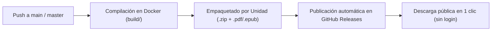

# Spec 06 — Publicación Automática y Ordenada por Unidad en GitHub Releases

* **Estado**: Implementada (2026-11-06 — Modalidad A: un Release por cada Unidad y Trabajo Práctico + eliminación de Artifacts redundantes en `main`)
* **Fecha**: 2026-11-06
* **Alcance**: Reemplazo del flujo principal de descarga basado en *GitHub Actions Artifacts* por la publicación automática y continua en **GitHub Releases** (`.github/workflows/editorial-ci.yml` y `README.md`), organizando los apuntes y cuestionarios por Unidad y Trabajo Práctico para descarga directa en 1 clic sin requerir inicio de sesión.

---

## 1. Diagnóstico del Problema Actual (`AS-IS`)

Actualmente, aunque los documentos se compilan y empaquetan por Unidad como *Artifacts* de GitHub Actions, la experiencia de descarga para un estudiante presenta cuatro fricciones importantes:

1. **Navegación engorrosa (4 pasos)**: Quien entra al repositorio debe ir a la pestaña *Actions* $\rightarrow$ seleccionar el workflow *Editorial CI/CD* $\rightarrow$ entrar a la última corrida exitosa $\rightarrow$ bajar hasta el final de la página hasta encontrar la tabla *Artifacts*.
2. **Requiere cuenta de GitHub e inicio de sesión obligatorio**: GitHub bloquea la descarga de *Actions Artifacts* a usuarios no autenticados (si alguien abre el link desde el celular o sin iniciar sesión en GitHub, los botones aparecen deshabilitados).
3. **Descarga forzosa en `.zip` y vencimiento a los 30 días**: Los *Artifacts* de Actions siempre comprimen el contenido en un `.zip` (no permiten abrir o bajar un único `.pdf` suelto) y caducan automáticamente.
4. **La página de `Releases` está vacía salvo que se pushee un tag `v*` manual**: El paso actual de Release solo se ejecuta en tags `v*` y sube todos los archivos mezclados sin separación por Unidad.

---

## 2. Arquitectura Propuesta (`TO-BE`)

Se propone que **cada push a `main` / `master`** (además de `workflow_dispatch`) actualice automáticamente la sección **[Releases](https://github.com/Gez-Schegtel/ASI-test/releases)** del repositorio.

A diferencia de *Actions Artifacts*, **GitHub Releases**:
* Aparece directamente en la **portada derecha del repositorio** (a 1 clic de distancia).
* **No requiere iniciar sesión en GitHub** (cualquier compañero puede descargar desde el navegador o el celular).
* Permite tanto descargar **un `.pdf` o `.epub` individual en 1 clic** como bajar el **`.zip` completo de una Unidad**.
* No caduca con el tiempo.

---

## 3. Modalidades de Organización en la Página de `Releases`

Existen dos formas limpias de presentar las unidades en `https://github.com/Gez-Schegtel/ASI-test/releases`:

### Modalidad A — Un Release por cada Unidad y Trabajo Práctico (Tarjetas separadas en `/releases`)

El workflow crea y mantiene actualizado automáticamente **un Release independiente por cada Unidad y Trabajo Práctico** (usando tags fijos como `unidad-i`, `unidad-iii`, `unidad-vi`, `practica-tp1`, `practica-tpi`).

Al entrar a **[Releases](https://github.com/Gez-Schegtel/ASI-test/releases)** se ven bloques separados y ordenados:

1. 📘 **Unidad VI — Seguridad y Auditoría de SI/TI** (`tag: unidad-vi`)
   * *Descripción con tabla de enlaces directos* + *Assets adjuntos*:
     * `Unidad VI - Seguridad y Auditoría.pdf` / `.epub`
     * `Seguridad y auditoría - Resolución.pdf` / `.epub`
     * `AdmSI-CUESTIONARIOS DE ESTUDIO - SEGURIDAD Y AUDITORIA DE SI-TI.pdf` / `.epub`
     * `Unidad-VI-Completa.zip` (todos los archivos de la unidad en un solo clic)
2. 📘 **Unidad III — Subsistema de Aplicación** (`tag: unidad-iii`)
   * `Unidad III - Subsistema de Aplicación.pdf` / `.epub`
   * `Aplicación de recursos - Resolución.pdf` / `.epub`
   * `AdmSI-CUESTIONARIOS APLICACIÓN DE RECURSOS.pdf` / `.epub`
   * `Unidad-III-Completa.zip`
3. 📘 **Unidad I — Los SI en la Empresa y Estrategia SI/TI** (`tag: unidad-i`)
   * `Unidad I - Cuestionario de Autoestudio - Resolución.pdf` / `.epub`
   * `Unidad-I-Completa.zip` (incluye borradores)
4. 🛠️ **Práctica — TPI (Vialidad Provincial - DVP)** (`tag: practica-tpi-dvp`)
   * `Explicación del TPI.pdf` / `.epub`, `TPI Parte 2.pdf` / `.epub` y `Practica-TPI-DVP.zip`
5. 🛠️ **Práctica — TP1 (Alineamiento Estratégico de SI/TI)** (`tag: practica-tp1-alineamiento`)
   * `TP1 - Alineamiento de SI-TI.pdf` / `.epub` + guías explicativas en `Practica-TP1-Alineamiento.zip`

---

### Modalidad B — Un Único Release Principal «📚 Apuntes y Guías Prácticas (Última Versión)» (`tag: latest`)

El workflow mantiene un único Release principal siempre al tope (`/releases/latest`) que:

1. En el **cuerpo del Release (Markdown)** genera automáticamente un **índice ordenado por Unidad** con tablas y enlaces de descarga directa a cada `.pdf`, `.epub` y `.zip` de unidad:
   * **Unidad I**: Enlaces directos al PDF/EPUB del cuestionario resuelto + `Unidad-I.zip`
   * **Unidad III**: Enlaces directos al apunte teórico (PDF/EPUB), cuestionario resuelto (PDF/EPUB) + `Unidad-III.zip`
   * **Unidad VI**: Enlaces directos al apunte teórico (PDF/EPUB), cuestionario resuelto (PDF/EPUB) + `Unidad-VI.zip`
   * **Trabajos Prácticos (`TP1` y `TPI`)**: Enlaces directos + `Practica-TP1-Alineamiento.zip` y `Practica-TPI-DVP.zip`
2. En la lista de **Assets** del Release adjunta los paquetes `.zip` por Unidad y los PDFs/EPUBs para que los enlaces de la tabla funcionen en 1 clic.

---

## 4. Limpieza de *Actions Artifacts* y Simplificación de `README.md`

1. **¿Qué hacemos con los *Artifacts* de la pestaña Actions?**
   * Al estar todo publicado en **Releases**, podemos:
     * **Opción 1**: Eliminar los pasos de `actions/upload-artifact` (o ejecutarlos únicamente en ramas secundarias / Pull Requests donde no se publica en Releases), ahorrando tiempo y espacio de almacenamiento de Actions.
     * **Opción 2**: Mantenerlos con `retention-days: 3` solo como respaldo de CI.
2. **Simplificación del `README.md`**:
   * La sección `📥 Descargar Apuntes Listos (PDF y EPUB3)` pasa a tener un único botón/enlace directo a **[📦 Ir a Releases — Descargar Apuntes por Unidad](https://github.com/Gez-Schegtel/ASI-test/releases)** (sin tener que explicar cómo buscar una corrida en verde dentro de GitHub Actions).

---

## 5. Decisiones Resueltas

1. **Modalidad en la página de Releases**: Se eligió la **Modalidad A** (un Release independiente por cada Unidad y Trabajo Práctico: `unidad-i` a `unidad-vi`, `practica-tpi` y `practica-tp1`, cada uno con sus PDFs/EPUBs sueltos y el `.zip` completo de esa unidad).
2. **Eliminación de *Actions Artifacts* redundantes**: Se eligió la **Opción 1** (en `push` / `workflow_dispatch` se publica directamente en GitHub Releases sin duplicar *Artifacts* en la pestaña Actions; solo en Pull Requests se genera un *Artifact* temporal de vista previa con `retention-days: 3`).
